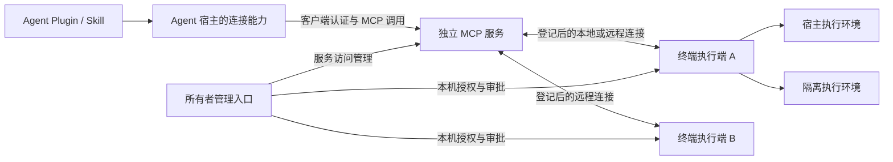
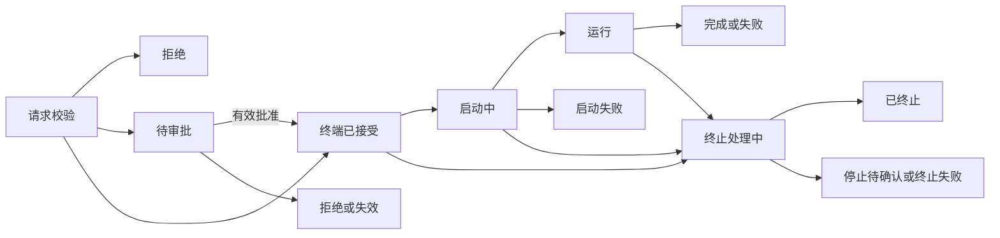

# OpenRemoteConnector 架构与行为契约

版本：0.1；更新日期：2026-10-18；状态：架构提案，尚未实现或通过验收。依据：[PRD v0.4](PRD.md)。

本文定义三部分职责、信任关系、连接条件、任务与数据契约及验收门槛。**不选定实现语言、框架、数据库、认证产品、传输库、隧道产品、沙箱后端或进程部署方式。** 文中的对象与操作名称只表达逻辑语义，不是已发布 API 或线协议。

产品需求以 PRD 为准；本文补充实现必须遵守的边界与可验证行为。[当前 MVP](MVP.md) 定义开源对比、价值假设与首版验证。旧拓扑和组件选型已归档到 [2026-10-15 架构](history/ARCHITECTURE-2026-10-15.md)；[归档 MVP](history/MVP-2026-10-15.md) 与 [旧 Linux 沙箱设计](LINUX_SANDBOX.md) 仅供历史参考，不能据此恢复已取消的约束。以下验收均为待执行要求，不代表已测结果。

## 1 已确定的架构边界

| 决策 | 本版约束 |
| --- | --- |
| 三部分 | Agent Plugin / Skill、独立 MCP 服务、终端执行端；同机与异机保持相同职责 |
| 服务独立 | MCP 与执行端可分别安装、配置、启动、停止和升级；一个安装入口可以统一编排，不强制对应特定数量的进程 |
| 多设备 | 一个 MCP 入口管理至少两台独立终端；任务始终固定目标，不按名称或在线状态替换 |
| 终端权限 | MCP 可以收紧访问，执行端保留本机授权与策略的最终限制 |
| 执行环境 | 隔离与宿主两种环境可选；与自动执行、规则过滤、逐次确认三个放行策略正交 |
| 安装 | Linux 单命令进入角色、网络与授权向导；Agent 一个 Skill 入口；必要的宿主连接配置仍明确展示 |
| 默认服务 | 不要求官方账号、项目方中继或中央目录；不承诺项目方提供默认公共基础设施 |
| 首版范围 | 单所有者、每个终端同时信任一个 MCP；第三方 provider、交互终端、服务级联与自动故障转移不在首版范围 |

Linux P0 支持基线沿用 PRD 的 Ubuntu 24.04 LTS x86_64；macOS P1 采用 App 交付体验，具体执行后端另选。系统基线是验收范围，不代表选择任何语言或容器技术。

## 2 组件与管理边界

箭头表示业务关系，不指定网络发起方向。图中所有者管理入口是逻辑角色，不要求单独部署一个服务器；P0 可通过本地 CLI 或用户已有的 SSH 管理各节点。

| 部分 | 负责 | 权限边界 |
| --- | --- | --- |
| Skill 与辅助脚本 | 接入指引、必要配置辅助、选择目标、调用与查询、解释失败 | 不保存长期秘密，不批准请求，不创建宿主原本没有的网络或配置能力；首版不要求常驻 ORC 客户端 |
| MCP 服务 | 验证客户端、稳定身份映射、服务侧访问规则、设备目录、请求转交、任务与输出呈现 | 不因为运行在某台机器上就获得该机器的执行能力；不能通过业务工具创建终端 grant 或修改本机策略 |
| 终端执行端 | 验证受信 MCP、检查本机授权、解析执行请求、规则与审批、任务管理、文件处理、结果保存 | 执行账户、环境、范围与截止时间由本机许可约束；不能依据 MCP 的许可扩大本机权限 |
| 所有者管理入口 | 登记、授权、撤销、环境准备、审批、升级与清理 | 与 Agent 业务入口分离；管理凭据不能进入任务、Skill 或工具结果 |

执行端内部按职责划分授权判定、任务监督、环境适配、文件与产物管理、状态保存等模块。该划分不预设独立进程、远程服务或数据库；选型不能改变职责边界。

仅启动 MCP 时允许服务诊断与登记管理，不能执行本机命令。必须另行登记并授权本机执行端，才能走与远程设备相同的任务流程。服务诊断读取本身的必要状态，不向 Agent 提供通用宿主文件或命令接口。

## 3 连接模型、安装前提与成本

### 3.1 两段链路分别验证

链路一是 Agent 实际调用环境到 MCP；链路二是 MCP 与终端执行端。每段分别报告地址条件、对端身份、认证、可用能力与故障原因。用户浏览器能访问入口，不证明云端 Agent 能访问；执行端已连接 MCP，也不证明 Agent 已登记或获准执行。

| 场景 | 必需路径 | 安装与验收行为 | 基础设施责任 |
| --- | --- | --- | --- |
| Agent、MCP、执行端同机 | 已验证的本地连接 | 不要求公网入口；独立登记与授权后完成调用 | 使用本机资源 |
| 两台设备处于局域网或已有互通网络 | 实际 Agent 与执行端均能通过所选路径使用 MCP | 显示地址与身份，验证两段业务交互；不要求新增公网服务器 | 复用用户已有网络与设备 |
| 终端只允许出站，已有可达 MCP | 执行端能够主动建立并维持到所选 MCP 的安全通道，使 MCP 请求可通过该通道送达终端 | P0 必须验证；终端不开放公网入站端口；通道协议与复用机制待选 | MCP 部署者承担其服务器与网络成本 |
| 云端 Agent | MCP 入口满足实际平台的连接、认证与安全要求 | 验证 PRD 声明的 ChatGPT 路径；额外平台设置、入口条件和费用必须可见 | 用户选用的平台、入口或服务器；不预设某家服务 |
| 两台设备仅能出站且没有可达 MCP 或已配置连接服务 | 尚无成立的互通路径 | 初始化早期报告缺失条件；可以选择仅完成本地安装，不显示远程配置成功 | 不自动购置 VPS、注册服务或借用社区节点 |

“终端主动建立通道”是满足只出站场景的功能要求，不指定反向代理、长轮询或长连接产品。P0 不要求自动打洞，也不假定任意出站网络均允许所选通道。云端平台隧道与第三方网络服务只有在明确配置并单独验收后才能作为支持路径。

若配置包含额外转发节点，须展示运营方、数据是否可见、凭据要求、可用性与费用归属；不自动切换到未配置节点。开源软件可部署不代表存在可免费使用的公共服务。首版没有可用默认中继的承诺，也不把两台仅出站设备的零配置互连列为通过条件。

### 3.2 安装状态与成功判据

安装向导依次执行：

1. 选择仅 MCP、仅执行端或同机完整安装，以及实际客户端与网络场景。
2. 在下载重型依赖和开放远程能力之前检查入口前提，展示用户尚需准备的地址、认证与外部服务。
3. 校验所选组件、安装必要依赖，配置身份和运行状态；只选宿主环境时不强制安装沙箱。
4. 验证两段连接身份与版本能力，完成终端登记。登记不授予执行权限。
5. 完成 Agent 原生连接与认证；用其实际调用路径执行获准的无副作用能力查询。
6. 所有者授予指定主体的有限权限，执行一个获准样例并记录结果。

分别显示“组件已安装”“入口条件未满足”“连接身份已验证”“客户端调用已验证”“已获执行授权”“样例任务成功”。任何一步不能代替后一步。首次无设备授权的客户端只能获得自身接入状态或空目录，不能靠诊断枚举未授权设备。

没有图形环境时提供可复制的登录指引和本地管理流程；长期秘密由受保护的凭据入口处理，不要求粘贴进聊天。发布安装地址、签名信任来源、升级与卸载流程须在发布前实现和验证，本文不提供虚构安装命令。

## 4 身份委托、登记与本机授权

### 4.1 信任关系

P0 沿用 PRD 的委托认证模型：所有者明确授权 MCP 验证 Agent 客户端，并向执行端传达认证结果。终端验证当前受信 MCP 的来源，再用它提供的稳定主体匹配本机 grant，不重复要求客户端在每台终端登录。

| 对象 | 逻辑身份与有效性 |
| --- | --- |
| MCP | 可验证的服务身份；名称、地址与进程实例不是身份本身；不能仅凭同名重装恢复信任 |
| 终端 | 可验证的稳定设备身份；改名不改变 grant，重新安装丢失身份时按新设备登记 |
| 客户端主体 | 受信 MCP 身份 + 该 MCP 认证域中的稳定账号身份 + 客户端身份；认证域差异不能被合并 |
| 连接或会话 | 只用于通信关联；不能作为授权主体，也不能把新会话当成新的权限来源 |
| 登记材料 | 短期、单次、绑定预期双方身份；成功登记后不可再次使用；不能充当执行许可 |

MCP 从已验证认证上下文生成主体，不能用 Agent 在业务参数中传入的用户名、角色、聊天 ID 或 `client_id` 覆盖它。终端拒绝主体缺失、来自非受信 MCP 或已失效的上下文；仅持有 MCP 通道凭据不构成任何客户端的执行 grant。

MCP 是身份与内容的可信方。若其被攻陷，攻击者可能冒用已有授权主体并读取其获准结果。终端只能限制账户、动作、环境、策略、目标和期限，不能证明被攻陷 MCP 所转述的客户端确实发起了调用。传输加密与服务认证不能消除这种委托风险。本版不承诺端到端独立客户端身份证明或 MCP 不可读内容。

### 4.2 授权记录与判定

本机 grant 至少绑定：主体、终端身份、执行账户、动作范围、执行环境与能力版本、工作区或宿主执行上下文、放行策略版本、有效期、撤销状态。字段如何编码、保存与签发尚未选择。

有效许可由服务侧访问规则与终端 grant、设备限制、环境有效能力共同决定。MCP 的许可只负责放行到终端；终端按自己的当前记录重新检查，不能信任请求附带的“已批准”布尔值。隔离 grant 不能用于宿主执行；同账户客户端 A 的 grant 也不能用于客户端 B。

正常重连、令牌续期、改名不延长 grant 或改变身份。更换 MCP、无法证明连续性的账号重建、新客户端、账户或环境变化均不能自动继承旧权限。扩大权限需所有者重新确认；收紧与撤销使相关未启动操作和批准失效，并触发关联任务停止。

### 4.3 主体与指令绑定

MCP 到执行端的每个有副作用请求都须完整绑定：主体、目标终端、操作内容、有效执行上下文、提交标识与有效期限。保护机制必须能够拒绝篡改、错误目标及失效请求，并结合执行端去重防止重放副作用；具体凭据和通道协议待选。

所有者批准绑定实际解析后的操作、入口脚本内容、输入摘要、环境、账户、目录、grant 与策略版本、批准期限及单次消费状态。主体、内容或语义改变则批准失效。批准的记录与消费由终端管理，不由 MCP 缓存的允许结果替代。

## 5 命令、规则与审批契约

### 5.1 最小任务请求

首版任务为非交互、有截止时间的独立操作，不提供会话接管或隐式持久 shell。逻辑契约如下：

| 内容 | 行为要求 |
| --- | --- |
| 目标与主体 | 必须绑定已验证主体、稳定设备身份和本机 grant；MCP 不填入自己的宿主目标代替缺失终端 |
| 命令形式 | 二选一：程序与独立参数列表，或指定解释器及脚本入口。前者按字面值传参，后者由所选解释器解释；禁止隐式互换 |
| 程序解析 | 执行端使用所有者配置且可见的解析环境，得到明确程序身份；规则预览、审批与运行使用一致解析结果。不存在或发生影响授权的变化时拒绝或重新判定 |
| 账户与目录 | 固定本机获准账户与工作目录；可采用可见的所有者默认目录，无有效值即拒绝。不能回退为 MCP 目录、服务账户或管理员 |
| 环境 | 使用声明的默认环境与获准覆盖项；不默认加载交互登录配置，不整体继承控制层环境，不注入通信秘密 |
| 输入 | 有界、预先提交；缺省为输入结束。无持续键盘输入或伪终端保证；需要交互的程序受截止时间约束 |
| 时限与配额 | 最终值不超过请求、本机策略、grant 剩余有效期与环境上限；展示实际值。无法满足必需限制时拒绝，不偷偷丢弃限制 |
| 入口内容 | 提交脚本文本或明确的脚本文件入口时，取得待批准的确定内容；执行使用获准内容，不能批准路径后运行已替换内容 |
| 输出 | 有界 stdout、stderr、退出码或结束原因、截断标记、可查询产物；控制字符与富文本作为不可信内容呈现 |
| 再次运行 | 同次提交重试与有意新建任务必须可区分；新建任务重新进行全部权限与策略检查 |

不能仅凭字符串路径断言执行的是同一程序；技术设计必须说明程序解析与执行之间的一致性边界。对宿主同账户任意代码篡改不作对抗保证，也不声称批准入口脚本会冻结它读入的所有依赖或外部状态。

跨任务只保留明确的文件副作用与获准产物。上一任务的当前目录、变量与后台进程不构成下一任务的隐式会话；隔离任务的可写副本不自动共享。需要复用产物时显式导入并重新检查权限。

### 5.2 三种放行策略

| 策略 | 决策 |
| --- | --- |
| 自动执行 | 通过身份、grant、参数、能力与配额检查后直接启动，不追加命令过滤或逐条审批 |
| 规则过滤 | 对有效请求进行确定性字段匹配；拒绝优先于转审批，转审批优先于允许；无匹配默认拒绝，所有者可改为转审批 |
| 逐次确认 | 生成具体操作预览并等待所有者；批准单次有效，拒绝、过期、撤销或内容改变均不执行 |

规则首版仅匹配主体、设备、账户、环境、动作、目录、命令形式、解析后的程序身份及明确参数条件；至少支持精确匹配与显式不限制字段。未知字段或无效规则不能启用；无法判定的输入不得自动允许。展示未受限制字段及全部命中原因，不能用自然语言意图或命令前缀替代语义。

允许解释器或不限制参数可能允许广泛行为，预览必须说明实际许可；规则不是脚本分析器或文件隔离器。规则预览不预留权限，最终启动仍检查当前策略和解析结果。

### 5.3 审批流程

待审批请求具有可查询标识，但没有启动权。所有者从终端管理入口查看主体、目标、账户、环境、程序、参数、脚本及输入；普通日志只保留元数据与摘要。Agent 只可查看自己申请的状态，不能调用批准或改策略接口。

终端执行批准消费与启动资格校验时，必须与本机撤销及策略更新形成明确顺序：若撤销先有效则禁止启动；若任务已启动则进入终止流程。启动前消费批准后发生故障，不恢复批准供自动重跑；通过原提交标识查询任务或标记未知。

## 6 执行环境、工作区与产物

### 6.1 环境职责

| 维度 | 隔离环境 | 宿主环境 |
| --- | --- | --- |
| 数据输入 | 明确批准的快照与受控产物导入 | 执行账户能访问的真实文件；工作目录不是访问边界 |
| 文件修改 | 独立可写副本；宿主回写必须审批 | 可直接修改真实文件；自动或规则放行后不追加差异审批 |
| 网络与工具 | 默认任务无外网；工具与依赖在所有者准备阶段确定 | 使用账户已有工具与网络权限；不是任意应用集成保证 |
| 资源与终止 | 验证所声明的文件、网络、CPU、内存、进程、存储与整任务清理边界 | 请求、输出和期限有界；进程与资源限制按实际能力展示，不承诺任意派生进程均可追回 |
| 失败 | 必需隔离或限制不可用即拒绝，不能回退宿主 | 账户或必要上下文不可用即拒绝，不能自动提权 |

环境适配层至少支持能力探测、准备、启动、查询、终止、产物收集及清理，返回有效控制项和可核对的运行实例身份。不同实现不能通过相同接口隐藏安全保证差异；不满足请求必需能力时拒绝。

宿主任意代码可能读取或修改同账户的 ORC 状态，这已属于其信任边界。角色分离和不给任务注入秘密不能被宣传为同账户隔离。本机 Agent 原有的非 ORC 工具同样不受 ORC grant 控制。

### 6.2 快照、差异与并发

隔离输入由终端所有者批准实际文件清单和版本，默认排除凭据配置、版本控制元数据、链接及特殊文件；文件名排除不能识别所有源码秘密。复制期间核对对象、类型、权限与额度，拒绝路径逃逸和不一致输入，不把尚未稳定的副本标为批准版本。

任务只修改自己的副本。停止工作负载或以可验证机制固定产物后再收集；所有路径、长度、类型与内容均视为不可信。首版只保证已声明的普通文本产物，不把返回归档直接解包到宿主。

回写绑定目标、基线版本与具体差异，再检查当前 grant 和批准。并发 ORC 回写到同一工作区需排序；检查基线与应用之间必须防止 ORC 内部竞争。发现宿主任务或用户改动导致基线变化时返回冲突，不静默覆盖。对不受 ORC 控制的并发写入，需要在技术验证中说明检测或排他机制的保证范围；无法提供足够保证时暂停相关回写，不能声称任意外部写入都有事务隔离。

不承诺跨文件事务原子性；多文件部分成功时逐项报告，并停止整批自动重试。成功回写不等于运行过代码可信，也不代表能回滚脚本的外部副作用。

### 6.3 必须可用的正向工作流

| 工作流 | 发布必须提供的准备 | 验收证据 |
| --- | --- | --- |
| 文本项目修改 | 多文件样例、批准清单、完整操作指引 | 可读取、修改副本、生成差异、拒绝或批准回写；批准前宿主不变 |
| 离线测试 | 至少一种已验证工具环境，依赖预装或包含于批准输入；用户无需为官方样例自行构建环境 | 无任务外网下分别得到通过与失败结果、退出码及有限输出；取消可核实 |
| 产物生成与读取 | 支持格式、大小与文件数限制、读取方式、保留策略 | 分段读取和权限检查正确；过大、过期、无权读取各自明确；保存到宿主仍需许可 |

缺依赖时指明缺失项和所有者支持的准备路径，不自动联网、导入宿主全部环境或切换执行模式。任意工具链、包解析和私有仓库凭据不作为首版保证。工具与环境的具体实现由 M0 实测后确定。

## 7 异步任务、重试与故障恢复

### 7.1 接受与执行分离

MCP 可以先持久记录转交意图并返回提交查询标识，但只有收到执行端持久接受的证据后才能显示“终端已接受”。中间状态明确为转交中或转交结果未知，不能把服务侧接收冒称任务正在执行。

执行端的任务记录是启动与终止状态的权威来源；MCP 持有访问规则和可追溯的状态副本。任务记录至少包含主体、MCP、目标、提交标识、有效请求摘要、grant/策略版本、运行实例标识、期限、状态变化及输出位置。结果丢失不能推定执行未发生。

该图是主流程，不省略故障不确定性：转交、启动、恢复中的证据不足均可进入“执行状态未知”。截止时间已到是停止原因，不证明任务已经消失；查询同时展示执行状态、停止原因和最后确认时间。等待批准或排队不延长 grant 与请求有效期。

### 7.2 重试与启动故障

逻辑提交标识由调用方在首次提交前建立，后续重试保持不变；具体承载方式待定。MCP 与执行端都以主体、目标及提交标识关联同一次操作，并持久化内容摘要。同标识同内容返回原记录，同标识不同内容拒绝。MCP request ID、网络连接 ID 不能代替跨重连提交身份。

执行端在产生副作用前持久记录意图，记录批准消费与实例关联。启动已发生但状态未写全时，不假定安全重跑，须核对实例或报告未知；宿主任意副作用不保证恰好一次。MCP 重启不得换新提交标识重发同一意图。

输出清理与防重放记录分别管理；输出到期不能使旧提交重新执行。去重记录与请求有效期的清理边界须在选型时确定：原提交可能被合法重试的窗口内不可删除，窗口过后旧提交必须明确拒绝，不能被当作新操作。所有者可明确发起新的任务，但其授权重新检查。

### 7.3 三种事件不能混用

| 事件 | 行为 |
| --- | --- |
| Agent 单次请求结束、输出流断开、暂停轮询、重建会话或关闭 UI | 已接受任务继续，受原 grant 与截止时间约束；同主体可重新查询。不能据此取消，也不能据此判断 MCP—终端失联 |
| MCP—终端控制通道失联或 MCP 停止 | 有界检测后由终端执行预先配置的策略：默认终止，或显式继续到原截止时间；不得超过 grant 到期时间 |
| 显式任务取消、grant 到期/撤销、终端暂停 | 未启动请求与批准失效，相关已启动任务进入终止；继续策略不能覆盖这些事件 |

失联判据必须基于 MCP—终端通道自己的健康证据，显示检测期限与最后有效联系时间；不能拿 Agent 的 HTTP/SSE 连接存活代替。所支持 MCP 传输的正常连接结束不能等同于业务取消；相关语义也见 [MCP 传输规范](https://modelcontextprotocol.io/specification/2025-11-25/basic/transports)。该引用说明断线边界，不固定项目最终支持的协议版本或 SDK。

### 7.4 撤销、重连与清理

MCP 侧撤销先在本侧阻止新操作和结果访问，再向终端传达撤销。终端在线时落盘生效并反馈；终端不可达时只能显示“入口访问已阻止、终端停止待确认”。已发送数据不可回收，正在传输的结果应停止继续交付，已在网络或客户端中的字节不作回收承诺。

终端本地撤销不依赖 MCP 在线。它阻止新启动、待审批与回写，并尽力终止关联任务。管理取消与状态核实不应因为执行 grant 已撤销而要求重新授予执行权限；所有者本地停止始终可用，客户端只能取消自己的任务，结果读取仍独立验证许可。

重连先验证双方身份与版本，再交换当前撤销和策略状态、核对任务，完成后才开放新任务或向客户端交付结果。不在断线期间建立自动执行的新任务积压队列，不重放缓存的“允许”决定。MCP 收紧或撤销未被终端确认期间，MCP 不得把原操作作为仍获准的新操作转交。

执行端保存恢复所需的任务意图与实例身份，重启后核对实际实例，不依据数据库中的“运行”直接宣称进程仍在运行，也不恢复旧任务进程。清理只针对能证明归属 ORC 的任务；无法确认停止时显示未知或失败。隔离环境的监督故障清理须有独立于单次请求处理的机制，其实现与最大检测期限待验证；不承诺内核或全部控制机制失效时仍能按时清理。

## 8 状态、存储与隐私契约

不预设数据库或缓存产品，但两端都需要可恢复状态，并明确权威归属：

| 记录 | 权威位置与复制规则 |
| --- | --- |
| 客户端认证映射、MCP 访问规则及撤销 | MCP；向终端传递必要主体与当前服务侧状态，不向任务传原始登录秘密 |
| 终端信任、本机 grant、策略、批准与消费 | 终端；MCP 可呈现获准摘要，不能用副本覆盖本机记录 |
| 提交、任务、实例与停止证据 | 终端为执行权威，MCP 记录转交和带确认时间的副本；失联时展示最后已知状态 |
| 快照、产物与输出 | 终端保存必要数据；MCP 仅在转发、恢复或明确缓存需要时复制，展示实际位置、容量和清理期限 |
| 审计与诊断 | 两端各自保存，关联同一提交和任务；默认只记主体、目标、环境、策略、动作类别、状态及拒绝原因 |

读取结果需检查当前主体、任务归属、服务规则和本机授权。MCP 的内容缓存不能绕过终端撤销：无法确认当前读取许可时，拒绝向客户端交付缓存正文；已到客户端的数据不在此承诺内。本地所有者可以管理自己的结果。

审计元数据初始保留 7 天，输出与临时产物初始最多 24 小时，均有容量上限；授权记录、已消费批准与去重状态不能随日志清理恢复旧权限。需要保留更久的获准快照另设所有者可见的保留与删除规则；活动任务使用中的输入不得被普通定时清理提前删除。资源表须分别列明输入、活动临时空间、产物、缓存与状态记录，避免只有单任务限制而没有全设备总量限制。

错误、输出、差异及诊断按不可信文本显示，不执行终端转义、HTML 或输出指令。默认不记录原始 token、完整命令参数、stdin 或文件正文；审批查看的完整内容经受保护管理路径读取。脱敏不保证识别所有源码秘密。

## 9 独立升级、回退与卸载

### 9.1 版本与能力协商

连接建立与执行前确认所需能力。软件版本、通信契约版本、状态格式版本和支持的环境/约束须可辨认；不能只比较版本字符串就假设理解全部安全语义。未知操作、环境、策略、审批条件或必需限制拒绝，不丢弃后执行。

协议必须能区分可忽略的纯展示元数据与必需执行约束；这种区分本身必须由双方理解。不能由请求方自行把权限字段标为“可选”从而绕过旧执行端。未知请求若不能确认安全解释，则整体拒绝。

不兼容时按实际能力保留安全的状态查询，否则明确报错；本地停止与撤销不依赖远端兼容。首版发布确定自身组合；从第二个发布版本起，记录新旧相邻版本两个方向的兼容结果，不强制所有组合都兼容，但不兼容必须正确拒绝。

### 9.2 在途升级与状态迁移

升级进入维护状态，列出作用范围、运行任务与待审批请求，停止接收新任务，默认等待任务结束；所有者可选择取消后升级。升级执行端只影响该终端，升级 MCP 影响其所有接入终端。等待过程中现有任务仍受期限、撤销和失联规则约束。

不能确认目标范围内的任务已结束时，阻止正常升级，不把停止进程或重启当成任务终止证明。状态迁移失败保留可恢复原件并暂停执行，不通过删除配置恢复服务。升级完成后核对身份、当前权限、已消费批准、去重记录与实际任务，再开放接单。

回退不等于用旧数据库覆盖现有安全状态。通过产品执行的回退/恢复须保留撤销、策略收紧和批准消费事实；若不能证明包含最新安全状态，则暂停执行、使旧批准失效、要求所有者重新授权，并拒绝重放旧提交。旧程序不能理解当前状态时拒绝启用执行能力。产品不能识别或抵御所有者绕过它替换全部状态的所有情况。

卸载沿用任务停止和权限撤销规则，只处理所选组件与属于 ORC 的资源，列明另一端未确认的状态及可选择保留的数据，不删除用户项目，不删除用户无关运行环境。停止管理窗口、停止服务与卸载必须是不同操作。

## 10 需求追溯与架构验收

下表补充架构层证据，不替代 PRD 的全部 AC。没有实现之前，所有条目均为未验证。测试数据使用专用工作区与人工凭据，记录组件版本、客户端、部署方式、环境和实际参数。

| 编号 | 验收场景与通过条件 | PRD 关联 |
| --- | --- | --- |
| AR-01 | 仅 MCP 安装无法运行本机任务；登记执行端后正常。同一入口连接本机与另一台设备，错误身份、同名或离线不替换目标 | FR-02/03/12/17；AC-01/02/03/04/13 |
| AR-02 | 同机、已有互通网络、仅出站终端接入可达 MCP 各完成真实任务；出站终端不开放公网入站；记录实际服务与费用归属 | FR-21；AC-22 |
| AR-03 | 双方仅出站无入口，或本地可达但实际云端不可达：向导早期报告条件缺失；不显示远程成功、不注册或使用未配置服务 | FR-01/21；AC-23 |
| AR-04 | 非作者通过一个 Skill，在 Codex CLI 与声明的 ChatGPT 路径完成认证、查询与获准任务；记录必要原生配置，不泄露秘密 | FR-13；AC-14 |
| AR-05 | A 有宿主授权、B 仅隔离；B 自填 A 身份、缺少主体、错误 MCP 来源或只有服务凭据均不能获得 A 权限；说明受信 MCP 正常认证这一前提 | FR-04/20/22；AC-20 |
| AR-06 | 重连与续期不延长 grant；同名新主体、新设备、更换 MCP 不继承旧授权；旧任务终止与批准失效分别可确认 | FR-02/04/22；AC-04/17/21 |
| AR-07 | 两种环境分别检验参数字面值、脚本、目录、账户、环境、stdin、缺程序与无会话继承；不静默改解释器、账户或环境 | FR-18/23；AC-24/25 |
| AR-08 | 规则拒绝/审批/允许冲突、未知字段、未匹配、解析目标改变按固定顺序处理；逐次批准入口脚本后换内容不得执行替换内容 | FR-09/19/23；AC-07/08/26 |
| AR-09 | 两种环境与三种策略的六种组合各至少完成一次获准任务和一次拒绝/失效场景；宿主自动执行不追加命令过滤，隔离回写始终另需批准 | FR-07/09/10/18/19；AC-06/08/10 |
| AR-10 | 返回任务标识后结束 HTTP 请求、断开输出流、停止查询、重建会话：任务继续且同主体可查询；另一个主体不可读 | FR-08/16/22；AC-19 |
| AR-11 | 在转交前后、终端持久接受后、启动前后丢响应或使组件崩溃；重试同次提交只返回原记录或未知；相同标识改变内容拒绝；清理输出后仍不能重跑旧请求 | FR-08/16/23；AC-19 |
| AR-12 | 仅阻断 MCP—终端通道，测量检测期限；默认终止与显式继续分别符合配置；继续不超过授权/任务期限 | FR-08/16；AC-12 |
| AR-13 | 在线及失联期间分别从两端撤销：MCP 阻止入口访问，终端停止按证据报告；重连先同步撤销；缓存结果不能绕过本机撤销，继续策略不能覆盖已知撤销 | FR-06/11/16；AC-11/12 |
| AR-14 | 审批、启动、回写与撤销并发，验证本机生效顺序；重复批准、过期批准及策略变更不能继续消费；取消不要求恢复执行 grant | FR-04/09/11/20；AC-08/10/11 |
| AR-15 | 执行端、监督机制或环境服务故障后核对实例；宿主派生进程停止按实际结果报告；无关任务不受清理影响，未知不重跑 | FR-08/16/18；AC-13/16 |
| AR-16 | 隔离文件、网络与资源拒绝测试通过，同时由非作者完成文本修改、离线测试和产物读取；缺依赖不联网或回退 | FR-05/06/07/24；AC-05/27 |
| AR-17 | 并发回写、宿主基线变化、链接/路径替换及多文件部分失败均准确处理；不能覆盖已检测冲突，不自动重试整批，不声称防住未验证的外部竞争 | FR-05/09/10；AC-09 |
| AR-18 | 输出洪泛、控制字符、秘密测试标记、到期/手动清理：数据有界、显示安全、日志无默认正文，保留与清理位置准确，不能清掉仍需防重放的记录 | FR-06/15/23；AC-15/25 |
| AR-19 | 新旧相邻版本双向组合，发送未知操作和必需约束，兼容组合符合清单、不兼容正确拒绝；本地停止与撤销仍可用 | FR-14/20/25；AC-28 |
| AR-20 | 运行中等待/取消后升级、升级失败、旧备份恢复及回退：不能放宽当前策略、复用批准或重跑旧任务；终止未知时阻止正常升级 | FR-09/16/25；AC-18/29/30 |
| AR-21 | 重复安装、校验失败、登出、窗口关闭、服务停止、独立卸载分别验收；所选角色状态正确，不修改用户无关环境或删除项目 | FR-01/17/25；AC-01/13/18 |

## 11 实施前仍需验证的决定

### 11.1 不由本文提前选定的技术

| 待定项 | 必须满足的选择依据 |
| --- | --- |
| 语言与组件组织 | 可分发、跨支持系统、可诊断与升级；不能因某个网络 SDK 的语言直接锁定全项目 |
| Agent 接入与认证实现 | 实际 P0 客户端闭环、稳定主体和权限映射、秘密保护；协议兼容性不能只靠模拟客户端推断 |
| MCP—终端连接 | 同机与远程一致、仅出站终端可用、双向请求、身份与重放保护、有界失联和恢复；无强制官方基础设施 |
| 状态存储与事务 | 持久接受、批准消费、撤销顺序、幂等、迁移与回退可验证；不预设数据库产品 |
| 宿主任务监督 | 账户、目录、环境、期限、实例归属和终止证据；准确展示同账户与派生进程边界 |
| 隔离实现与工具环境 | 满足声明的隔离与资源限制，并完成三类正向任务；安装失败不转宿主 |
| 安装与发布 | 固定可追溯产物及真实性验证、角色化依赖、headless 管理、升级和卸载；不要求用户手工拼装 |
| 资源与超时参数 | 请求、队列、并发、输入、临时空间、输出、状态、保留空间和失联期限有初始值、硬/软限制说明及测量证据 |

### 11.2 M0 出口

M0 先用候选实现完成仅出站终端接入、真实 Agent 认证、稳定身份委托、请求断开后任务继续、重复提交去重、撤销与恢复，以及隔离正向工作流。记录无法满足的条件及安装步骤；不能只凭某个单独组件能运行就确认整套方案。

通过后形成独立决策记录，说明候选比较、选用理由、许可证与分发约束、已测版本、失败边界和替换接口，再确定技术栈。后续依 PRD 的 M1—M5 推进；正式发布前完成全部 P0 验收及真实资源/超时参数，不把本文未填写的数值当作无限制或默认安全。

## 12 本版变更

1. 用独立 MCP 与终端执行端替代旧的每设备 MCP 直连拓扑，保留同机完整安装与多设备统一入口。
2. 明确身份委托、主体绑定、本机授权和受信 MCP 失陷边界。
3. 分离 Agent 请求结束、控制通道失联与取消/撤销，补充持久接受、重试、恢复和停止证据。
4. 定义命令形式、执行上下文、规则优先级、审批绑定及隔离正向工作流。
5. 补充网络场景、安装成功判据、成本责任、混合版本升级及回退保护。
6. 建立 PRD 与 AR-01—AR-21 的验收映射，旧架构归档；所有具体技术栈重新保持待选。
