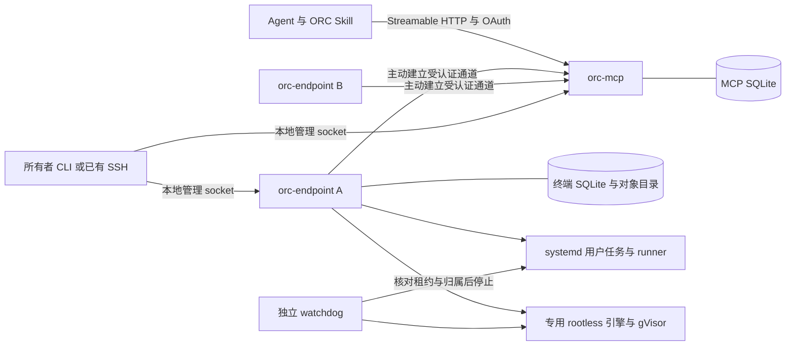
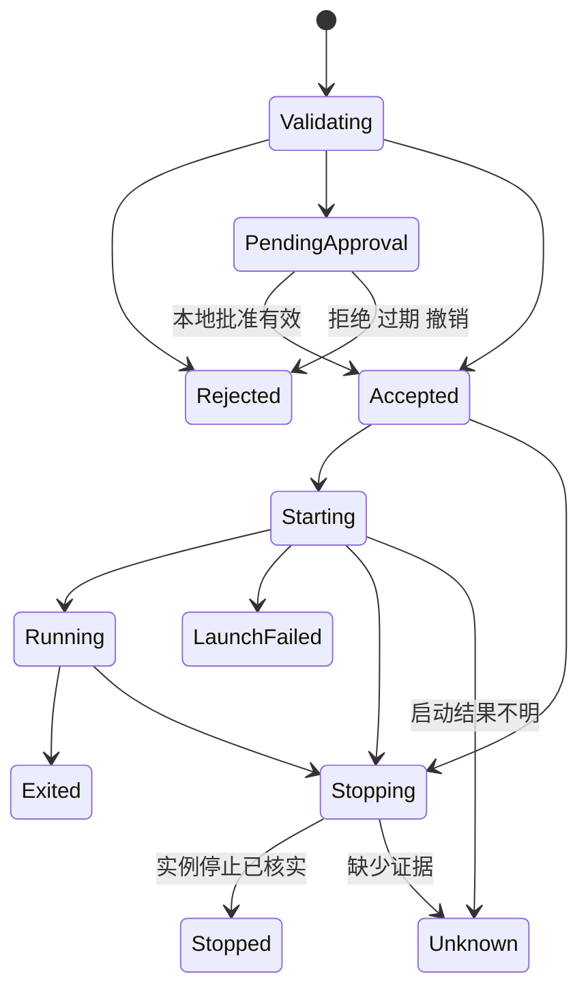
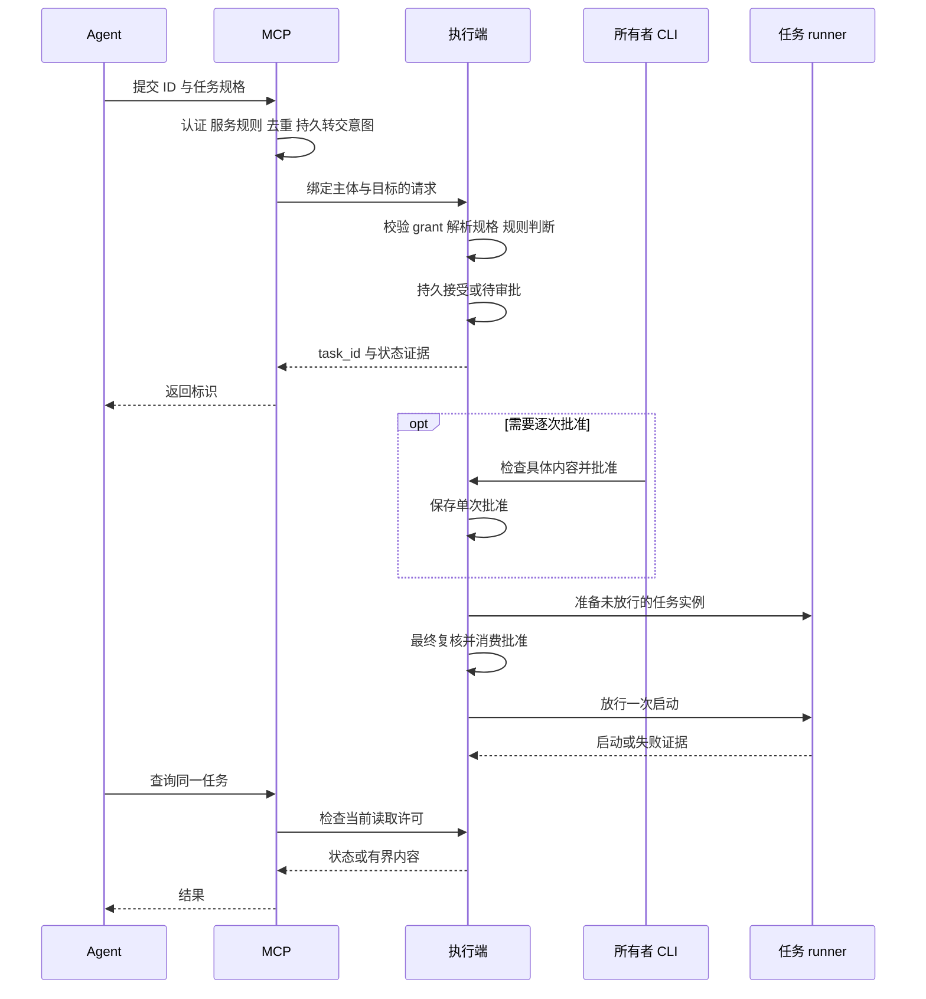

# OpenRemoteConnector 详细设计与实现方案

版本：0.2；更新日期：2026-10-18；状态：统一采用 Rust 的实现设计，依赖组合及运行保证待 M0 验证。

依据：[PRD v0.4](PRD.md) 与 [Architecture v0.1](ARCHITECTURE.md)。需求冲突以 PRD 为准，职责和行为边界以 Architecture 为准。实现语言已确定为 Rust；本文选择的依赖版本、协议集成和执行后端须通过 M0 出口后记录验证结果，不表示项目已经实现或通过验收。历史 MVP 与沙箱文档不作为本次选型依据。

核心方案是：**Rust 统一实现独立 MCP 服务、终端执行端、CLI、runner 和 watchdog，以 Cargo workspace 共享领域模型和协议；Agent 通过原生 MCP 接入，终端主动连接 MCP，两端各自持久化状态。** 终端完成最终授权、审批、任务监督和文件处理。Linux 宿主任务由 systemd 用户服务监督，隔离任务先验证独立 Rootless Docker 与 gVisor 后端。MCP 只转交操作，安装 MCP 本身不会获得宿主执行能力。

统一 Rust 的范围包括 ORC 自维护的服务、安装管理逻辑、收集器及后续桌面管理界面；外部数据库、操作系统和隔离运行时仍作为受控依赖使用。Python 正向工作流是用户任务样例，不是 ORC 服务实现依赖。语言选择不改变 PRD 的授权、隔离和生命周期边界。

## 1 范围与技术决策

### 1.1 首版交付范围

P0 覆盖 Ubuntu 24.04 LTS x86_64、单所有者、一个 MCP 管理至少两台独立终端、每个终端同时信任一个 MCP。必须支持两种执行环境和三种放行策略的全部六种组合，以及 Codex CLI 本地和远程接入、具备权限的 ChatGPT 远程 MCP 接入。

不纳入 P0：交互式 PTY、持久 shell、第三方 MCP provider、团队权限、多 MCP 级联、自动打洞、自动故障转移、任务联网安装依赖。macOS 在 M5 实现独立后端和签名公证 App，不能直接沿用 Linux 的验收结果。

### 1.2 技术选型与替换边界

| 领域 | 拟采用方案 | 选择理由及验证条件 |
| --- | --- | --- |
| 核心语言 | Rust 2024 edition；一个 Cargo workspace，多个 crate 和独立二进制 | 语言决策已确定；用所有权和类型区分资源句柄及状态，系统接口集中在平台 crate |
| 异步与 HTTP | Tokio、Axum、Tower | 承载 MCP、认证、控制通道和有界后台任务；阻塞文件及数据库操作不占用异步工作线程 |
| MCP | 官方 Rust SDK `rmcp`，Streamable HTTP | 使用原生客户端，不自建 Agent 常驻桥接进程；验证固定 SDK 与两个客户端的协议交集 |
| 客户端认证 | `oxide-auth` 授权服务器内核，加 ORC 的 Axum 适配和单所有者确认 | 原生 Rust 内嵌实现；元数据、DCR、resource 绑定、持久存储和令牌族撤销由 ORC 补齐并验证 |
| 终端通道 | `tokio-tungstenite`、`rustls`、`tokio-rustls` | 终端主动建立受认证 TLS/WebSocket 通道；固定证书验证及消息大小限制 |
| 本机管理 | Tokio Unix socket、Rust CLI `clap` | 以操作系统 UID 验证所有者；管理操作与 Agent 工具分开 |
| 持久状态 | `rusqlite` 加两端独立 SQLite，WAL，关键事务 `synchronous=FULL` | 独立数据库线程串行写入，明确审批消费、撤销和恢复的顺序 |
| 宿主执行 | `zbus` 调用 systemd，Rust `orc-runner`，`rustix` 加受限 `libc` 封装 | 固定 UID、FD、目录和环境；启动及停止以系统证据为准 |
| 隔离执行 | `bollard` 调用专用 Rootless Docker Engine，gVisor `runsc` 先验证 `systrap` | Docker API 与 Agent 参数隔离；环境、配额和整任务停止仍需实测 |
| 数据与协议 | `serde`、`serde_json`、`schemars`；内容对象和 SHA-256 摘要 | 严格解码、生成 schema、固定规范化字节；摘要不作为读取凭据 |
| macOS 管理 App | M5 使用 Rust `egui`/`eframe`，本地 IPC 与平台凭据适配 | 统一维护 Rust 界面和后台；另验收打包、可访问性、签名及公证 |
| 发布 | Cargo 固定工具链与 lockfile、分角色版本包、签名 manifest | 安装、升级和回退独立处理；没有发布前不提供虚构下载地址 |

`rmcp` 的来源见 [MCP 官方 Rust SDK](https://github.com/modelcontextprotocol/rust-sdk)。`oxide-auth` 是可嵌入的 OAuth2 服务器库，提供包括 PKCE 的协议扩展；它不是完整 MCP 授权服务器，不能把选用库等同于完成 OAuth 2.1/MCP 兼容，见[项目说明](https://github.com/197g/oxide-auth)及 [PKCE 文档](https://docs.rs/oxide-auth/latest/oxide_auth/code_grant/extensions/struct.Pkce.html)。

### 1.3 候选比较与决策门槛

| 决策 | 比较过的方向 | 本方案取舍 |
| --- | --- | --- |
| 语言与边界 | 统一 Rust、跨语言服务与执行端 | 已确定统一 Rust；共享模型与错误类型，平台差异用 trait 和条件编译隔离。M0 验证组件实现，不再把语言作为待选项 |
| OAuth | Rust 内嵌服务器库、自托管完整身份产品、外部托管 IdP | 单所有者采用 `oxide-auth` 加本地确认，ORC 完成明确的协议适配；遇到不满足项先修正或更换 Rust 依赖，不引入另一语言的认证服务掩盖缺口 |
| 控制通道 | WebSocket、HTTP 长轮询、gRPC 双向流 | WebSocket 优先适配已有 HTTPS 入口；不自动切换协议。出站代理阻断升级时明确诊断 |
| 存储 | SQLite、PostgreSQL、纯文件 | 单实例 P0 使用 SQLite；不引入高可用数据库，也不共享一份 SQLite 给两台机器 |
| 隔离 | 普通 rootless OCI、gVisor、microVM | 普通 OCI 暴露较多宿主内核接口；microVM 增加 KVM 和镜像管理要求；先对 gVisor 做新一轮可行性验证，不继承旧文档的“已选定”状态 |

M0 固定实际版本、校验值、依赖许可证和可再分发条件，写入 `release-manifest.json` 与对应 ADR。本文不使用 `latest` 作为发布依赖，也不提前声称某个版本组合已兼容。

### 1.4 Rust 依赖清单

下表指定实现职责；精确版本在 M0 编译和集成后写入 `Cargo.lock`。文档链接中的 `latest` 仅为上游资料入口，不是构建时的版本规则。

| 组件 | 使用位置 | 具体约束 |
| --- | --- | --- |
| `tokio`、`tokio-util` | 服务事件循环、I/O、定时器及 `CancellationToken` | 按组件启用所需 feature；网络请求、通道和任务监督使用不同取消域 |
| `axum`、`tower`、`tower-http` | HTTP 路由、认证中间件、限流及请求预算 | 认证上下文由服务端注入；超时不取消已接受任务 |
| `rmcp`、`schemars` | MCP 传输、工具注册及工具 schema | 只在 MCP 适配层依赖 SDK；仅启用所需服务端能力 |
| `oxide-auth` | 授权码、PKCE 和 token 流程内核 | 禁用不采用的授权方式；ORC 提供存储和 MCP 扩展，详见 §4.1 |
| `tokio-tungstenite`、`rustls`、`tokio-rustls` | 设备 TLS/WebSocket 通道 | 显式选择 TLS 加密 provider；连接前检查证书和信任，不使用不安全 verifier |
| `rusqlite` 的 `bundled`、`backup` feature | 持久状态、迁移和在线备份 | 固定 SQLite 实现版本；同步连接只由数据库线程持有 |
| `serde`、`serde_json`、`uuid` | 严格类型、JSON 和 UUIDv7 | 拒绝重复键及未知执行字段；UUID 时间窗口由业务层检查 |
| `sha2`、`ed25519-dalek`、`getrandom`、`zeroize` | 摘要、签名、随机数及秘密缓冲 | 使用系统随机源，失败即停止密钥/令牌生成；不自制密码算法 |
| `rcgen` | 登记阶段签发设备证书 | CA 密钥仅由 MCP 身份模块持有；证书身份映射及轮换单独验收 |
| `zbus` | systemd 用户 D-Bus 接口 | 开启 Tokio 集成并核对 feature 组合，避免额外异步运行时 |
| `rustix`、`libc` | Linux FD、路径解析、时钟、进程和必要 syscall | 优先安全封装；自写 unsafe 限平台 crate，明确前置条件及测试 |
| `bollard` | 专用 Docker Unix socket | 通过类型化 API 创建/查询/停止固定 profile，不拼装 shell 命令 |
| `clap`、`reqwest` | CLI 及安装器下载 | 安装器使用 HTTPS 与有界下载；校验完成前不执行包内容 |
| `thiserror`、`tracing`、`tracing-subscriber` | 领域错误和结构化日志 | 稳定错误码；禁止对含秘密或正文的对象自动输出 Debug |
| `async-trait` | 后端动态分派 | 统一 `Send + Sync` 接口；一次性许可通过所有权传递 |
| `egui`、`eframe`、`security-framework` | M5 桌面界面及 Keychain | 平台依赖按 target 配置，不进入 Linux 服务构建 |
| `proptest`、`tempfile`、`cargo-fuzz`、`cargo-deny` | 开发与验证 | 属性测试、临时工作区、解析器 fuzz、依赖许可证及通告检查；不随服务运行 |

HTTP、数据库和系统适配分别参见 [Axum](https://docs.rs/axum/latest/axum/)、[rusqlite](https://docs.rs/rusqlite/latest/rusqlite/)、[zbus](https://docs.rs/zbus/latest/zbus/)及 [Bollard](https://docs.rs/bollard/latest/bollard/) 的上游文档。统一 Rust 指 ORC 自维护代码；`bundled` SQLite、TLS 加密 provider 和系统框架可能包含原生构建依赖，发布清单必须记录它们，不能据此承诺所有产物完全静态或不含 FFI。

## 2 部署结构与代码组织

### 2.1 运行结构



同机安装仍启动独立 MCP 和执行端单元，采用相同通道和权限流程。默认回环监听不暴露公网；远程启用时配置域名、证书和可达入口。MCP 用户与执行用户可以不同，MCP 进程不持有终端管理 socket 或容器引擎 socket。

拟交付 `orc` 管理命令，以及 `orc-mcp`、`orc-endpoint`、`orc-runner`、`orc-watchdog` 可执行程序。用户只管理 MCP 和终端两个产品组件；runner 与 watchdog 属于终端内部实现。

P0 一个终端身份绑定一个固定普通执行 UID，执行端以该 UID 运行。所有者在安装时选择账户，配置不符即拒绝启动，不在请求中调用 `sudo` 或动态切换账户。更换 UID 视为授权上下文变更：暂停、终止旧任务、作废旧 grant 后重新配置。需要跨账户同时执行的场景另行设计。

### 2.2 拟建目录

```text
Cargo.toml                 workspace、共享依赖、feature 与 lint
Cargo.lock                 提交精确依赖解析结果
rust-toolchain.toml         固定 Rust 工具链
crates/
  orc-domain/              Principal、grant、规则、审批、任务状态与错误
  orc-protocol/            wire DTO、严格解码、签名及能力协商
  orc-store/               rusqlite、SQL 迁移、安全 journal 与额度
  orc-auth/                oxide-auth 适配、OAuth 持久化及登录确认
  orc-mcp/                 MCP/HTTP 服务二进制、设备目录与转交
  orc-endpoint/            终端服务二进制、授权调度器及恢复
  orc-execution/           ExecutionBackend trait 与启动许可
  orc-backend-host-linux/  systemd 与宿主运行实例
  orc-backend-gvisor/      Bollard、隔离准备、运行及收集
  orc-workspace/           快照、差异、回写及内容对象
  orc-platform-linux/      OwnedFd、openat2、execveat 与系统时钟
  orc-admin/               本地管理 DTO、socket 服务及客户端
  orc-cli/                 orc 命令，安装与管理入口
  orc-installer/           校验、角色安装、升级及卸载逻辑
  orc-runner/              监督、单线程 exec 阶段及隔离收集子命令
  orc-watchdog/            独立故障清理二进制
  orc-desktop/             M5 Rust 管理 App
  orc-platform-macos/      M5 Keychain、进程及 launchd 适配
  orc-integration-tests/   跨 crate、故障注入和真实后端测试
xtask/                     Rust 发布、打包及验收辅助命令
api/schema/                从协议类型导出的 JSON Schema 与样例
skills/orc/                单入口 Skill 与无秘密的配置说明
environments/python/       固定离线工具环境
examples/                  文本修改、离线测试与报告生成
packaging/systemd/         MCP、执行端、watchdog 与任务单元
docs/decisions/            语言决策及 M0 验证后的组件 ADR
```

这是后续代码布局，不表示这些目录已经存在。每个 crate 使用标准 `src/lib.rs`、`src/main.rs` 和 `tests/`；工作区统一依赖和锁文件的机制见 [Cargo workspace 文档](https://doc.rust-lang.org/cargo/reference/workspaces.html)。`orc-domain` 不依赖 Tokio、SQLite 或 MCP SDK；`orc-protocol` 只映射协议 DTO 与领域类型；存储和执行器实现领域接口。只有组合层二进制连接这些适配器，不把网络框架类型传入授权核心。

MCP 二进制不依赖执行后端及终端管理客户端，避免角色功能混装。`orc-cli` 的 binary 名为 `orc`；安装器只分发所选角色和依赖。Linux 平台 crate 使用 target 条件编译，macOS 未实现的能力显式返回不支持，不通过空实现宣称已兼容。只有终端调度器能调用执行后端，只有本地管理层能创建 grant 或消费所有者确认。

### 2.3 异步调度和资源所有权

MCP 与执行端各有独立 Tokio runtime。设备连接使用有界 `mpsc` 收发队列，任务并发使用 `Semaphore`；后台任务由监督器持有 `JoinSet` 或显式 handle，检查退出结果，不创建无人跟踪的执行 future。大文件复制、摘要计算和同步库调用进入有界阻塞工作池，提交前取得额度，防止 `spawn_blocking` 自身形成无界队列。

终端授权调度器采用单一 actor：通过两条有界队列区分撤销/停止和普通提交，优先处理控制消息。SQLite 事务不跨网络 `.await`，共享锁不跨后端调用；昂贵准备在 actor 外完成，带版本结果回到 actor 复核。数据库工作线程处理已接受命令后，响应接收方被释放也不撤回提交；调用方通过原操作 ID 核对结果。

取消分三种作用域：请求超时只取消等待响应；通道取消触发有界失联状态机；任务取消由持久任务状态驱动后端停止。`CancellationToken` 是协作信号，不是进程停止证据，参见 [Tokio 工具库说明](https://docs.rs/tokio-util/latest/tokio_util/sync/struct.CancellationToken.html)。不得把 HTTP 请求的 token 直接传给长期任务监督器。

`OwnedFd`/`BorrowedFd` 管理文件描述符，`PrincipalId`、`DeviceId`、`SubmissionId` 使用不同 newtype 防止误混。`PreparedInstance` 与 `LaunchPermit` 不实现 `Clone`；许可构造只对授权调度器开放，启动按值消费。这些类型限制同一进程内误用，跨进程和崩溃后的单次性仍由持久记录与启动门保证。`Drop` 可以关闭句柄，不能代替异步停止、审批落盘、终止核实或事务补偿。

### 2.4 构建和依赖管理

根工作区采用 edition 2024 与 resolver 3，固定 `rust-toolchain.toml`、`workspace.package.rust-version` 和 `Cargo.lock`；M0 用所选版本的实际 MSRV 验证兼容性，不填未经编译的版本号。依赖 feature 按角色启用，不用 `--all-features` 代替平台矩阵；MCP 安装无需引入 Docker 客户端运行环境，宿主安装无需下载隔离引擎。

Linux 首版构建目标为 `x86_64-unknown-linux-gnu`，在 Ubuntu 24.04 基线上构建并运行验收；不默认承诺 musl 全静态产物。M5 使用 `aarch64-apple-darwin` 单独构建、签名和公证。终端用户运行预编译包，不需要本机 Cargo；构建机所需 C 编译器、SQLite 或 TLS provider 原生部分纳入发布依赖记录。

日常检查包含 `cargo fmt --all --check`、按平台选择 package 的 `cargo clippy --all-targets -- -D warnings`、`cargo test` 以及 `cargo deny check`；不在 Linux 上强行编译仅 macOS 可用的桌面/框架 package。打包使用 `cargo build --locked --release` 的指定 package/target。生产依赖不用浮动 Git 分支，确需补丁时固定提交、来源和许可证。领域及协议 crate 禁止自写 unsafe，系统调用和必要 FFI 集中在平台 crate，逐个说明不变量及调用条件。

## 3 两段连接与终端登记

### 3.1 Agent 到 MCP

MCP 对外提供 `/mcp`，以 Streamable HTTP 作为首版传输。一次 `tools/call` 只等待受限时间，返回提交或任务标识；长任务通过查询工具读取。P0 不依赖客户端实现 MCP 可选的长任务扩展。HTTP、SSE 或 MCP 会话结束仅结束通信，不映射为业务取消；这与 [MCP 传输规范的断线语义](https://modelcontextprotocol.io/specification/2025-11-25/basic/transports) 一致。

`orc-mcp` 将 `rmcp` 的 Streamable HTTP 服务挂入 Axum 路由，用 Tower 层检查每次请求的 bearer token、服务规则及消息预算，再注入受信 Principal。会话 ID 仅用于通信；不能把初始化请求的身份缓存为后续所有调用的权限，也不能从工具参数恢复 Principal。rmcp DTO 在适配层转换为 `orc-protocol` 的严格请求类型，SDK 的工具 schema 不能代替终端校验。

Codex CLI 使用其原生 HTTP MCP 配置及 OAuth 登录；支持路径见[官方 MCP 配置文档](https://learn.chatgpt.com/docs/extend/mcp?surface=cli)。ChatGPT 首先验收有自定义 MCP 权限的网页端，经可达 HTTPS URL 和 OAuth 接入；实际平台权限及配置以[官方自定义 MCP 指南](https://developers.openai.com/api/docs/guides/custom-mcp-server)为准。平台原生连接审批不替代终端本机授权。

同机 Codex 路径先验证回环 HTTP 与 OAuth；HTTP 例外只限受检验的回环地址，校验 Host、Origin 并防止跨站调用。LAN 和公网路径使用 HTTPS，不允许通过跳过证书验证完成安装。云端入口以真实工具调用完成验收；浏览器打开成功只能作为局部诊断。

### 3.2 MCP 与终端

终端主动连接 `/endpoint/v1/connect`，首选 TLS 1.3。通过自管设备 CA 签发的客户端证书认证设备；执行端同时校验服务器证书和已登记的 MCP 身份公钥。公网 Agent 入口和设备入口可使用不同监听器；若设备入口经过反向代理，必须维持可验证的设备身份转交，不能接受任意 `X-Device-ID` 请求头。P0 首选设备 TLS 直接终止于 MCP。

设备监听器用 `tokio-rustls` 完成双向 TLS，再把已验证的连接交给 WebSocket 层；客户端用 `tokio-tungstenite` 和显式 rustls 配置发起连接。证书校验得到的设备绑定随连接传递，不读取不可信 HTTP 头替代它。握手、单帧/整消息大小、读写超时和发送缓冲均在构造连接时配置，详见 [WebSocket 库](https://docs.rs/tokio-tungstenite/latest/tokio_tungstenite/)与 [rustls](https://docs.rs/rustls/latest/rustls/) 的上游接口。

连接建成后的顺序固定为：

1. 验证双方密钥身份、证书有效期及当前信任状态。
2. 交换协议主版本、能力集合、状态格式和双方启动 ID。
3. 分配新 `connection_epoch`；只允许当前连接代数提交新操作。
4. 同步 MCP 的访问撤销序号，以及终端的 grant、策略摘要和撤销序号。
5. 对账待确认提交、任务、停止证据；不重新执行未知任务。
6. 双方确认同步完成后进入 `ready`；之前仅允许同步和必要的停止请求。

心跳初值为每 5 秒一次，15 秒没有经过认证的有效响应即判定失联。终端以本机单调时钟计算，不使用 Agent 请求活动刷新心跳。重连退避从 1 秒到 30 秒并加抖动。时间值是待测试的设计初值，发布前以故障测试确定。

通道按设备隔离队列。控制帧优先，文件与输出分块传输，每块最多 64 KiB；禁止大文件占满队列而阻塞撤销。控制消息不超过 256 KiB，超限关闭相关请求；不启用未经大小约束的压缩。慢设备只能耗尽自己的预算。

### 3.3 身份与登记流程

MCP 和执行端分别首次生成 Ed25519 身份密钥；`mcp_id`、`device_id` 为公钥摘要的类型化表示，显示名独立保存。证书和通道密钥可轮换，但身份变更必须由旧身份签署连续性证明或重新由所有者登记。无法证明连续性时按新身份处理。

登记采用以下流程，不以单个短数字码作为长期信任：

1. 执行端通过本地 CLI 生成登记请求，包含设备公钥、随机 nonce 和 10 分钟期限。
2. 所有者在 MCP 管理入口确认预期设备指纹，产生绑定该设备公钥、MCP 指纹和 nonce 的一次性邀请。
3. 执行端所有者核对 MCP 指纹；邀请从受保护文件或标准输入读取，不放入 shell 参数、Skill 或聊天。
4. 双方证明持有私钥；MCP 在事务中消费邀请，记录设备并签发设备证书。重复或错设备兑换拒绝。
5. 登记结果只有 `trusted_ungranted`；没有执行 grant，Agent 目录中也不会自动出现该设备。

撤销信任关闭现有通道并阻止重连；执行端使旧 MCP 下的 grant 和批准失效，终止关联任务。到期证书不能凭设备名称恢复信任；可验证的原身份续签不改变 grant 有效期。

## 4 客户端认证与权限模型

### 4.1 单所有者 OAuth

MCP 同时承担资源服务器和内嵌授权服务器角色。按 [MCP 授权规范](https://modelcontextprotocol.io/specification/2025-11-25/basic/authorization)提供受保护资源元数据、授权服务器元数据、授权码加 PKCE S256、资源标识校验及 token 撤销。实现优先验收预登记客户端与 DCR；未实现 CIMD 时不在元数据中声明支持。OpenAI 对发现、PKCE 和客户端登记的要求见[官方认证文档](https://developers.openai.com/plugins/build/auth)。

`orc-auth` 使用 `oxide-auth` 的授权服务器流程和 PKCE 扩展，提供 Axum 请求/响应适配、SQL 存储及单所有者确认。注册客户端、授权码和令牌后端必须使用持久实现，不直接使用库的内存示例。Rust 的 `oauth2` 客户端库不作为本项目的授权服务器实现，也不引入额外语言的认证 sidecar。

| 协议职责 | Rust 实现分工 | 必须验证的行为 |
| --- | --- | --- |
| 授权码与 PKCE | `oxide-auth` 流程，ORC 强制 S256 和字段校验 | 缺失/错误 challenge、verifier 或降级为 plain 拒绝；授权码单次消费且与客户端/回调绑定 |
| 登录与同意 | `orc-auth` 持久待登录记录，本地 CLI 确认 | 请求绑定浏览器 nonce、CSRF 防护、client、redirect、scope、resource 和 PKCE；CLI 确认不创建执行 grant |
| MCP/OAuth 元数据 | Axum 的 well-known 与 challenge 响应 | 只声明已实现 endpoint、scope、认证方式和扩展；不能仅因库有 OAuth2 流程就声明完整兼容 |
| 预登记与 DCR | ORC 注册模块及数据库事务 | 无授权默认值、数量/频率限制、精确回调地址校验；重新注册不继承权限 |
| resource 绑定 | ORC 校验并存入授权码及令牌记录 | `/authorize`、`/token` 与 bearer 校验使用同一规范资源标识，缺失/错目标不能成为通配许可 |
| refresh 与撤销 | 库流程加 ORC 令牌族表和事务 | 同时失效旧 refresh 并生成新值；复用、并发刷新及主动撤销有确定结果 |

避免再实现一套用户名密码系统：浏览器授权请求生成待登录记录，所有者通过 MCP 所在机器的本地 CLI 或已有 SSH 核对客户端及回调地址后确认，浏览器继续标准授权码跳转。完整绑定内容包括上表字段与期限。CLI 确认的是当前登录请求，不批准任何终端执行 grant。`oxide-auth` 未直接提供的 MCP 扩展由 ORC 明确实现并做协议测试，不能省略后继续开放服务。

初值：登录确认 5 分钟，授权码 60 秒单次使用，access token 10 分钟，refresh token 最长 30 天并轮换及检测复用。令牌使用至少 256 位随机不透明值，数据库只存可验证摘要及元数据；每次调用检查撤销、client、owner、scope、resource 和期限。撤销刷新令牌族同时阻止相应访问。token 续期不延长终端 grant，已接受任务也不因提交时 access token 自然到期而被取消。

DCR 只创建未授权客户端注册，限制数量和频率；客户端名称不能决定权限。重新注册生成新身份，不按同名、相同回调 URL 自动合并。公开客户端身份表示已完成协议流程的客户端注册，不是对某个二进制或所有聊天会话的硬件证明。实际客户端重新登记导致身份改变时，界面必须显示需要重新授权。

### 4.2 稳定主体

```text
Principal = (mcp_id, auth_domain_id, owner_id, client_registration_id)
principal_id = SHA256(canonical(Principal))
```

`owner_id` 首次安装随机生成；账号删除重建不得复用。MCP 只从已经验证的 token 记录建立 Principal，工具参数不接受 `principal_id`、角色或账号覆盖项。执行端验证信封来自受信 MCP 后匹配本机 Principal。

终端接受 MCP 的认证委托，因此 MCP 失陷可能冒用既有获准主体。请求签名和设备证书不能消除这个风险。本机控制限制其可使用的账户、环境、动作、范围及期限；本地管理审批与扩权不通过 MCP 通道提供。

### 4.3 grant 与服务规则

每个 grant 只允许一种环境、一个执行账户及一份策略版本，至少包含：

```text
grant_id, principal_id, device_id, execution_uid
actions[], environment_profile_id, environment_digest
workspace_ids[] 或 host_context_id
policy_id, policy_revision, quota_profile_id
issued_at, expires_at, revision, status
```

动作分开授权：`device.discover`、`snapshot.read`、`task.submit`、`task.inspect`、`result.read`、`artifact.read`、`changes.propose`。回写应用和管理审批属于本地所有者操作，不存在 Agent 的 `grant.create` 或 `approval.approve` 工具。原任务所有者的取消和最小停止状态查询是特殊控制路径，不以当前执行 grant 仍有效为前提；正文读取仍需独立授权。

有效权限是 MCP 服务访问规则、本机 grant、设备当前状态和环境能力的交集。MCP 可阻止访问，不能增加终端动作。查询设备仅返回该 Principal 获准发现的目标；无授权主体只能看到自身接入状态或空列表。

放宽策略、换账户或换环境生成新的 grant 版本，需所有者重新确认。P0 为避免错误判断“等价放宽”，任何策略语义变更都使关联未消费批准失效；收紧按撤销处理，停止相关任务。单纯显示名更改不影响身份和许可。

## 5 数据模型与持久化

### 5.1 权威记录

| 所在端 | 表或对象 | 主键与关键约束 |
| --- | --- | --- |
| MCP | `identities`、`oauth_clients`、`oauth_tokens` | 身份独立于名称；token 摘要唯一，刷新令牌族可撤销 |
| MCP | `devices`、`service_policies` | 公钥绑定 device_id；每设备独立连接代数及访问版本 |
| MCP | `submissions`、`dispatch_attempts` | `(principal_id, device_id, submission_id)` 唯一；记录原始请求摘要与转交证据 |
| MCP | `task_views` | 仅状态副本，必须含终端版本和 `last_confirmed_at` |
| 终端 | `trust`、`grants`、`policies` | 一个有效 MCP 信任；版本只前进，不以网络副本覆盖本机记录 |
| 终端 | `submissions`、`tasks`、`task_events` | 同一提交唯一；每任务事件序号递增；状态写入使用版本比较 |
| 终端 | `approvals` | 绑定内容摘要、版本和期限；`consumed_by` 至多写入一次 |
| 终端 | `runtime_instances` | 任务、启动尝试、实例 ID、systemd invocation ID、boot ID 关联 |
| 终端 | `snapshots`、`artifacts`、`change_sets`、`file_apply_results` | 内容摘要、权限归属、基线及逐文件应用结果 |
| 两端 | `security_events`、`revocation_outbox` | 安全序号单调递增，撤销发送可重试，不可静默删除未确认项 |
| 两端 | `blob_refs`、`quota_reservations`、`audit_events` | 字节预算和引用计数事务更新；审计不存默认正文 |

请求中的账户、环境和有效目录在终端解析后生成 `EffectiveSpec`；任务保存不可变的完整规格及 `effective_digest`。完整命令、stdin 和脚本保存在权限为 0600 的正文对象中；普通事件和日志只保存摘要及动作类别。

SQLite 采用单写入队列、短事务、外键和明确的忙等待上限；撤销不排在大量输出写入之后。正文文件先写临时对象、校验、`fsync`、原子更名，再在数据库中引用；崩溃遗留的未引用对象由 GC 清理，不生成指向半个文件的任务记录。数据库及目录同样需要 `fsync` 语义。WAL 的边界参见 [SQLite 官方说明](https://www.sqlite.org/wal.html)；备份使用在线备份接口，不只复制活动数据库主文件。

具体使用 `rusqlite::Connection` 的专用数据库线程；有界消息携带类型化命令、操作 ID 和 oneshot 响应端，连接和事务不暴露给 HTTP handler。对审批消费、去重及安全序号变更使用明确的短写事务和条件更新，检查实际影响行数。OAuth 同步后端在有界阻塞流程中调用同一存储协议；不在 Tokio 线程里等待同步 SQL，也不在持有事务时等待用户确认。备份使用 `rusqlite` 的 [backup 接口](https://docs.rs/rusqlite/latest/rusqlite/backup/index.html)，schema 迁移作为有编号的 SQL 随 crate 打包。

### 5.2 提交身份与防重放

调用方在首次提交前创建并保存 UUIDv7 `submission_id`；Skill 使用宿主已有的生成能力或 Rust CLI 的一次性辅助命令，不启动后台服务。所有同次重试保持 ID 和请求内容不变。UUID 中时间不得晚于接收端 60 秒，且首次提交不得早于 24 小时；`request_expires_at` 不超过 ID 时间加 24 小时。时间异常拒绝副作用并提供校时诊断。

两端以相同三元组去重，分别保存 `request_digest`。摘要覆盖严格解码后的业务参数，包括期限；对象字段排序固定，数组保持顺序，禁止重复 JSON 键、未知执行字段和不确定数字。可使用 RFC 8785 的规范化编码实现，浮点资源值改为整数单位。同 ID 同摘要返回原记录，同 ID 不同摘要返回 `SUBMISSION_CONFLICT`。

Rust wire 类型采用显式 tagged enum 和 `serde(deny_unknown_fields)`，再做跨字段语义校验；不靠 untagged enum 猜测命令形式。重复 JSON 键需在递归反序列化 visitor 中拒绝，不能先转成会丢失重复键信息的通用对象再检查。规范化编码集中在 `orc-protocol` 并用固定测试向量验证；`serde_json::to_string` 本身不视为 RFC 8785 实现，`schemars` 生成 schema 也不代替运行时校验。

首次请求过期后不得再启动任务；已有记录仍可按当前权限查询。安全去重墓碑至少保留 7 天，并保留到关联任务与审批完成；输出 24 小时清理不影响墓碑。墓碑清理后，旧 UUID 的嵌入时间已超出首次接受窗口，仍被拒绝；不能通过修改外部时间字段使旧 ID 重新合法。持久记录已过期请求时不必无限保留拒绝记录，时间窗口本身负责拒绝。

MCP 在执行端离线时拒绝新提交，不创建可自动运行的积压队列。失联前已经持久转交但结果未知的请求，仅允许以原 ID 对账；若证明终端从未接受，可在仍有效且重新通过当前策略时重试同一提交。不能换 ID 掩盖未知状态。

### 5.3 任务状态与停止状态

任务分别保存三个维度，避免“超时”被误认为“已经停止”：

| 字段 | 值与含义 |
| --- | --- |
| `execution_state` | `pending_approval`、`accepted`、`starting`、`running`、`exited`、`not_started`、`unknown` |
| `stop_state` | `none`、`requested`、`confirmed`、`failed`、`unknown` |
| `finish_reason` | `exit_zero`、`exit_nonzero`、`launch_failed`、`cancelled`、`deadline`、`grant_revoked`、`grant_expired`、`control_lost`、`endpoint_paused`、`supervisor_lost` |

退出码只在有退出证据时填写。`requested` 不等于 `confirmed`；停止待确认时保留实例引用和最后核实时间。MCP 另用 `forwarding`、`delivery_unknown`、`endpoint_acknowledged` 表达转交状态，不冒充终端任务状态。



## 6 对外工具与内部协议

### 6.1 MCP 工具

所有工具以认证上下文识别调用者，业务参数不能指定身份。除自身接入诊断和设备列表外，调用必须明确携带 `device_id`；任务查询还携带 `task_id` 或 `submission_id`。禁止按名称替换目标。

| 工具名 | 输入重点 | 返回及权限检查 |
| --- | --- | --- |
| `orc_connection_status` | 无 | 当前主体的接入结果，不枚举未授权终端 |
| `orc_devices_list` | 分页 cursor | 已获发现权限设备、名称、连接、能力摘要及确认时间 |
| `orc_device_inspect` | device_id | 环境、有效 grant、可用工具、硬软限制与策略版本 |
| `orc_snapshot_list`、`orc_snapshot_read` | device_id、snapshot_id、相对路径、offset、limit | 仅批准版本；读取配额与当前 grant 均检查 |
| `orc_policy_preview` | 完整任务规格 | 终端解析结果、命中规则、未限制字段和有效配额；不预留批准 |
| `orc_task_submit` | 提交 ID、固定目标、grant、命令、上下文、期限 | 提交标识；终端确认后返回 task_id，或 pending_approval |
| `orc_submission_get` | device_id、submission_id | 转交状态及关联任务；未知状态不得建议重新创建任务 |
| `orc_task_get`、`orc_task_list` | device_id、任务或分页参数 | 自己的状态、最后证据时间；列表不暴露其他主体任务 |
| `orc_task_output_read` | device_id、task_id、stream、offset、limit | 字节范围、退出状态、截断及清理信息 |
| `orc_task_cancel` | device_id、task_id、幂等操作 ID | 先报告取消已接收，再查询实际停止；不需要恢复执行 grant |
| `orc_artifacts_list`、`orc_artifact_read` | device_id、task_id、artifact_id、读取范围 | 不透明 ID 不能代替权限；内容只支持声明格式 |
| `orc_changes_propose`、`orc_changes_get` | 输入基线、产物、目标工作区、幂等操作 ID | 生成确定差异及待审批标识；不应用宿主修改 |

工具说明明确宿主命令可以有写入副作用，`task_submit` 不标为只读。协议注解用于客户端呈现，不参与后端授权。任务输出和文件内容标为不可信数据，不拼入 Skill 的控制指令。

宿主文件读取通过获准宿主命令完成，不另加一个隐含受目录隔离的通用文件工具。隔离目录读取只访问批准快照或已固定产物。`changes.propose`、取消等副作用操作与任务提交采用相同幂等规则。

### 6.2 任务提交示例

以下 ID 和时间仅展示格式，CLI 和工具尚未实现；实际 ID 由调用方当次生成。

```json
{
  "submission_id": "01a14d2a-9a00-7000-8000-000000000001",
  "device_id": "dev_example",
  "grant_id": "gr_example",
  "environment_profile_id": "linux-isolated-python-v1",
  "context": {
    "snapshot_id": "snap_example",
    "cwd": "/work/project"
  },
  "command": {
    "kind": "argv",
    "program": "python3",
    "args": ["-m", "unittest", "discover", "-s", "tests"]
  },
  "stdin": {"kind": "text", "value": ""},
  "env_overrides": {"PYTHONHASHSEED": "0"},
  "limits": {"wall_time_ms": 120000, "output_bytes": 1048576},
  "request_expires_at": "2026-10-18T04:05:00Z"
}
```

`command` 是严格的二选一 schema：

- `argv`：`program` 与字符串数组 `args`，不插入 shell，不展开变量、管道、通配符或重定向。
- `script`：明确 `interpreter`、解释器参数、脚本参数，以及 `inline` 或 `file_entry` 入口；后者只允许本机获准上下文内路径，不能提供任意 URL。终端必须读取并固定入口内容。

两种模式都拒绝 NUL、超长参数、未知字段及未经授权环境覆盖。宿主请求使用 grant 内的 `host_context_id`，不能用 snapshot 请求自动改为宿主上下文。实际执行 UID 从 grant 取得并返回，不由 Agent 传一个用户名后自动切换。

终端确认后的返回示例：

```json
{
  "submission_id": "01a14d2a-9a00-7000-8000-000000000001",
  "device_id": "dev_example",
  "task_id": "task_example",
  "delivery_state": "endpoint_acknowledged",
  "execution_state": "pending_approval",
  "stop_state": "none",
  "approval_id": "approval_example",
  "effective_digest": "sha256:example",
  "effective_limits": {"wall_time_ms": 120000, "output_bytes": 1048576},
  "next_action": "owner_review"
}
```

### 6.3 MCP 到终端的信封

内部消息使用版本化 JSON 严格 schema，主要类型为 `hello`、`sync`、`heartbeat`、`request`、`response`、`task_event`、`chunk` 和 `ack`。数据块携带独立 transfer ID、顺序、长度和摘要，过期传输回收预留空间。

有副作用请求的签名负载绑定：`protocol_major`、`mcp_id`、`device_id`、`principal`、`connection_epoch`、`operation`、`submission_id`、`request_digest`、完整请求、`service_policy_revision`、`sent_at` 和短期 `delivery_expires_at`。使用登记的 MCP Ed25519 密钥签名规范化字节，终端验证摘要、签名、目标、代数和期限，再执行本机检查。签名不替代 grant。

投递信封初始有效 30 秒；它只约束接收，不决定已接受任务能运行多久。重发原业务请求可使用新的投递信封，但必须保持原提交身份、内容和业务期限。事件按 `task_id + event_seq` 去重；错序先补状态，不倒退任务版本。双向 TLS 保护内容，签名用于把委托主体与整条指令明确绑定，不构成 MCP 失陷下的端到端用户证明。

### 6.4 错误和恢复提示

错误统一返回 `code`、`device_id`、可见的任务/提交标识、`retry_mode`、简短原因和 `next_action`；不默认附完整命令、内部堆栈或 token。

| 错误 | 行为 |
| --- | --- |
| `AUTH_REQUIRED`、`ACCESS_DENIED` | 重新原生登录或由所有者授权；不存在用业务参数修复身份的路径 |
| `DEVICE_OFFLINE`、`ENTRY_UNREACHABLE` | 标明受阻链路；不换目标、不积压新任务 |
| `GRANT_EXPIRED`、`GRANT_REVOKED`、`APPROVAL_REQUIRED` | 查询既有状态或等待本地管理；不自动扩权 |
| `CAPABILITY_UNAVAILABLE`、`INCOMPATIBLE_CONTRACT` | 拒绝请求并指出缺失能力；不丢弃限制后执行 |
| `SUBMISSION_CONFLICT`、`SUBMISSION_EXPIRED` | 不重试为新任务；有意再次运行必须用户意图明确并重新授权检查 |
| `POLICY_CHANGED`、`ENTRY_CHANGED` | 原批准失效；重新预览或审批 |
| `BASELINE_CONFLICT`、`WORKSPACE_NOT_EXCLUSIVE`、`PARTIAL_APPLY` | 停止回写，返回逐项状态，不自动覆盖或重试整批 |
| `OUTPUT_TRUNCATED`、`CONTENT_GONE`、`QUOTA_EXCEEDED` | 区分仍可读的前缀、清理结果和容量不足 |
| `EXECUTION_UNKNOWN`、`STOP_UNCONFIRMED` | 只能查询、对账或请求停止，不推定未执行 |

## 7 终端授权与启动算法

### 7.1 请求处理顺序



1. 通道层检查来源、目标、代数、签名、格式及投递期限。
2. 查询持久去重记录；重复请求只能返回原记录或内容冲突，不再次执行后续副作用。
3. 在本机校验 grant、UID、动作、环境、上下文、设备暂停状态和剩余期限。
4. 解析程序与目录，固定显式脚本和 stdin，合并允许的环境覆盖，计算有效资源上限。
5. 执行三种策略之一；拒绝也返回确定原因，无法解析不进入允许分支。
6. 短事务保存提交、EffectiveSpec、任务和必要审批；事务提交成功才向 MCP 报告终端已接受或待审批。
7. 调度器在有资源且未过期时准备实例，最终再检查当前版本、审批和程序身份，执行一次启动。

持久化接受失败时禁止启动。MCP 等待终端响应超过初始 3 秒可返回转交标识及 `delivery_unknown`，后台继续核对原提交；不以 HTTP 超时撤销已接受任务。

### 7.2 程序解析与执行一致性

宿主默认 PATH 初值为 `/usr/local/bin:/usr/bin:/bin`，由所有者配置并展示；不读取 `.bashrc`、`.profile`。默认环境为显式 HOME、USER、LOGNAME、PATH、LANG 和任务 TMPDIR。环境变量清单由上下文提供，默认禁止覆盖动态链接器及解释器注入类变量；所有者可以显式增加覆盖项，但其变更必须重新授权。控制服务的环境、访问令牌和 socket 不自动传递给任务。

`argv.program` 含路径时按固定 cwd 解析，否则按上述 PATH 找到唯一目标。预览记录解析路径、设备号、inode、大小、修改信息和内容摘要。启动时重新打开并核对，变化返回 `ENTRY_CHANGED`。Linux runner 以文件描述符执行受支持的 ELF 程序，使用 `execveat` 或等价的 FD 执行封装，避免在最终检查后再次按可替换路径查找；具体系统调用行为见 [execveat 文档](https://man7.org/linux/man-pages/man2/execveat.2.html)。

P0 的 `argv` 不自动解释 shebang 文件；检测为脚本时要求改用明确的 `script` 形式。脚本入口从打开的文件描述符读取，检查普通文件、大小及前后状态，保存确定内容；批准绑定该内容。运行前再次核对显式文件入口是否仍匹配，随后把已批准字节写入密封 memfd，通过只读文件描述符交给固定解释器。不能先审批路径、再运行该路径的新内容。不兼容 FD 脚本入口的解释器返回不支持，不能悄悄改用 `-c` 或另一解释器。

隔离环境的程序身份由固定镜像摘要、环境版本和镜像内工具清单确定。任务无法更换镜像、挂载或 runtime；runner 在只读工具环境内核对解析结果。入口脚本仍采用同样的确定内容绑定。

这些检查固定程序入口、显式参数和脚本字节；不冻结动态库、导入模块、脚本后续读取的数据或网络状态。宿主同账户恶意代码也能篡改控制状态，不在此保证内。相关限制直接显示在审批界面。

### 7.3 规则模型

P0 规则采用 JSON 配置，经同一严格解码器转换为 `orc-domain` 的类型化 AST；CLI 管理入口负责可读预览，避免再维护不同配置格式的语义。每个可匹配字段必须显式使用 `exact` 或 `any`，不存在漏写字段即通配。参数初版支持整个数组精确匹配及固定位置精确条件；使用位置条件时必须声明是否允许额外参数。目录使用终端解析后的明确路径，不用字符串前缀模拟目录范围。

```json
{
  "revision": 1,
  "unmatched": "deny",
  "rules": [{
    "id": "allow-offline-tests",
    "effect": "allow",
    "match": {
      "principal": {"exact": "principal_example"},
      "device": {"exact": "dev_example"},
      "account": {"exact": 1000},
      "environment": {"exact": "linux-isolated-python-v1"},
      "action": {"exact": "task.submit"},
      "cwd": {"exact": "/work/project"},
      "command_kind": {"exact": "argv"},
      "program": {"exact": "python3_identity_from_environment_manifest"},
      "args": {"exact": ["-m", "unittest", "discover", "-s", "tests"]}
    }
  }]
}
```

拒绝优先于转审批，转审批优先于允许；没有命中使用 `unmatched`，只允许 `deny` 或 `review`。无效字段、无效类型或不能解析的程序身份阻止规则启用。预览展示所有命中规则和 `any` 字段，而不只显示最终布尔值。

`automatic` 分支跳过规则和逐次批准，但仍做身份、grant、上下文、配额和期限检查。`review` 分支始终生成审批。允许解释器或任意参数意味着允许该入口的广泛行为，不能宣称内部命令也经过逐项规则审查。

### 7.4 审批与撤销的顺序

批准摘要覆盖 Principal、设备、UID、环境摘要、动作、程序身份、参数、脚本、stdin、有效 cwd、有效环境、输入快照、配额、期限、grant 和策略版本。审批期限初值 5 分钟，且不超过请求和 grant 的剩余期限。Agent 只能查询自己申请的状态；完整内容由本地管理 socket 展示。

执行端设置一个授权调度器，串行处理“最终启动资格”“撤销”“策略变更”“回写提交”。昂贵的快照和环境准备可在锁外进行，但不能产生获准业务副作用；最终版本复核与启动门放行必须通过该调度器。

启动流程分为两段：先持久记录 `launch_intent` 并创建尚未执行用户程序的 runner；再在授权调度器内复核、事务消费批准、标记唯一 `launch_attempt`，最后向 runner 放行一次性启动门。**线性化点为调度器放行启动门。** 此前生效的撤销禁止放行；此后到达的撤销按已启动或启动中任务处理并终止整个实例。批准消费和实际 OS 执行不能组成数据库原子事务，故任何中间故障都保留已消费记录，只核对原实例，不自动恢复批准或再发启动门。

回写同样在每个实际文件应用前复核版本并经授权调度器排序。撤销在两个文件之间生效时，停止后续文件，已应用文件记入部分结果，不冒称整批回滚。终端写入撤销事实成功后才反馈本地已撤销；停止完成另行反馈。

## 8 执行环境与监督

### 8.1 后端接口

```rust
use async_trait::async_trait;

#[async_trait]
pub trait ExecutionBackend: Send + Sync {
    async fn probe(&self, ctx: &BackendContext) -> Result<Capabilities, BackendError>;
    async fn prepare(
        &self,
        ctx: &BackendContext,
        spec: &EffectiveSpec,
    ) -> Result<PreparedInstance, BackendError>;
    async fn start(
        &self,
        ctx: &BackendContext,
        prepared: PreparedInstance,
        permit: LaunchPermit,
    ) -> Result<InstanceRef, BackendError>;
    async fn inspect(
        &self,
        ctx: &BackendContext,
        instance: &InstanceRef,
    ) -> Result<RuntimeEvidence, BackendError>;
    async fn stop(
        &self,
        ctx: &BackendContext,
        instance: &InstanceRef,
        reason: StopReason,
    ) -> Result<StopEvidence, BackendError>;
    async fn collect(
        &self,
        ctx: &BackendContext,
        instance: &InstanceRef,
        budget: ArtifactBudget,
    ) -> Result<Artifacts, BackendError>;
    async fn cleanup(
        &self,
        ctx: &BackendContext,
        instance: &InstanceRef,
    ) -> Result<(), BackendError>;
}
```

此接口是实现草案，领域类型由对应 crate 定义。`async-trait` 用于 `Arc<dyn ExecutionBackend>` 的异步动态分派，见[库文档](https://docs.rs/async-trait/latest/async_trait/)；不假设原生 `async fn` trait 自动满足该用法。`prepare` 不运行用户命令；`start` 按值消费特定实例的一次启动许可。`Capabilities` 将限制表示为 `enforced`、`best_effort` 或 `unsupported`，并附探测时间和证据。请求指定的必需限制不是 `enforced` 时拒绝，不由接口隐藏后端差异。能力版本改变后重新检查 grant。

`BackendContext` 由任务监督器创建，包含这次后端操作的预算和服务关闭信号，不继承 Agent 请求取消状态。`start` 或 `stop` 调用超时后可能已产生副作用，必须保留持久 `launch_attempt`/实例引用并进入 `inspect` 对账，不能仅因 future 被丢弃就报告未启动或已停止。`BackendError` 区分确定拒绝、确定启动失败、能力缺失与副作用未知，再映射到 §6.4 的稳定错误码。

### 8.2 Linux 宿主后端

`orc-backend-host-linux` 使用 `zbus` 的类型化 proxy 调用 systemd 用户 D-Bus `StartTransientUnit`，创建命名唯一的 transient service 并启动 `orc-runner supervise`，不通过 shell 拼装 `systemd-run`。为固定版本生成/维护最小 proxy 和类型化属性，记录 unit 名、invocation ID、boot ID、cgroup 路径及进程开始时间，不只保存 PID。MCP、普通请求处理器和任务输出处理均不持有该 proxy。

runner 等待启动门，接收确定 argv、环境、stdin 和 cwd 文件描述符后启动任务；stdin 发送结束即关闭，无 PTY。stdout/stderr 由 runner 分别限量读取、保存和上报，不能因 MCP 断开而停止读取。达到保留上限后继续排空并丢弃多余字节，同时记录截断；达到吞吐保护阈值可按配置终止任务，不能无限阻塞控制面。

Rust runner 分为监督阶段和 `exec` 子命令。监督阶段以 Tokio 维护有界 I/O、期限和退出查询；它启动同版本的 `orc-runner exec`，经受保护 Unix socket、对端凭据和一次 nonce 向该子进程传递确定规格及 SCM_RIGHTS 文件描述符。exec 阶段保持单线程，不启动 Tokio：用 `rustix` 校验 FD、切换目录和设置限制，只保留允许继承的输入输出/脚本 FD，最后通过平台 crate 的小型 `libc::execveat` 封装替换自身。这样无需在多线程服务的 fork 后执行复杂 Rust 逻辑，也不以 C 辅助程序承担启动逻辑。

监督阶段明确持有并等待子进程句柄，分块读取管道，禁止 `Command::output()` 无界收集。关闭 future 或释放 `Child` 不等于终止进程；即使对短期辅助进程使用 `kill_on_drop(true)`，也仍须 wait/reap 和实例核实，见 [Tokio 进程生命周期说明](https://docs.rs/tokio/latest/tokio/process/index.html)。系统级终止仍由 systemd、后端和 watchdog 负责，Rust RAII 不能替代这些证据。

任务单元设置 `KillMode=control-group`、有界 `TimeoutStopSec` 和可用的 `RuntimeMaxSec`，正常结束也处理残留子进程。取消先向所属任务组发 TERM，初值 3 秒后仍存活则 KILL，并核实单元和 cgroup 状态。systemd 的控制组终止语义见[官方说明](https://www.freedesktop.org/software/systemd/man/latest/systemd.kill.html)。

宿主 CPU、内存和进程控制在实际 cgroup 委派有效时启用；缺失时能力如实标记，带必需限制的请求拒绝。宿主文件写入没有统一磁盘硬配额承诺。任意同账户程序可能迁出 cgroup、启动其他用户服务或修改 ORC 状态，所以即使所管理 cgroup 已空，也只报告该实例的停止证据，不能证明所有外部副作用或逃离管理的进程已清除。

### 8.3 Linux 隔离后端

重新验证的候选组合为专用 Rootless Docker、固定 runsc 和 `systrap`。gVisor 的 rootless 集成路径及平台说明分别见 [rootless 文档](https://gvisor.dev/docs/user_guide/rootless/)和[平台文档](https://gvisor.dev/docs/user_guide/platforms/)。安装器只在选择隔离环境时准备这些组件。

`orc-backend-gvisor` 用 `bollard` 连接安装器记录的专用 Unix socket，以类型化 Engine API 完成 create、start、inspect、stop、kill 和 remove；固定 API 兼容范围，启动前核对实际引擎、runtime 和实例信息。超时产生的创建/启动未知结果以原实例名及持久意图对账，不能无条件重发 create/start。镜像内的启动器和收集器使用同一工作区编译的 Rust `orc-runner`，分别暴露受限子命令，不在任务中加载通用管理接口。

强制约束如下：

- 引擎使用独立 socket、data-root、配置和 systemd 用户单元；拒绝 rootful 引擎，不加入系统 docker 组，不修改用户默认 Docker context。
- 每个任务独立 sandbox，镜像固定 digest，rootfs 只读；工作负载固定非 root UID，清空 capabilities，启用 no-new-privileges。不允许 Agent 设置 runtime、设备、端口、OCI annotations 或挂载。
- 只读 `/input` 来自已批准快照，不挂载真实项目；任务写入专用 `/work` 副本和有硬上限的临时空间。
- 引擎和 runsc 均配置无外部网络，禁止宿主网络及宿主 socket；只保留沙箱内部 loopback。逐项验证 IPv4、IPv6、DNS、宿主服务和元数据地址。gVisor 网络模式见[官方网络文档](https://gvisor.dev/docs/user_guide/networking/)。
- 安装和运行前检查 user namespace、subuid/subgid、cgroup v2、systemd 委派、LSM、镜像与 runtime 摘要；必要项失败拒绝隔离任务。Docker 官方明确说明缺少条件时部分 rootless 资源参数会被忽略，因此必须读取实际 cgroup 并执行压力测试，见[资源限制说明](https://docs.docker.com/engine/security/rootless/tips/#limiting-resources)。

**可保留产物的临时空间实现：** P0 先验证安装阶段建立专用有容量上限的 tmpfs scratch 池，在其中分配任务目录，挂载进 `/work`。该目录是 ORC 的临时副本，不是用户项目。安装器按实际 user namespace 映射设置写入 UID，并记录 mount ID；需要的挂载权限集中在隔离环境准备步骤，由所有者明确允许，不给任务或日常服务管理员权限。没有管理员准备条件且不能提供等价硬配额时，该隔离 profile 不可用，宿主 profile 仍可独立安装。

scratch 池初值 768 MiB，任务工作目录与临时文件合计预算受池和任务内存上限共同限制；`/tmp`、共享内存另设大小并纳入总资源预算。tmpfs 可能使用 swap，不据此承诺内存保密。引擎日志关闭默认无限保存，输出由 ORC 有界接管；镜像拉取发生在所有者准备阶段，大小和镜像缓存单独限额。

**停止后收集：** 先停止整个工作负载 sandbox，核对 Sentry、关联实例和 cgroup 的停止证据；保留 scratch 挂载。再运行固定摘要的独立收集器，使用相同 UID 映射，只读挂载该 scratch，禁网、限时、限资源，以“路径、类型、长度、摘要、字节块”协议导出普通文本。宿主再次校验并保存对象，不解包任意 tar。最后销毁收集器、删除任务目录、释放额度。用户工作负载无法在收集器启动前继续修改文件；若无法核实停止，则暂停收集，标为产物未固定。

gVisor 的来宾进程数量不等于宿主 runtime 线程数，需分别验证沙箱内进程/线程预算及宿主 runtime cgroup 预算，不能只设置 Docker 的 `pids-limit` 就宣称两者相同；见 [gVisor 资源模型](https://gvisor.dev/docs/architecture_guide/resources/)。若该组合不能同时完成固定产物、硬配额和整任务清理，M0 不通过，不能换用普通 runtime 后继续标为同一隔离能力。

来宾预算先以固定非 root UID 和不可提高的硬 `RLIMIT_NPROC` 实现，逐项验证 fork、线程及派生进程；宿主 runtime 使用独立 cgroup 的 TasksMax。两者任一可绕过就不能宣称该限制受强制执行。scratch 在任务开始前预留，收集结束前不复用；异常重启需先核对并清理旧实例，不能把同一可写目录分配给新任务。

### 8.4 独立监督与期限

执行端每 5 秒更新任务监督租约，watchdog 独立运行，每 2 秒检查一次；初值 15 秒租约失效后启动清理，TERM/KILL 及核实预算额外最多 5 秒。上述约 22 秒是健康调度条件下的待验证目标，内核失效或整个宿主失去调度时不作硬实时保证。

watchdog 不接收远端业务请求；它读取受保护的任务归属、已确认 grant 截止时间和监督租约，只能停止已证明属于 ORC 的实例。停止证据写入独立有界 journal，执行端恢复后合并；watchdog 无权创建任务、恢复批准或扩大 grant。其正常存活是启动隔离任务的前提；watchdog 故障时执行端停止接单并清理现有隔离任务。

运行期限取 `min(请求时限, grant剩余时间, 本机上限, 环境上限)`。接受和开始运行时均重算，等待审批和排队不延长期限。运行时以包含休眠时间的单调计时来源监督，并同时检查绝对授权到期；时钟回拨不能延长已建立的任务预算。重启使旧租约失效，按实例对账和停止流程处理，不从旧墙钟值恢复无限运行。

失联继续策略只适用于 MCP—终端通道失联，最长到原截止时间；不覆盖已知撤销、授权到期、本地暂停或监督器故障。Agent 停止轮询不影响上述任何租约。

## 9 快照 产物与回写

### 9.1 导出与读取

所有者通过 `orc workspace export` 选择源目录和文件，终端生成实际清单、排除原因、长度及摘要。默认排除凭据配置、`.git`、符号链接、硬链接及特殊文件；过滤文件名不保证源码没有秘密，完整清单必须可审阅。

Linux 文件代理持有目录 FD，使用 `openat2` 的 `RESOLVE_BENEATH`、`RESOLVE_NO_SYMLINKS` 等约束访问相对路径，并按 profile 禁止跨挂载；逐组件检查、禁止绝对路径、`..`、NUL、链接和特殊文件。不能以 `realpath` 后再普通打开代替这一流程；系统调用的解析保证见 [openat2 文档](https://man7.org/linux/man-pages/man2/openat2.2.html)。

Rust 实现以平台 crate 的 [rustix `openat2`](https://docs.rs/rustix/latest/rustix/fs/fn.openat2.html) 和 `OwnedFd` 封装持有根目录及目标对象，解析结果不降回裸字符串后重新打开。接口使用受检验的相对路径 newtype；原始文件名以可保真字节表示，显示转义与访问路径分开，不能用有损 UTF-8 转换后的名字执行删除或更名。

复制时验证文件类型、link count、身份、复制前后状态和累计字节，内容摘要由实际复制字节计算。源正在变化则终止该次导出。最终清单和快照摘要形成后，所有者批准的是这份不可变副本；后续宿主变化不会进入旧快照。单文件稳定检查不保证跨文件同一时刻的一致视图；需要跨文件一致性的项目必须在导出时暂停所有写入者或从受支持的文件系统快照导出。

快照存入内容对象目录，批准、grant 和对象引用绑定。快照更新产生新 ID，不能原地修改已批准对象。读取 API 使用 snapshot_id 和相对路径，不接受宿主绝对路径；每个分页重新检查权限和大小。输出或产物再导入任务必须显式选择、授权并形成新的输入引用。

### 9.2 产物与差异

P0 声明 UTF-8 普通文本，包括 `.txt`、`.md`、`.json`、`.csv` 和源码文本；NUL、无效编码和特殊文件拒绝作为可回写文本。图片、可执行文件和任意二进制不在首版保证内。文件名按原始字节标识，不做静默大小写或 Unicode 归一化；显示时转义控制字符，拒绝混淆路径及规范化后碰撞的条目。

任务停止并固定产物后，生成 `artifact_manifest`。差异以“基线快照 + 新产物 + 目标工作区”构建，逐文件记录 create/update/delete、原摘要、新摘要、大小和预览。Agent 传来的 unified diff 只作为待检查输入，实际应用以终端计算的文件清单和确定新内容为准，不调用带模糊匹配的补丁程序。

本地所有者审批绑定 change_set 摘要、目标设备和目录身份、基线、当前 grant/策略版本及期限。自动放行隔离任务仍需独立批准回写；宿主自动任务不进入此流程。

### 9.3 并发与回写算法

P0 自动回写仅在**能建立排他写入约定的受管工作区**启用。每个工作区有独立锁，全部 ORC 回写、导出及受管编辑会话都必须遵守。官方样例使用专用工作区；使用外部编辑器时，由所有者通过受管编辑入口持锁运行。普通项目若存在不遵守锁的后台构建、同步或编辑进程，则暂停回写，仅保留差异供审阅，返回 `WORKSPACE_NOT_EXCLUSIVE`。不能把用户点击确认或文件监视器没有事件当作排他证明。

在上述受支持条件下，算法为：

1. 取得工作区独占锁，确认无活动宿主任务或受管外部写入者；核对根目录 FD 与登记身份。
2. 校验当前 grant、策略、批准摘要和期限；逐项安全打开目标，检查普通文件类型、身份与完整基线摘要。任何已知冲突停止整批，尚不消费应用副作用。
3. 在同一文件系统创建随机临时文件，写入确定新内容并 `fsync`；不继承可执行位、setuid 或来源扩展属性。
4. 通过授权调度器单次消费批准，建立逐文件应用 journal；每项应用前再次检查撤销和基线。更新以原子更名替换，新建使用不可覆盖已存在文件的操作，删除只处理清单中核实的目标。
5. 每成功一项记录结果和新摘要并同步目录。失败或撤销时停止余下项目，返回已应用、未应用、冲突、未知的逐项结果。
6. 清理临时文件并释放锁。崩溃恢复对照 journal 和文件摘要判断，不能自动重试整个 change_set；不确定项交由所有者检查。

目录锁只约束参与协议的写入者，普通文件系统没有通用的“按内容摘要比较并原子替换”接口。若宿主同账户代码、用户或工具绕过约定，最后一次摘要检查与更名之间仍有竞争窗口；本文不声称防住这种竞争。M0 必须验证排他工作区的使用流程；无法建立排他条件时关闭自动应用，不能只增加一次检查后宣称问题已解决。

不承诺跨文件原子性。单文件替换原子也不意味着整批事务原子；回写成功不代表代码可信，更不代表可以回滚宿主命令的外部副作用。

### 9.4 三个随包样例

| 样例 | 随包准备 | 完整流程 |
| --- | --- | --- |
| 文本项目修改 | 多文件 Python 小项目与受管工作区，无真实秘密 | 批准快照，读取文件，修改副本，提出差异，先拒绝再用新申请批准，验证宿主变化 |
| 离线测试 | 固定 Python 工具环境，使用标准库 `unittest`，不下载依赖 | 分别运行通过、失败和长循环样例，核实退出码、输出、期限和取消 |
| 文本报告 | 输入数据与报告生成脚本 | 生成 JSON/Markdown，分段读取，申请保存；验证超额、到期、撤销后读取失败 |

镜像在所有者准备阶段下载或离线导入，记录 Python、系统工具和镜像版本。缺少依赖返回具体缺项及 `orc environment prepare` 管理路径，不由任务联网安装，也不把全部宿主环境复制进沙箱。

## 10 故障恢复与数据访问

### 10.1 启动及重启对账

执行端每次启动先进入 `recovering`，读取安全状态、任务意图、runtime 实例和 watchdog journal。对账完成前只允许本地停止、撤销及状态诊断。

| 崩溃位置 | 恢复行为 |
| --- | --- |
| MCP 尚未持久化转交意图 | 客户端用原 ID 重试；终端去重仍为最后防线 |
| MCP 已转交，未收到确认 | 查询终端原提交；不能显示未执行，也不能新建 ID |
| 终端接受事务完成，尚无 launch_intent | 原记录可继续调度，但必须重新校验当前权限和期限；已撤销或失联策略不允许时不启动 |
| launch_intent 或批准消费存在，启动结果不明 | 检查唯一实例、runner 和启动证据；证据不足标记 unknown，不再次放行 |
| 已运行但任务数据库未写 running | 以真实实例和 launch_attempt 对账，保留状态未知直到有证据；恢复时停止旧实例，不重建进程 |
| 退出证据存在但输出未完整提交 | 保留退出状态，输出报告缺失或部分可读，不重新运行以补输出 |
| 停止请求已发但后端不可达 | 标记 stop unknown/failed，保留实例和清理重试；不误报已终止 |
| 回写中崩溃 | 按逐文件 journal 核对现状，返回部分结果，不恢复批准或整批重放 |

未知实例只有在能用受保护的创建意图、精确实例 ID、启动代数和专用环境证明归属后才清理。不能仅凭用户可伪造的标签或 PID 杀进程，不运行全局容器 prune。

### 10.2 撤销和断线策略

MCP 撤销事务先更新服务策略版本，阻止新请求和后续结果交付，再写入撤销 outbox。在线终端持久处理并返回序号；离线时显示“入口已阻止，终端停止待确认”。已认证并已发出的请求在网络中与撤销竞速时，以终端收到并排序的事件为准，服务端不能宣称跨网络即时停止。

终端本地撤销无需 MCP；撤销后立即作废未启动任务和批准，启动中的实例也进入停止流程。暂停终端采用相同机制。停止与撤销的控制线程和缓冲区预留资源，不与大文件输出争用全部额度。

重连必须先确认双方身份、同步撤销最高序号并对账，才重新发布结果。默认控制通道失联终止任务；明确选用继续策略时，也只维持失联前已经接受且仍有效的运行，不自动启动断线期间新收到的工作。

### 10.3 结果读取与缓存

P0 MCP 不持久缓存结果正文，只保存元数据和短暂转发缓冲；终端是内容存储位置。每次读取均检查服务规则、主体与任务归属，再向终端核对当前 grant 和输出有效期。终端不可达时可返回经过服务权限检查的最后已知状态，但不得返回缓存正文。

结果分块请求和发送前都检查撤销版本；撤销后停止后续块。已经在网络缓冲或客户端的字节无法回收，不能将逐块校验宣传为零字节竞速。`task.inspect` 被撤销时，只允许归属主体获得最小停止状态以完成取消核实，不附命令、文件名或结果正文。

终端 stdout/stderr 以字节 offset 分别读取，返回原始字节范围、总保留量、截断原因和下一 offset。展示采用 UTF-8 安全解码并转义控制字符，不执行 ANSI/OSC、HTML 或 Markdown 内嵌指令。原始下载如未来支持，也必须经过同样权限检查。

### 10.4 留存与清理

审计元数据默认保留 7 天；输出及临时产物最多保留 24 小时。批准快照默认同样保留 24 小时，所有者可在总额度内设置更长有效期；仍被活动任务引用的对象先标记待删，任务终止并解除引用后再删除。显示实际保留位置和期限。

清理顺序为过期无引用正文、完成任务临时空间、无引用快照、过期审计；去重、安全撤销和批准消费记录按各自安全规则处理。容量达到高水位时拒绝新副作用或新快照，不删除必要安全状态来继续运行。秘密轮换和磁盘加密可由部署者管理，应用层删除不承诺 SSD 物理擦除或删除 Agent 已收到的副本。

## 11 资源预算与性能目标

以下为新设计的初始参数，必须经 M0 压力测试调整并随发布锁定，不引用旧沙箱文件的数值作为已验证保证。所有有效参数由 `orc_device_inspect` 和任务预览返回；所有者可收紧，扩大必须在环境已验证上限内重新授权。

| 项目 | 初值 | 执行方式与边界 |
| --- | --- | --- |
| grant | 默认 1 小时，必须有限期 | 终端授权记录；任务不超过剩余期限 |
| 任务时长 | 默认 120 秒，profile 上限 600 秒 | runner、systemd/后端、watchdog 多处核对 |
| 任务并发 | 每终端总计 1 个活动任务 | 宿主与隔离合并计数；收集期间仍占槽位 |
| 待执行/审批 | 每终端最多 16 个，其中每主体最多 8 个 | 接受前预留；等待不延长期限，离线不新增 |
| 请求 | 业务请求 256 KiB；参数总量 32 KiB | 解码前限制请求体；正文对象也计入预算 |
| 脚本与 stdin | 脚本 64 KiB；stdin 64 KiB | 分别计数并受总请求上限约束；缺省 stdin 立即 EOF |
| 单次读取 | 64 KiB 原始数据 | 编码后另检查消息上限；cursor 绑定目标与内容版本 |
| 单快照 | 128 MiB，2,000 文件，单文件 8 MiB | 复制前及流式复制中限制，禁止无界扫描 |
| 单任务产物 | 合计 64 MiB，1,000 文件，单文件 8 MiB | 收集器与宿主双重计数 |
| stdout 加 stderr | 合计保留 8 MiB | 共享有界预算，超限标记截断并持续排空 |
| 输出洪泛 | 持续超过 4 MiB/s 达 5 秒触发终止 | 设计保护阈值，需实测误伤和控制面可用性 |
| 隔离 CPU | 最多 2 核等价时间配额 | 实测 cgroup 强制上限 |
| 隔离内存 | 单任务 2 GiB，另给控制服务预留资源 | 包含受管运行时与收集阶段；按实际记账验证，不只看配置值 |
| 隔离进程 | 来宾进程/线程预算 128，宿主 runtime TasksMax 初值 512 | 两个层次独立测试，未证实强制时 profile 不可发布 |
| 隔离临时空间 | scratch 池 768 MiB；`/tmp` 64 MiB；共享内存 64 MiB | 文件系统硬容量；单活动任务不共享可写目录，全部计入终端资源预算 |
| 隔离输入总量 | 512 MiB | 快照对象的累计预留，不含引用重复计算；超额拒绝新导出 |
| 结果正文总量 | 每终端 512 MiB | 包括输出、产物及待应用内容；先预留再写入 |
| 镜像缓存 | 每终端 4 GiB | 控制层校验压缩及展开预算；只清理 ORC 管理且无引用镜像 |
| 元数据与审计 | 每端安全状态 256 MiB、审计 128 MiB | 独立上限；安全状态不足暂停新操作，保留撤销所需空间 |
| MCP 设备数 | 首版默认上限 16 台，验收至少 2 台 | 技术容量限制，不是订阅额度；调高须容量测试 |
| MCP 转发缓冲 | 每设备 256 KiB，服务总量 8 MiB | 有界队列；停止/撤销保留独立控制容量 |
| 控制通道 | 心跳 5 秒，失联 15 秒 | 以有效对端健康证据判定，独立于 Agent |
| 审批 | 默认 5 分钟 | 不超过 grant 和请求期限；单次消费 |

宿主模式保证请求、输入、输出和任务期限有界。CPU、内存、进程和存储限制必须按实际能力显示；不能把表中的隔离配额当作对任意宿主副作用的限制。

性能目标用于指导优化，不是发布前的实测结论：健康 LAN 中提交获得终端持久确认的 p95 小于 1 秒，状态查询 p95 小于 500 毫秒；在线撤销 p95 在 2 秒内进入终端停止流程。另记录宿主启动、隔离冷/热启动、快照复制、取消确认和文件回写的 p50/p95。测试说明硬件、输入大小和网络时延，不把环境准备或用户审批时间混入服务处理延迟。

## 12 安装 管理与 Agent 体验

### 12.1 角色化安装

Linux 发布时提供一条启动安装器的命令，具体下载地址待发布。安装器先下载并核验签名 manifest，再选择固定版本组件；不能以执行未校验远程脚本作为完整真实性保证。公钥指纹和引导程序须有独立可核对的发布渠道，离线安装使用同一 manifest。

安装与维护逻辑放在 Rust `orc-installer`，由 `orc setup` 调用；下载、限额、签名校验、角色计划和失败恢复共用类型化状态机。若提供单行 shell 引导，它只获取并校验预编译安装器，不承载第二套授权或生命周期实现。发行包附 Cargo.lock 摘要、工具链、构建 target、原生依赖和组件清单；只更新所选角色的版本链接。

向导按顺序执行：

1. 选择仅 MCP、仅执行端或同机完整安装；检测系统、架构、磁盘和必要管理权限。
2. 确认实际 Agent、入口地址及网络场景，分别列出两段连通前提；两端仅出站且没有入口时提前停止远程配置，可选择仅安装本地组件。
3. 展示额外服务和费用归属：用户已有服务器、域名、证书、网络服务或所选平台。默认不创建第三方账户、不购买服务、不依赖公共中继。
4. 选择执行账户及环境/策略，初始不授予 Agent 权限。仅宿主不下载沙箱；需要隔离时展示 user namespace、cgroup、scratch 挂载等具体准备项，不全局禁用 AppArmor 或其他系统保护。
5. 验证包并写入独立组件目录，创建受限状态目录与 socket；安装 systemd 用户单元。开机运行、linger 等需要所有者明确启用，不因安装自动改变登出行为。
6. 完成 MCP 信任登记、原生客户端认证，并从实际 Agent 调用路径运行无副作用接入查询。
7. 所有者选择指定 Principal 的有限 grant，运行获准样例，分别显示组件、连接、客户端、授权和任务的验证结果。

重复安装检查已有 manifest、身份和配置，不重新生成身份、不覆盖 grant。组件文件失败回滚到未启用状态，不把部分安装标为可执行。联网只用于用户同意的安装/更新准备，不成为任务外网许可。

### 12.2 本地管理接口

管理 socket 位于用户 runtime 目录，目录 0700、socket 0600；用 `SO_PEERCRED` 检查预期 UID。状态目录与凭据文件分别为 0700 和 0600。管理操作默认不暴露 TCP 接口，无桌面机器使用已有 SSH 登录后运行 CLI。

拟实现命令如下，均为接口设计，不是当前可执行功能：

| 命令组 | 操作 |
| --- | --- |
| `orc setup`、`orc doctor` | 安装/初始化、两段链路和身份诊断 |
| `orc mcp auth pending/approve/revoke` | 确认原生 OAuth 登录或撤销客户端入口 |
| `orc endpoint enroll/trust/show/pause` | 登记、核对信任、查看及暂停终端 |
| `orc grant create/list/revoke` | 查看生效内容，向具体主体授权或撤销 |
| `orc policy validate/preview/apply` | 严格验证、预览及由所有者生效配置 |
| `orc approval list/show/approve/reject` | 展示具体内容并单次批准，不支持 Agent 通道调用 |
| `orc workspace export/edit/status` | 生成批准快照、持锁编辑与检查排他条件 |
| `orc changes show/apply` | 检查差异、基线及批准后应用 |
| `orc task list/show/cancel` | 本地所有者管理任务，无需重授执行 grant |
| `orc environment prepare/check` | 拉取/导入固定工具环境并验证限制 |
| `orc upgrade/rollback/uninstall` | 选择组件及任务处理方式，维护安全状态 |

终端普通输出默认净化；需要查看完整脚本和输入时使用受保护的分页查看，不执行其中终端控制序列。审批页同时显示“已消费”“过期”“失效”等状态，重复点击不会产生第二份许可。

宿主同账户任意代码可以访问该 UID 的管理资源，这是宿主模式的已声明信任边界。socket 权限保护其他账户和网络调用者，不提供同账户隔离。

### 12.3 Skill 工作流

`skills/orc/SKILL.md` 作为一个分发入口，包含连接说明、目标选择、模式含义、提交 ID 生成、轮询、输出读取、审批等待及错误处理。需要配置辅助时调用 Rust CLI 的短命令，只写入用户选择的原生配置并展示变更，不保存长期 token，不自行创建 grant；不要求 Agent 安装 ORC 常驻服务。

Skill 的操作顺序：确认 MCP 入口和认证 → 查询可见设备 → 以稳定 ID 明确目标 → 查看 grant 与有效环境 → 创建提交 ID → 提交 → 查询同一任务 → 读取有界结果。出现未知状态先查询原提交；再次运行必须明确创建新意图。待审批时指向所有者 CLI，不要求在聊天中发送批准 token。

Codex 使用原生配置与登录。ChatGPT 按当时平台支持的 Plugin/Skill 包装机制分发同一入口内容，并完成原生 MCP 注册；M0 验证实际账户可用的打包方式。若某个账户不能安装所需入口或使用自定义 MCP，报告平台条件未满足，不能用“已给出文本”代替 Skill 接入成功。

### 12.4 可观测性

结构化日志仅记录 request/submission/task ID、主体摘要、目标、环境、动作、策略版本、状态和原因。HTTP 日志不记录 Authorization、cookie、请求正文或工具结果；URL 查询参数同样不默认记录。配置和异常输出统一过滤秘密字段，调试模式如需正文必须由所有者显式开启并设置有界留存，不能随诊断包默认导出。

本地指标包括在线设备、待审批和活动任务、拒绝原因、停止待确认数量、通道时延、队列深度、存储额度及清理失败。默认没有官方遥测端点。诊断包包含版本、配置键名、能力与错误码，不含真实文件内容和凭据。单台设备故障保持其他设备的调度独立。

## 13 兼容 升级 回退与卸载

### 13.1 协议兼容

分别记录软件版本、内部协议主次版本、MCP 协议版本、数据库 schema 版本和环境 capability 版本。内部执行 schema 对权限字段严格拒绝未知值；仅在双方协议已定义为展示元数据的区域允许扩展。请求方不能自行把未知约束标记为 optional。

每个操作附所需能力列表，执行端取其与本机受信 schema 的并集校验；未知操作或必需约束拒绝。协议不兼容但共同支持只读状态时可展示受限状态；停止和撤销始终保留本地入口。MCP SDK 支持的版本不自动成为产品支持版本，发布清单记录真实客户端握手结果。

### 13.2 升级流程

组件进入 `maintenance` 后停止接收新任务，展示受影响设备、运行任务和批准，默认等待任务完成；用户可选择取消后继续。不能证明任务已结束时阻止正常升级。MCP 升级前暂停新转交并等待所有目标完成，避免把预期重启误当作可以忽略的失联；执行端升级仅影响本机。

依次完成：下载并验证新包 → 备份配置和状态 → 保留安全 journal → 执行迁移 → 启动为只读恢复模式 → 核对身份、撤销、消费记录、去重和实例 → 能力探测 → 恢复接单。数据库迁移失败保留原件和错误，不删除数据库重新初始化。

待审批内容仅在 schema、语义、程序和全部版本仍可核实一致时保留；否则明确失效。日常服务停止通过管理流程先暂停、停止并核实任务；直接故障退出由 watchdog 接管，不能视为正常停止完成。

### 13.3 安全状态的回退保护

两端各自维护追加式 `security-journal`，记录撤销、策略收紧、批准消费、信任变化和提交接受事实，带递增序号和摘要链。它独立于可回退的应用数据库，不随普通回退覆盖；并非防同账户篡改的不可变日志。

涉及权限的写入先同步 journal 事件，再在数据库事务中应用并记录高水位，成功后才执行副作用或反馈。journal 有记录、数据库未应用时恢复重放该状态事件；这是恢复授权状态，不是重跑任务。数据库声称的高水位高于有效 journal 时视为损坏，暂停执行。

产品回退/恢复先保留当前 journal，再把旧库迁移到目标版本可理解的格式并重放安全事件。任一端无法理解当前安全 schema 时拒绝启用执行能力。若最新安全 journal 丢失或无法证明完整，不以旧备份直接启动：保持暂停，作废旧批准和 grant，并由所有者完成身份重新登记及重新授权；旧提交不迁入新的可执行身份空间。这样不会因恢复而重新接受已清理的旧任务。

journal 的提交事件可以恢复拒绝重放所需的墓碑，不能恢复为待执行队列。安全状态达到容量上限时先暂停新提交；压缩只有在已同步持久化安全快照、保留高水位并满足 §5.2 去重窗口后进行，不能因审计到期删除当前仍有效的撤销或消费事实。

首次发布不必虚构历史兼容版本；从第二次发布开始，必须测试新 MCP/旧执行端及旧 MCP/新执行端两个方向。兼容或明确拒绝都可记录，不能省略其中一个方向。

### 13.4 卸载

仅处理用户选择的组件：先暂停新工作、撤销对应访问、终止并核实任务，再移除服务和所属程序。提供保留输出、快照和配置的选项，清楚列出仍未确认的远端停止状态。终止未知时不继续正常破坏性清理。

删除临时挂载前核对记录的 mount ID 和归属，拒绝卸载用户无关挂载。删除引擎资源限专用实例，不修改用户 Docker 环境，不删除项目。卸载 MCP 不声称执行端已卸载，关闭 CLI 窗口也不等于停止服务。

## 14 实施拆分与交付顺序

### 14.1 M0 必做原型

M0 只建立能够证明关键约束的小型纵向实现，不先铺满全部界面。每个原型保存命令、配置、软件摘要、测试输入、预期/实际结果和失败记录；输出写入 `docs/validation/`，通过后形成 ADR。

| 工作包 | 具体实现 | 出口条件 |
| --- | --- | --- |
| V0 身份与真实客户端 | `rmcp`/Axum、`oxide-auth` 持久后端、MCP OAuth 扩展、CLI 登录确认 | Codex 和具备权限的 ChatGPT 原生认证；身份跨重连稳定；新客户端不能继承权限；无秘密进入聊天 |
| V1 出站终端 | rustls/WebSocket 登记、Tokio 有界队列、心跳和同步屏障 | 防火墙只放行终端到指定 MCP 的出站连接，仍能查询、运行和撤销；无入口组合准确失败 |
| V2 持久任务 | rusqlite 数据库线程、授权 actor、启动门、假后端及 Rust runner | 接受前后、启动前后故障注入；同次重试不重复启动；future 取消与请求结束不取消已接受任务 |
| V3 两种执行后端 | zbus/systemd、Bollard/rootless/runsc、scratch、Rust 收集器和 watchdog | 核实账户、文件/网络/资源边界；单组件故障时停止证据准确，无未知自动重跑 |
| V4 文本闭环 | 清单导出、快照、产物、差异、排他工作区及逐项 journal | 三个正向样例完成；外部并发条件不满足时暂停回写；部分应用可恢复查询 |
| V5 安装可行性 | 固定 Rust 工具链和锁文件、三角色安装器、原生依赖探测、headless 操作 | 干净 Ubuntu 使用预编译包，无需 Cargo；宿主模式不安装沙箱；列出实际管理员操作与成本 |

M0 的阻断项优先级是：真实客户端认证 → 出站通道 → 持久接受与启动去重 → 隔离限制和产物固定 → 回写排他性。任何一项无法满足，先调整相应接口或候选选型并重跑证据，不修改需求来掩盖失败。

### 14.2 M1 至 M5

| 阶段 | 开发任务与依赖 | 可交付结果 |
| --- | --- | --- |
| M1 同机闭环 | 在 M0 ADR 后实现完整模型、迁移、grant、三策略、工具、两后端和本地 CLI | 仅 MCP 无执行能力；六种环境/策略组合各完成允许及拒绝/失效场景；输出、取消和回写闭环 |
| M2 多设备 | 多通道隔离、目录权限、撤销 outbox、重连对账及断线策略 | 至少两台独立 Linux，一台工作站和一台 VPS；同机/集中/混合都不替换目标 |
| M3 安装维护 | 签名包、角色向导、Skill、诊断、兼容协商、升级回退及卸载 | 非作者全流程；混合版本和在途升级验证；恢复旧备份不能恢复权限 |
| M4 Linux 试用 | 全部 P0 回归、固定发行包、版本矩阵、三个官方样例 | 完成 AC-01 至 AC-30，再按 PRD 邀请 5–10 位用户试用两周并收集真实使用反馈 |
| M5 macOS | 管理 App、凭据存储、launchd、宿主和隔离平台适配、签名公证 | 独立验证 Apple Silicon、休眠恢复、资源与停止；完成 Linux/Mac 混合场景 |

不以本表推断工期。M0 先记录各工作包成本和阻塞，再估算后续开发；没有实现基线时不提供看似确定的人日承诺。

### 14.3 建议代码合入顺序

1. Cargo workspace、最小 feature、领域 newtype、严格 serde 解码、错误类型、rusqlite 迁移和假后端。
2. grant、策略解释器、审批绑定、单次消费和授权 actor；先验证状态转换、重复消息及取消竞态。
3. zbus 宿主后端、Rust runner 的监督/exec 阶段、启动门、期限及停止证据。
4. rmcp/Axum、oxide-auth 的 ORC 扩展和 rustls/WebSocket 通道，接入真实客户端。
5. Bollard 隔离后端、固定工具环境、Rust 快照/收集/差异及回写。
6. watchdog、重启对账、撤销传播及全设备额度压力测试。
7. 安装器、Skill、诊断和维护流程，完成真实用户验收。

此顺序用于 M0 后的正式代码整理；M0 的客户端和隔离高风险原型仍须提前验证，不能等到主流程实现完才发现候选不可用。

### 14.4 macOS 适配方向

M5 使用 Rust `egui`/`eframe` 实现安装、授权、审批和诊断界面，复用同一 workspace 的协议与管理客户端，见 [eframe 文档](https://docs.rs/eframe/latest/eframe/)。UI 主线程只处理显示和交互，后台 Tokio runtime 经有界消息和本地 IPC 请求服务；不在界面线程执行任务、SQL、密钥操作或等待网络。错误、审批内容和状态使用同一领域类型，不另写一套界面权限判断。

长期身份密钥由 Rust `orc-platform-macos` 的 `security-framework` 适配器调用 Keychain，接口依据[该库文档](https://docs.rs/security-framework/latest/security_framework/)。launchd 配置、服务安装和升级由 Rust 安装器管理；MCP 与执行端分别运行，关闭窗口不停止服务。App bundle、中文字体、键盘导航、可访问性、签名和公证独立验收；UI crate 不引入 Linux 发布包。

宿主后端实现独立的进程身份、期限及停止证据，不把 Linux cgroup 保证搬到 macOS。隔离后端优先评估 Apple Silicon 的 Linux 虚拟机容器方案，具体 runtime 和最低系统版本须另作 ADR；不能以宿主执行补足隔离失败。必须单独验证休眠期间期限、唤醒后重新认证、App 升级/卸载，以及混合 Linux/Mac 设备的主体和目标一致性。

## 15 测试与需求追溯

### 15.1 测试层次

单元测试覆盖纯规则决策、严格 schema、期限、状态转换、摘要绑定和去重，不模拟“工具调用成功”代替安全行为。集成测试使用真实 SQLite 和进程/文件系统，验证事务、崩溃点和目录竞争。后端验收在真实 Ubuntu 工作站与 VPS 执行，记录内核、systemd、cgroup、Engine、runsc 和镜像摘要。

Rust 测试用 `proptest` 检查规则优先级、状态转换和摘要稳定性，`cargo-fuzz` 覆盖严格 JSON、通道帧、路径和产物解析。用 Tokio 可控时间测试心跳及超时状态机，再在 Linux 实测包含休眠时间的系统时钟。增加请求 future 丢弃、actor 队列饱和、SQL 已提交但 oneshot 接收方消失、后台任务 panic 及辅助进程句柄释放等故障用例；不能把编译通过或 Rust 内存安全当作权限与进程清理正确性的证明。

用可控故障点在提交持久化、消息发送、终端接受、批准消费、启动门放行、实际 exec、结果落盘和回写更名后中断组件。每个测试说明副作用是否发生、是否可确认、重复请求行为和清理结果。负面测试只用专用工作区和人工测试凭据。

真实客户端单列 Codex 同机、Codex 远程、ChatGPT 远程；模型调用行为、认证页面和平台权限不能由自制 MCP 测试客户端替代。测试不使用真实秘密或生产项目。

### 15.2 发布覆盖表

| 测试组 | 本设计对应内容 | PRD 功能 | PRD 验收 |
| --- | --- | --- | --- |
| 角色安装与身份失败 | §2、§3、§12 | FR-01、FR-02、FR-03、FR-17、FR-21 | AC-01、AC-02、AC-23 |
| 多设备与目标固定 | §3、§4、§6、§10 | FR-02、FR-04、FR-12、FR-14、FR-17 | AC-03、AC-04、AC-13 |
| 隔离负面与配额 | §8、§9、§11 | FR-05、FR-06、FR-07 | AC-05 |
| 宿主直接执行 | §4、§7、§8 | FR-04、FR-10、FR-18、FR-20 | AC-06、AC-10 |
| 确定性规则与审批 | §7 | FR-09、FR-19、FR-23 | AC-07、AC-08、AC-26 |
| 回写与部分失败 | §9、§10 | FR-05、FR-09、FR-10 | AC-09 |
| 撤销及断线恢复 | §3、§7、§8、§10 | FR-08、FR-11、FR-16 | AC-11、AC-12 |
| Skill 与真实网络 | §3、§4、§12 | FR-03、FR-13、FR-21 | AC-14、AC-22 |
| 隐私及清理 | §5、§10、§11、§12 | FR-06、FR-15 | AC-15 |
| 派生进程及停止证据 | §8、§10 | FR-08、FR-16、FR-18 | AC-16 |
| 信任和主体连续性 | §3、§4 | FR-02、FR-04、FR-20、FR-22 | AC-17、AC-20、AC-21 |
| 维护与卸载 | §12、§13 | FR-01、FR-17、FR-25 | AC-18 |
| 异步任务和幂等 | §5、§6、§7、§10 | FR-08、FR-16、FR-22、FR-23 | AC-19 |
| 命令和输入输出契约 | §6、§7、§8、§11 | FR-08、FR-15、FR-18、FR-19、FR-23 | AC-24、AC-25 |
| 隔离正向工作流 | §8、§9、§12 | FR-05、FR-06、FR-07、FR-10、FR-24 | AC-27 |
| 混合版本和回退 | §5、§13 | FR-04、FR-09、FR-14、FR-16、FR-20、FR-25 | AC-28、AC-29、AC-30 |

该表覆盖 FR-01 至 FR-25、AC-01 至 AC-30。Architecture 的 AR-01 至 AR-21 作为同一套测试的架构断言，特别核对 AR-09 六种组合、AR-14 撤销竞态、AR-17 外部写入边界和 AR-20 回退安全。追溯表示有设计和测试入口，不表示已经验收通过。

| 非功能要求 | 具体证据 |
| --- | --- |
| NFR-01 权限一致 | 同机/远程复用 schema、Principal、grant 与拒绝测试；没有 MCP 本机执行旁路 |
| NFR-02 限制可验证 | 真实文件/网络/CPU/内存/线程/存储压力结果；宿主与隔离能力分别展示 |
| NFR-03 生命周期准确 | 请求断开、通道失联、撤销、崩溃和停止未知分别记录；不误杀无关实例 |
| NFR-04 安装与诊断 | 非作者 headless 完成三角色安装、Skill、审批、撤销；记录手动步骤 |
| NFR-05 兼容可追溯 | 客户端、OS、网络、认证、环境和版本矩阵，包含相邻版本两个方向 |
| NFR-06 独立维护 | 单组件维护及卸载；回退重放安全事实，保留用户项目；技术限额明确 |
| NFR-07 数据最小化 | 测试秘密标记不进入普通日志和诊断；正文实际存储和清理位置可核对 |
| NFR-08 故障范围 | 一台设备输出洪泛、离线或恢复不阻塞其他设备；MCP 故障范围明确 |

### 15.3 必须记录的 M0 决策

| 决策记录 | 必须回答的问题 | 未通过时的处理 |
| --- | --- | --- |
| ADR Rust 构建与依赖 | 固定工具链/MSRV、Cargo feature、平台 package、SQLite/TLS 原生依赖和发行包是否匹配 | 修正 Rust 依赖及打包；语言决策保持 Rust，不把依赖问题转换为另一语言的运行服务 |
| ADR 认证与客户端 | rmcp、oxide-auth 与 ORC 适配是否完整覆盖元数据、resource、PKCE、注册、刷新复用和撤销；client ID 是否稳定 | 修正 Rust 认证实现或明确支持前提；P0 真实客户端未通过不发布 |
| ADR 控制通道 | 仅出站网络是否支持选用 TLS/WebSocket；同步屏障和有界失联是否有效 | 提交新传输方案并重新验收，不静默接入其他节点 |
| ADR 执行监督 | runner、systemd、watchdog 是否能准确证明归属和停止；启动故障是否产生重复任务 | 修正监督与持久化顺序，未知状态禁止自动重跑 |
| ADR 隔离后端 | UID 映射、硬配额、tmpfs 生命周期、gVisor 来宾限制、停止后收集和三个样例是否成立 | 不启用该隔离 profile；先改方案再验证，不能以宿主替代隔离 P0 |
| ADR 文件回写 | 排他工作区流程是否可复现；路径竞争、基线改变及部分失败是否准确报告 | 暂停不能证明排他条件的目录自动回写；正向样例不通过则 M0 不通过 |
| ADR 发布与恢复 | 固定产物真实性、依赖分发、升级兼容和安全 journal 恢复是否可操作 | 不发布未经验证的安装/回退入口，保留可恢复状态 |

正式实现从这些决策与可重复证据出发推进；设计、接口版本和发布能力必须同步更新，不能把草案中的候选组合直接标为受支持产品。

## 16 本版变更

v0.2 确定统一采用 Rust，更新 MCP、OAuth、HTTP/TLS、存储、系统接口和桌面依赖；代码组织改为 Cargo workspace。补充异步取消边界、数据库线程、单次许可所有权、Rust 后端 trait、单线程 exec 阶段及分平台构建验证。产品范围、权限语义和 PRD 验收编号保持一致。
