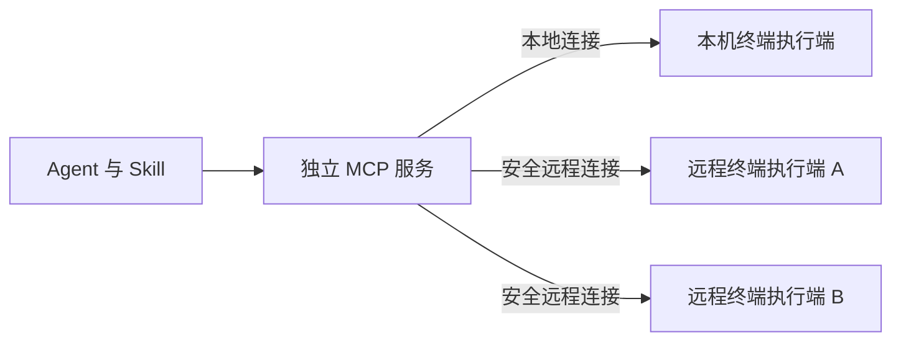

# OpenRemoteConnector 产品需求文档

版本：0.4；更新日期：2026-10-18；状态：需求提案，尚未实现或通过产品验收。

本文只定义产品职责、用户流程、行为规则与验收条件，不指定实现语言、通信协议细节、认证组件、沙箱实现或进程组织方式。本版沿用已确认的三部分划分：**Agent Plugin / Skill、独立 MCP 服务、终端执行端**，补齐连接、身份信任、执行契约、生命周期与升级验收要求。

同机部署与异机部署采用同一产品模型：MCP 始终是独立服务，通过本地连接或远程连接使用终端执行端；同机部署不合并两者职责，也不提供绕过终端执行端的另一套执行路径。

本版取代此前“禁止任何中转节点”“MCP 必须在目标终端上”“所有任务必须进沙箱”的需求。保留 Linux 第一优先级、macOS 第二优先级及便利安装目标。[当前 MVP](MVP.md) 补充开源对比、价值假设与首版验证；[当前架构与行为契约](ARCHITECTURE.md) 按本版定义职责、信任关系、状态与验收映射，尚未选定技术栈。[归档 MVP](history/MVP-2026-10-15.md)、[归档技术架构](history/ARCHITECTURE-2026-10-15.md) 和 [旧 Linux 沙箱设计](LINUX_SANDBOX.md) 仅供历史参考；发生冲突以本文的产品需求为准。

## 1 产品定位与目标

OpenRemoteConnector（简称 ORC）让用户通过自己选择和管理的 MCP 服务，将个人终端上的能力授权给 Agent 使用，并自主选择执行环境和放行规则。

首批用户是使用 Agent 的个人开发者，拥有 Linux 工作站、家庭服务器或 VPS，希望减少多设备接入与维护成本。产品首先解决以下问题：

| 用户问题 | 预期价值 |
| --- | --- |
| Agent 无法方便地使用已有设备环境 | 通过统一入口发现设备、发起操作、查看结果 |
| 多台设备需要重复配置 Agent 连接 | 一个 MCP 服务可管理多台终端，设备分别授权 |
| 对任务安全限制的需求不同 | 可选隔离执行、宿主直接执行，并配置自动放行、过滤或审批 |
| 不希望设备访问依赖项目方的服务 | 用户选择同机或独立服务器部署，无强制官方账号或托管中继 |
| 安装和维护多个组件过于繁琐 | Agent 侧一个 Skill 入口；Linux 一条命令进入安装向导；受支持桌面设备通过 App 安装 |
| 不清楚 Agent 操作了哪台设备、访问是否仍有效 | 操作明确绑定目标设备，可查看记录、撤销授权并查询任务停止结果 |

产品价值是灵活部署、统一连接与可选择的执行策略。是否存在持续使用需求仍需验证；不以支持 MCP 本身、连接数量或 GitHub stars 作为价值证明。

## 2 三部分产品划分

### 2.1 Agent Plugin / Skill

向 Agent 说明如何使用 ORC、连接 MCP 服务、选择设备和能力、发起任务、查询结果，以及处理拒绝、审批和离线状态。

交付目标为一个 Skill 入口，可包含配置模板与必要辅助脚本，优先使用宿主已有连接能力。需要原生 MCP 配置或登录确认的客户端，应明确展示必要步骤；不承诺任意 Agent 都能只加载文本就自动连通。

Skill 不保存长期秘密，不授予设备权限，也不代替用户批准策略变更。用户移除或 Agent 未加载 Skill 时，MCP 和终端的权限约束仍应生效。首版不要求 Agent 侧另装 ORC 常驻服务。

### 2.2 独立 MCP 服务

MCP 服务是面向 Agent 的统一能力入口，负责客户端访问控制、终端登记与发现、目标选择、操作转交、状态和结果呈现。

它可独立安装、配置、启动和停止，部署在目标终端所在机器或另一台服务器上。一个服务可以同时连接其所在机器的终端执行端和其他机器的终端执行端。

仅安装 MCP 服务不应自动获得其所在机器的执行能力。要操作该机器，仍须连接、登记并授权本机终端执行端。MCP 自己所在机器的资源与用户选定目标终端的资源必须可区分。

### 2.3 终端执行端

终端执行端负责与受信 MCP 服务连接、维护本机权限与执行策略、接收操作、提供执行环境、管理任务并返回状态和结果。

**终端执行端是必需组件，沙箱是可选执行环境。** 选择宿主直接执行时，连接、认证、任务管理和反馈能力仍然存在。终端所有者保留本机策略的最终决定权；MCP 可进一步限制访问，但不能扩大终端已允许的范围。

### 2.4 职责与安装边界

| 部分 | 用户主要操作 | 不应隐含获得的能力 |
| --- | --- | --- |
| Agent Plugin / Skill | 安装、选择 MCP 入口、按工作流使用设备 | 管理授权、改变执行模式、获取长期凭据 |
| 独立 MCP 服务 | 配置入口、登记终端、授权客户端、查看设备和任务 | 自动控制所在机器、绕过终端策略、让新设备继承全部权限 |
| 终端执行端 | 信任 MCP、选择账户与执行策略、配置工作范围、暂停或撤销 | 自动信任其他 MCP、默认提供管理员权限 |

“独立服务”是产品部署和生命周期要求；是否使用特定进程、容器或通信机制由后续技术设计决定。同机安装可由一个安装向导统一完成，但安装后仍展示两个独立组件及其连接状态。

## 3 部署与连接需求

### 3.1 统一部署模型

图中本地和远程连接属于同一个 MCP 到终端关系；Agent 的运行位置独立于这两种连接方式。图仅表达产品关系，不规定哪一方主动发起网络连接。

| 部署方式 | 安装内容 | 用户得到的体验 |
| --- | --- | --- |
| 同机部署 | 一台机器安装独立 MCP 服务及终端执行端，建立本地连接 | 单机用户一次向导完成；操作仍经过终端执行端和本机策略 |
| 集中部署 | 一台服务器安装 MCP 服务，各目标机器安装终端执行端 | Agent 配置一个 MCP 入口即可使用获准的多个终端 |
| 混合部署 | MCP 同时连接本机及远程执行端 | 同一入口选择不同目标，授权、任务与结果保持独立 |

### 3.2 连接原则

- 不强制依赖 ORC 官方账号、中央设备目录或项目方托管中继；用户可以独立部署并运行。
- 用户明确选择的独立 MCP 服务器，包括跳板机，是正式支持的服务节点，不再被“禁止中继”的旧要求排除。不自动将操作转交到用户未配置的其他服务。
- 分别验证 Agent 到 MCP、MCP 与终端两段连接。Agent 能访问 MCP 不代表目标终端在线；目标终端不必直接对 Agent 暴露网络入口。
- 本地连接仍需登记和权限检查，不因同机而自动信任。远程连接需验证通信对端、保护指令与结果，并支持凭据撤销。
- 不承诺任意网络环境下零配置连通，也不在需求层预先限定远程连接的建立方向。不可达时说明哪一段受阻，不能静默更换设备或引入未授权节点。
- 集中部署默认由用户信任 MCP 服务处理指令与结果；不承诺 MCP 看不到内容。Agent、MCP 服务与终端的信任关系必须在配置时清楚展示。

### 3.3 首版网络场景与安装前提

下表定义必须验证的用户场景，不指定打洞、隧道或中继产品。安装器先识别所选场景，展示两段链路的条件与额外成本，再安装对应组件。连通性必须从实际调用位置验证，用户打开浏览器的电脑可达不代表云端 Agent 可达。

| 场景 | 前置条件与用户步骤 | 首版交付与失败行为 | 额外服务与成本 |
| --- | --- | --- | --- |
| Agent、MCP、执行端同机 | Agent 支持本地接入；完成本机登记和客户端授权 | P0；不要求公网入口，验证本地完整调用 | 无需额外连接服务器 |
| 自己的两台设备同局域网或已有互通网络 | 一台部署 MCP；实际 Agent 和执行端均有获准路径连接它；确认地址、服务身份及所需网络设置 | P0；验证双向业务交互和身份；禁止以关闭身份校验解决连通问题 | 可复用已有设备与网络，无强制新增服务器 |
| 终端只能出站，已有可达的独立 MCP | 用户提供并信任 MCP 入口，终端允许访问该入口；Agent 也能访问它 | P0；必须支持终端不开放公网入站端口的完整任务闭环；连接机制后续确定 | 复用用户自有或选择的服务器，列明其费用承担者 |
| 云端 Agent 接入 | 相应账号有自定义连接权限；MCP 入口满足该 Agent 的地址、身份认证及安全连接要求 | P0 按声明的 ChatGPT 支持路径验收；不能仅凭设备侧自检显示云端可用 | 所需域名、证书、网络入口或平台连接服务的准备步骤与费用归属明确展示 |
| 两台设备均只有出站能力，无可达 MCP 或已配置连接服务 | 现有网络没有可验证的互通路径 | P0 必须早期诊断并报告缺失条件；该组合不承诺零配置互连，不自动购买服务器或注册第三方服务 | 用户可自行选择增加可达 MCP 或后续受支持连接服务；没有选择前保持未连通 |

“只能出站”场景的验收使用有明确出站许可的受限网络，不承诺穿透任意网络封锁。P0 不以自动 P2P 穿透或社区公共中继可用为前提，也不承诺项目方提供默认托管服务。未来增加第三方或社区服务时，必须单独声明接入范围、使用条件、运营方、费用及信任边界，不能因软件开源就推定公共资源可免费使用。

安装状态至少分为“组件已安装”“入口条件未满足”“连接身份已验证”“客户端调用已验证”“已获执行授权”。仅在所选实际客户端完成一次获准的无副作用能力查询后，才可显示该接入路径已验证；执行授权与任务成功另行显示。缺少网络条件时可由用户选择仅完成本地安装，但不得把它报告为远程配置成功。

## 4 用户、支持范围与核心场景

### 4.1 用户角色与优先级

MVP 面向单个所有者。该用户可同时管理 MCP 服务和多台终端，可授权多个 Agent 客户端；团队权限、跨所有者委托和多租户管理不在首版范围。

P0 表示首版发布必须验收，P1 表示随后优先扩展，P2 表示按需求评估。下表是支持目标，不是已验证兼容声明。

| 维度 | P0 | P1 | P2 / 首版外 |
| --- | --- | --- | --- |
| MCP 服务部署环境 | Ubuntu 24.04 LTS x86_64，可单独安装，也可与终端端共同安装 | macOS 同机完整安装体验 | 其他服务部署环境分别验证 |
| 终端设备 | Ubuntu 24.04 LTS x86_64，覆盖工作站与 VPS | Apple Silicon macOS；其他 Linux 组合随后验证 | Windows、WSL2、Intel Mac、NAS、树莓派等独立评估 |
| Agent 客户端 | Codex CLI；ChatGPT 远程 MCP 路径，需有相应账户权限 | Claude Code 优先互操作验证，随后其他 CLI、桌面和 IDE 客户端 | 未验证组合不得标为正式支持 |
| 部署形态 | 同机、集中和混合；一个 MCP 同时连接至少两台独立 Linux 设备 | Linux 与 Mac 混合设备 | 多 MCP 服务之间级联、自动故障转移 |
| 执行方式 | 隔离环境与宿主环境；自动放行、规则过滤和逐次确认 | 更多执行环境与细化策略 | 团队审批、企业策略中心 |
| 安装体验 | Agent 一个 Skill 入口；Linux 一条命令进入角色选择与初始化 | macOS 签名、公证 App；可选终端端或同机完整安装 | 其他设备在宣布支持时提供合适安装包 |

首版同一终端只需验证与一个 MCP 服务的有效信任关系；一个服务可连接多个终端。更换 MCP 服务需在终端重新确认，不迁移旧服务的客户端授权；同时信任多个 MCP 服务留待后续需求。

首版不专门提供远程桌面、键鼠录屏、既有终端会话接管、团队协作、公开插件市场、任意第三方 MCP 安装或跨服务聚合。第三方 provider 是后续扩展，不再作为本次三部分核心闭环的 P0 门槛。

宿主执行可调用执行账户已有工具；不承诺 ORC 自动安装或适配任意工具链、GPU、原生应用或系统管理操作。提供命令执行入口与为特定应用提供正式集成支持是两件不同的事。

### 4.2 用户故事

| 编号 | 用户故事 | 成功结果 |
| --- | --- | --- |
| US-01 | 我只想操作一台 Linux 机器 | 一次向导安装两个独立组件，通过本地连接完成任务 |
| US-02 | 我想让一台服务器管理工作站和 VPS | Agent 连接一个 MCP 即可选择获准终端，无需为每台终端重配 Agent |
| US-03 | 我不想让某个任务直接接触宿主项目 | 在隔离环境操作获准副本，提交修改供我审阅 |
| US-04 | 我信任某个 Agent，希望它直接使用已有环境 | 明确授权宿主直接执行后，无逐条审批地运行指令 |
| US-05 | 我只想自动放行部分操作 | 可设置规则，未匹配或不能判定的请求被拒绝或转审批，规则行为可预览 |
| US-06 | 我想先核对即将执行的操作 | 能看到设备、环境、账户和操作内容，再决定批准或拒绝 |
| US-07 | 我想立即停止某个客户端或某台设备的访问 | 后续请求被阻止，已有任务的停止或失联状态准确可见 |
| US-08 | 我不想手工拼装组件 | 一个 Skill 引导 Agent 接入；Linux 单命令、其他受支持桌面设备用 App 初始化 |
| US-09 | 我的服务器没有桌面环境 | 安装、信任确认、策略配置、审批和撤销都可通过 CLI 或已有 SSH 完成 |
| US-10 | 我想从同机使用扩展到多设备 | 为已有独立 MCP 添加远程终端，已有本地能力与策略不变 |

## 5 执行环境与放行策略

### 5.1 两个独立维度

| 维度 | 选项 | 用户可观察的行为 |
| --- | --- | --- |
| 执行环境 | 隔离环境 | 使用获准数据副本和限定工具环境，按所选隔离能力约束文件、网络及资源访问 |
| 执行环境 | 宿主环境 | 以所有者选择的执行账户运行指令，可使用该账户的真实文件、工具和网络权限 |
| 放行策略 | 自动执行 | 已认证、已获授权且满足设备策略的操作直接执行，不额外过滤或逐次确认 |
| 放行策略 | 规则过滤 | 依据用户配置判定允许、拒绝或转审批；明确规则作用对象和未匹配行为 |
| 放行策略 | 逐次确认 | 展示具体操作并等待所有者确认；拒绝、超时或内容变化均不执行 |

首版支持上述两维组合；“宿主环境 + 自动执行”称为**直接执行模式**，对应用户希望不增加指令过滤或逐条确认的用法。它仍要求可信连接、身份验证和有效设备授权，不自动使用 root，也不允许所有连接 MCP 的客户端共享该能力。

安装向导要求所有者明确选择环境和策略，初始无 Agent 执行权限；可以推荐隔离环境，但不强制安装沙箱后才能使用宿主模式。选择隔离环境后，如所需能力不可用必须报错，不能自动切换到宿主环境。模式变更影响授权条件时需重新确认，Agent 无权自行切换。

### 5.2 文件、规则与能力边界

- 隔离环境首版采用显式导出工作区的产品流程：可审阅文件清单，默认排除凭据配置、版本控制元数据、链接和特殊文件；任务使用副本，宿主变化不静默进入旧快照。默认无任务外网访问，工具输出仍可带出获准内容。
- 隔离产生的宿主修改通过具体差异申请，由所有者确认并检查基线后应用。自动执行隔离任务不等于自动允许回写宿主。
- 宿主模式可以直接修改执行账户可访问的真实文件，不强制经过快照或差异回写。若采用逐次确认，批准的是操作本身，不保证能够预览脚本造成的全部文件变化；自动执行或规则放行时不再追加逐次回写审批。
- 宿主模式的工作目录或命令过滤不等于文件访问隔离。若开放任意命令，实际影响范围取决于执行账户权限，界面不能承诺“只能访问所选目录”。命令可能读取该账户可访问的凭据或修改本机配置；不自动向任务注入 ORC 通信秘密，但也不能声称抵御同账户代码读取或篡改。
- 规则过滤需说明匹配对象、先后次序和默认动作，支持执行前预览。拒绝规则优先；未匹配默认拒绝，可由所有者改为待审批；无法可靠解析的表达不得猜测为允许。首版明确支持的规则形式，不承诺理解任意脚本的最终行为。
- 过滤是请求层控制，不能宣传为与沙箱等价。即使某个解释器或脚本入口被允许，仍可能产生规则未能识别的后续行为。
- 更严格的执行限制、资源上限及可用工具必须按环境展示。不能将隔离环境的文件、网络和资源保证套用于宿主模式。

### 5.3 最小命令与任务契约

首版提供非交互、有限时长的任务；不接管现有终端会话，不提供持续交互终端，也不在多次调用之间隐式保留 shell 状态。两种执行环境使用同一请求语义，实际可用工具和限制分别展示。

| 项目 | 必须定义的行为 |
| --- | --- |
| 命令形式 | 区分“程序及独立参数列表”和“指定解释器的脚本”。前者的参数按字面值传递，不隐式展开通配符、变量、管道或重定向；后者由声明的解释器解释。不得自动把一种形式改成另一种 |
| 目标与上下文 | 每个任务固定终端、账户、执行环境、工作目录和授权。未指定目录时使用所有者配置并可见的默认值；无有效默认值则拒绝，不使用 MCP 所在机器的目录代替 |
| 账户与环境 | 执行端验证所选账户可用且已获准使用；不可用时拒绝，不回退到服务账户或管理员。公布程序解析方式、默认环境和所有者允许的覆盖项；不默认加载交互式登录配置，也不自动继承 MCP 或执行端的全部环境变量与通信秘密 |
| 输入 | 可提供有上限的预先提交输入；未提供时输入结束。需要密码提示、交互式终端或后续键盘输入的工具不在首版契约内；不得无限等待，按任务期限结束并报告可获得的原因 |
| 输出与结束 | 区分正常退出、非零退出、启动失败、超时、取消和执行状态未知；正常退出时提供退出码，输出有限且标明截断。展示输出和差异时作为不可信文本处理，不执行其中的控制序列或内容 |
| 跨任务状态 | 宿主模式的文件修改可能持久存在，但上一任务的工作目录、环境变量和后台进程不成为下一任务的隐式会话。隔离任务的临时副本不自动复用；需要继续使用产物时，必须明确选择并重新检查读取或导入权限 |
| 重试 | 区分重试同一次任务与有意再次运行；同一次提交的重试返回原任务或未知状态，不能静默再执行。具体请求标识方式由技术设计确定 |

逐次确认展示上述有效上下文，以及待运行程序、参数或脚本和输入摘要；完整提交内容应可在所有者管理入口检查，不写入普通日志。批准绑定实际提交内容与策略版本。显式提交的脚本文本，以及以脚本文件形式提交的入口内容，审批后变化必须使批准失效；执行时须使用被批准的入口内容，无法保证时拒绝。脚本再读取的其他文件、导入依赖及外部状态不因此被冻结，界面必须区分“批准入口内容”和“保证全部行为未变化”。

规则模式首版只支持对声明字段做确定性匹配：客户端、终端、账户、执行环境、动作类别、工作目录、命令形式、解析后的程序身份及明确参数条件。首版至少提供精确匹配和显式不限制某字段的形式，不把自然语言意图、命令字符串前缀或脚本行为推断作为自动放行依据。配置时必须显示未受限制的字段；规则无效或引用未知字段时不能启用。

多个规则命中时，拒绝优先于转审批，转审批优先于允许；无匹配默认拒绝，可由所有者明确改为转审批。允许解释器、脚本形式或不限制参数，意味着接受该入口可能执行广泛行为，配置和预览须明确显示；不能仅因为外层命令匹配就声称内部命令通过检查。预览依据与实际执行一致，输入、解析目标或策略改变后重新判定。这些过滤要求仅适用于规则模式，不向宿主自动执行模式追加指令过滤。

### 5.4 隔离模式的可用工作流

P0 除隔离拒绝测试外，必须交付以下可重复的正向任务，不以“沙箱能启动”代替实际可用性：

| 工作流 | 输入与准备 | 成功结果 |
| --- | --- | --- |
| 读取并修改文本项目 | 所有者批准一份包含多个普通文本文件的项目快照 | Agent 读取并定位内容，隔离任务修改副本，产生可审阅差异；批准前宿主未变，批准后只应用获准变化 |
| 离线运行已有依赖的测试 | 发布包提供至少一类已声明工具环境及配套示例；依赖已包含在该环境或获准输入中 | 测试可重复执行，分别验证通过与失败的退出状态、有限输出和取消；全程不依赖任务外网 |
| 生成并读取产物 | 使用获准输入生成声明支持格式的报告或文件 | Agent 能在授权和容量范围内分页或分段读取；可申请保存至已授权位置，未经确认不修改宿主；过大、过期与无权读取分别反馈 |

发布时必须列明实际支持的工具、版本、依赖准备方法、输入和产物类型及上限，并提供不含真实凭据的完整样例。首版至少支持普通文本产物；其他格式只有声明并验收后才支持。用户在任务前通过所有者管理流程选择已验证环境、准备依赖并批准输入；不要求 Agent 在隔离任务中下载依赖，也不要求用户为官方样例自行构建运行环境。

依赖或所需工具缺失时报告缺失项及受支持的准备路径；不自动联网安装、不导入宿主全部依赖或凭据、不切换至宿主模式。任意项目的依赖解析、任意工具链自建及联网安装不属于首版保证。此处不指定工具语言、镜像格式或隔离后端，M0 必须用候选环境证明上述三类工作流可完成。

## 6 关键使用流程

### 6.1 安装与首次授权

1. Linux 用户运行一条安装命令，选择“仅 MCP 服务”“仅终端执行端”或“同机完整安装”，并按 §3.3 检查接入场景与前提；安装器处理所需组件、校验与诊断，不要求用户手工拼装。仅宿主模式不强制安装隔离运行环境；条件不足时在远程配置前说明缺失项和成本，不将本地安装成功等同于远程可用。
2. 同机完整安装在本地连接两个独立组件；集中部署在各终端安装执行端后，由所有者确认目标 MCP 的身份并完成登记。配对信息短期有效，不能替代执行授权。
3. 所有者在终端配置执行账户、可用环境、放行策略、操作范围与时限；在隔离工作流中确认导出文件。首次安装不自动授予任何 Agent 执行权限。
4. Agent 安装 ORC Skill 并连接 MCP，完成宿主要求的配置和认证；MCP 只显示当前客户端获准的设备和能力。
5. 用户授予指定客户端在指定终端上的权限。新增终端默认不向既有客户端开放；新增宿主执行能力不被旧沙箱授权覆盖。
6. Agent 明确选择设备和可用执行方式，发起任务；自动放行、规则判断或待审批行为与配置一致，结果带目标和执行环境。
7. 所有者查看状态及记录，可撤销客户端授权、暂停终端或停止组件。

“一个 Skill”是统一分发和使用入口，不保证所有宿主都能自动注册连接。“一条命令”是完整安装向导入口，允许必要的管理员、信任和权限确认，不等于零交互或穿透任意网络。发布入口尚未实现，本文不提供可执行安装地址。

macOS P1 通过签名、公证 App 完成相同产品流程，管理所选角色及必要运行环境；不得以要求用户手工部署多个运行时作为正式安装体验。

### 6.2 多设备与策略变更

一个 MCP 入口下展示稳定设备身份、名称、连接状态与当前可用能力。操作必须显式绑定目标设备；不能按同名目录、最近在线设备或默认排序自动替换目标。

所有者能分别暂停和撤销终端；撤销 A 不影响 B。新增设备、改变执行账户、扩大动作范围或降低执行限制都不能自动扩大旧授权。策略变更对在途任务的处理必须明示；收紧权限按撤销规则处理，不能让旧批准继续执行被禁操作。

### 6.3 生命周期与失联

关闭管理 CLI 或 App 窗口不等于停止服务。MCP 服务与终端执行端分别显示运行、暂停、停止和连接状态；开机运行需所有者明确启用。

停止 MCP 会使其连接的设备对 Agent 不可用，但不等于终端执行端已经退出。停止某个执行端只影响该终端。仅重启 MCP 不应重复启动任务或让终端遗忘本机策略；恢复后先核对状态再接受新请求。

任务一旦被接受，就具有独立于单次请求连接的可查询身份。任务是否仍获准运行取决于授权、截止时间、显式控制和 MCP 与执行端的失联策略，不以 Agent 是否正在轮询或保持某条请求连接为依据。

| 事件 | 任务与反馈行为 |
| --- | --- |
| Agent 的单次请求结束、结果流断开、会话重连、暂不查询或关闭界面 | 不自动取消已接受任务；在授权与期限内继续，重新认证为同一主体后可查询。请求未收到响应时先查询或重试同一次提交，不能推定未执行 |
| MCP 与执行端经确认失联，或 MCP 停止 | 终端按预配置策略处理：默认终止关联任务，可显式选择继续到原任务截止时间；期限不得超过授权有效期。停止请求和停止证据分别报告 |
| 任务显式取消、授权到期或撤销、终端本地暂停执行 | 终止相关任务，不因“失联后继续”配置而忽略。未启动操作及待审批请求失效；已发生副作用不回滚 |
| 执行端停止或故障恢复 | 尝试停止其管理任务；恢复先核对实际状态及当前授权，不恢复旧任务进程或重跑未知请求；无法确认的任务如实标记 |

MCP 与执行端失联检测必须有有界超时，显示当前值和状态，发布时给出经验证的取值；正常请求结束或 Agent 沉默不能作为该失联的判据。断线后不得向终端积压未经重新校验即可执行的新操作。远端发起撤销而终端不可达时，MCP 立即阻止该入口后续操作和结果读取，显示“服务端已阻止后续访问，终端停止待确认”；重连后先同步撤销与当前策略，再接受新任务或发布结果。即使允许失联任务继续，终端一旦获知撤销也须停止。

宿主模式尤其在开放同账户任意命令时，不承诺所有派生进程都可被可靠追回，也不承诺本机日志不可篡改。产品应尽力停止所管理的任务，并如实报告已确认、未知和失败；需要更强隔离和生命周期保证的用户应选择经过验收的隔离环境。

### 6.4 独立升级与版本兼容

MCP 与执行端分别显示软件版本、支持能力及当前组合是否兼容。发布时给出兼容范围和升级顺序；从第二个可发布版本起，必须验证新旧相邻发布版本分别作为 MCP 和执行端的组合，支持或不支持均需明确记录，不能仅测试两端同步更新。

执行前确认双方理解本次操作及其全部必需限制。不认识的执行环境、策略字段、审批条件或安全约束必须导致相关操作拒绝；不得丢弃未知字段后继续，不得自动改用宿主模式。若可安全提供状态查询则保留，并明确其限制；否则报告版本不兼容。本地停止与撤销入口不能依赖远端版本兼容。

升级前展示受影响任务与审批，默认停止接收新任务并等待活动任务结束；用户可明确选择取消任务后升级。无法确认终止时阻止正常升级并报告原因，不把重启当作停止证明。升级期间另一端是否仍可服务按实际连接状态显示；升级后先核对身份、授权、任务与能力，再接单。

产品提供的回退与备份恢复流程必须保留当前的撤销状态、策略收紧及已消费的批准记录，不能用旧备份重新激活权限或重复运行任务。无法确认恢复数据是否包含最新安全状态时，保持执行暂停，要求所有者重新授权，使旧批准失效且不重放历史任务；不宣称能识别所有者在产品外手工替换全部状态。不兼容当前状态的旧版本应拒绝启动执行能力并给出恢复路径，不清空配置“修复”。仍待处理的批准只有在内容、策略和语义均可验证时才保留，否则失效并要求重新审批。卸载沿用同样的任务处理与权限撤销要求。

## 7 功能需求与验收标准

下列 FR 均为 P0；“必须”是发布条件，不代表已实现。编号沿用并修订既有需求，新增独立服务与执行策略要求。

### 7.1 Agent Plugin / Skill

| 编号 | 需求 | 可观察的验收条件 |
| --- | --- | --- |
| FR-13 | 单入口接入与使用指引 | 安装一个 Skill 获得连接、选设备、运行、查询和异常处理指引；宿主要求的额外配置明确展示，不要求另装 ORC 常驻客户端；不在 Skill 或聊天中保存长期秘密 |

### 7.2 独立 MCP 服务与连接

| 编号 | 需求 | 可观察的验收条件 |
| --- | --- | --- |
| FR-02 | 设备登记与身份 | 显示稳定设备 ID、名称、关联 MCP 身份与连接状态；登记材料不可重复使用；改名不改变权限，不匹配的对端拒绝连接 |
| FR-03 | 本地和远程安全连接 | 同一 MCP 支持本地及远程终端；分别报告两段链路状态，所有连接验证身份；没有未经配置的节点或设备替换；不依赖强制官方服务 |
| FR-04 | 分设备授权 | 记录经验证的客户端、MCP、终端、动作、执行环境、策略与期限；初始无执行权限；一台设备的授权不能用于其他设备或其他环境 |
| FR-12 | 多设备统一入口 | 一个 MCP 连接至少两台独立终端，Agent 无需逐设备注册 MCP；仅列获准设备；每次操作和结果均绑定唯一目标，离线或同名不触发替换 |
| FR-14 | 能力发现与呈现 | 按目标设备显示可用环境、工具范围、策略和限制；同机与远程使用相同能力语义，不能把 MCP 所在机器的能力冒充目标能力。原第三方 provider 接入要求移至首版外 |
| FR-17 | MCP 独立部署 | 可以只安装和启动 MCP，此时不能执行宿主操作；登记本机执行端后才能操作；独立停止、重启 MCP 不导致执行端策略丢失，同机完整安装也符合此要求 |
| FR-21 | 网络前提与接入验证 | 按 §3.3 在安装前识别场景、条件及额外成本；覆盖同机、已有互通网络、仅出站终端接入可达 MCP 及声明的云端路径；缺少入口时早期诊断，不将安装成功等同于远程可用 |
| FR-22 | 客户端身份委托 | 按 §8.2 明确 MCP 的认证责任与失陷边界；Agent 自填身份不能替换已认证主体；终端按 MCP、账号、客户端区分授权，缺失或错误上下文拒绝，重连不扩权 |

### 7.3 终端执行端

| 编号 | 需求 | 可观察的验收条件 |
| --- | --- | --- |
| FR-05 | 隔离工作区导出 | 所有者可检查导出清单和排除原因，Agent 只能获取批准版本；宿主变化需明确更新后才能进入快照 |
| FR-06 | 文件与结果读取 | 隔离模式限制在获准快照；宿主模式清楚显示账户可访问范围及缺少隔离的限制；读取结果有权限与大小检查，不混入其他任务数据 |
| FR-07 | 可选隔离执行 | 按所选环境执行，隔离任务不能直接修改宿主项目或越过已声明边界；隔离条件缺失时报错，不能自动改为宿主执行 |
| FR-08 | 任务生命周期 | 发起任务返回可查询标识；显示客户端、目标设备、账户、环境、策略、截止时间和有限输出；普通请求连接结束不取消已接受任务；支持显式取消并区分请求已接受与终止已确认 |
| FR-09 | 审批与修改申请 | 逐次确认绑定具体操作和有效策略；隔离回写展示具体差异和基线。批准单次有效，参数变化、过期或撤销使其失效；Agent 不能批准自己的申请 |
| FR-10 | 按模式处理写入 | 隔离回写检查批准和基线，冲突或部分失败准确报告；宿主自动执行或规则放行可直接写入，不强加差异审批，也不声称可自动回滚或预知全部变更 |
| FR-11 | 撤销、暂停和停止 | 在执行端确认撤销后拒绝新操作并尝试终止关联任务；MCP 侧撤销立即阻止该入口后续操作和结果读取，失联终端显示停止待确认，不能误报成功 |
| FR-18 | 宿主直接执行 | 所有者显式配置执行账户与自动放行；已授权指令可使用该账户真实环境，无额外指令过滤或逐条确认。认证和授权仍必需，不自动提权，不继承沙箱授权 |
| FR-19 | 可配置放行规则 | 按 §5.3 支持确定性字段匹配和预览；拒绝优先于转审批，转审批优先于允许；未知不自动放行；参数与程序解析语义一致。修改规则不能静默扩大已有授权，不宣传为脚本行为分析或隔离保护 |
| FR-20 | 终端本机最终策略 | 拒绝 MCP 超出本机许可的操作；Agent 无权切换执行账户、降低策略或更换受信服务。更换 MCP 必须重新确认；声明不防御宿主同账户任意代码篡改 |
| FR-23 | 明确的任务执行契约 | 按 §5.3 区分参数列表与解释器脚本，固定目录、账户、环境和有界输入；无隐式交互会话；输出和结束状态可辨认；审批绑定入口内容，内容变化失效；重试与再次执行可区分 |
| FR-24 | 隔离模式正向可用性 | 按 §5.4 交付文本修改、离线测试和产物读取的完整样例与已验证环境；列明依赖准备路径及限制；缺失依赖不触发联网、凭据导入或宿主回退 |

### 7.4 安装、管理与可观测性

| 编号 | 需求 | 可观察的验收条件 |
| --- | --- | --- |
| FR-01 | 便利安装与诊断 | Linux 一条命令可选择三种安装角色并完成初始化；只安装所选能力的依赖；校验失败不启用不完整服务，重复运行不破坏已有配置，必要管理员操作集中说明 |
| FR-15 | 记录与隐私管理 | MCP 与终端分别记录主体、目标、环境、策略、动作类别、状态及拒绝原因，并可关联同一任务；默认不记录凭据、完整参数或正文，支持脱敏诊断及清理 |
| FR-16 | 断线、恢复与重试 | 按 §6.3 区分请求结束、Agent 暂离与 MCP—终端失联；只有后者触发预设失联策略；恢复先同步撤销、核对状态，重复请求不静默重跑或重复消费批准。无法证明是否执行时显示未知，不保证任意宿主副作用恰好发生一次 |
| FR-25 | 独立升级与兼容判定 | 按 §6.4 展示双方版本及兼容状态；未知必需限制不得忽略；混合版本行为可验证；升级处理在途任务，回退不恢复旧权限、批准或已完成任务 |

## 8 权限、隐私与默认行为

### 8.1 授权与策略规则

- 连接、登记、身份认证与执行授权是不同状态。登记设备不会向已有 Agent 开放它，登录 MCP 也不等于可用其全部终端。
- 有效权限受 MCP 访问规则与终端本机策略共同限制；任何一方拒绝都不能执行。终端不得只凭未验证的客户端显示名或聊天 ID 信任请求。
- 身份粒度为受信 MCP 下经验证的账号与客户端身份，不随单次连接变化；不承诺区分同一账号与客户端下的所有聊天会话。终端记录须能关联授权主体及其 MCP 来源，不把服务共享凭据当作所有 Agent 的共同执行授权。
- 初始无执行权限；默认授权期限建议一小时，用户可配置有限期限。执行环境、账户、动作和策略是授权内容，扩大权限需明确重新授权。
- MCP 和 Agent 不能通过业务工具批准自己的操作或关闭终端策略。直接执行模式授权的宿主代码仍可能以执行账户权限修改机器，这属于该模式的信任边界，不宣称可被请求层规则完全防住。
- 结果读取重新检查权限；所有者可在本地查看自己的结果。撤销无法回收已经返回的数据，也不自动撤销已发生的文件或外部系统副作用。
- 隔离失败不会自动降级；所有者可以另行选择并授权宿主模式。这是明确的产品选择，不是错误恢复路径。

### 8.2 客户端身份的委托信任

P0 采用产品层面的委托认证关系：所有者登记 MCP 时，明确允许该服务验证 Agent 客户端身份并向终端传达认证结果。终端验证来源确为当前受信 MCP，再按客户端主体检查本机授权；不要求终端重复执行客户端的原始登录流程。声明的传递格式与保护机制由技术设计决定。

授权主体必须稳定区分 MCP 身份、账号身份及客户端身份，不以显示名、网络连接或聊天会话作为身份本身。同一主体正常重连、凭据续期不改变其身份，也不延长本地授权；新客户端、另一个 MCP、重新创建的账号或无法证明连续性的身份不自动继承权限。MCP 重装或恢复不能仅凭原名称恢复信任；无法证明原身份时按新服务登记。

MCP 只能使用自己的认证结果建立客户端上下文，不能采信 Agent 在工具参数中自填的账号、角色或客户端标识来替换调用主体。执行端拒绝缺失、来源不匹配或已失效的身份上下文，并将任务、结果、批准与本机授权绑定到同一主体。MCP 的连接凭据仅证明服务身份，不能单独授权任何客户端执行；更换 MCP 需重新登记并授权，旧任务按撤销规则处理。

这一委托意味着：**受信 MCP 被攻陷后可能冒用已经获准的客户端，并在其授权范围内发起调用或读取结果。** 设备端限制其已批准的账户、动作、环境、策略和期限，但不能证明被攻陷 MCP 所声称的客户端确实发起了请求。P0 不承诺在 MCP 失陷后仍保持客户端身份真实性；若未来需要此保证，须另行定义独立身份验证或端到端委托需求。即使请求来自受信 MCP，本地管理审批和扩权仍不属于其业务权限。

### 8.3 数据流与隐私

| 数据或位置 | 可见性及要求 |
| --- | --- |
| 隔离输入 | 只提供明确导出的文件；排除规则不能保证源代码里没有秘密，应允许审阅实际范围 |
| 宿主数据 | 可被已授权指令按执行账户权限访问；不能声称未导出的文件在该模式下一定不可读取 |
| MCP 服务 | 可处理指令、返回结果及连接元数据，包括独立部署时；同时是客户端身份的受信认证方，失陷影响见 §8.2；不保证其不可见明文 |
| Agent 及模型提供方 | 可接触返回的内容；自托管、同机或隔离都不等于内容不会进入云端模型处理链路 |
| 连接凭据 | 各部分分别管理，不主动注入任务或复制进 Skill、聊天与普通日志；宿主同账户任意执行的风险另行明确 |
| 审计元数据 | MCP 与终端各自有界保存，初始默认 7 天，可由所有者清理；不是不可篡改审计承诺 |
| 输出与临时产物 | 初始最多保留 24 小时，容量有界、可提前清理；界面展示终端和 MCP 实际保留位置。清理某一侧不冒称已删除另一侧或 Agent 的副本 |
| 产品遥测 | 无强制内容遥测或官方收集端点；诊断默认排除凭据、文件正文和完整指令参数 |

无网络的隔离任务仍可通过输出将获准输入返回给 Agent；宿主任务还可能使用执行账户原有网络能力。不能以“隔离”或“连接由用户自托管”推断绝对数据保密。

## 9 状态、错误与非功能需求

### 9.1 用户可辨认的状态

| 对象 | 必须区分的状态 | 反馈要求 |
| --- | --- | --- |
| MCP 服务 | 未配置、运行、暂停、停止、Agent 连接失败 | 明确服务本身和 Agent 入口是否可用 |
| 接入配置 | 组件已安装、入口条件未满足、连接身份已验证、客户端调用已验证 | 显示实际验证路径及缺失前提；执行授权另列，不从本地自检推断云端可用 |
| MCP 与终端连接 | 未登记、待确认、在线、失联、信任撤销、版本不兼容 | 与执行端进程是否运行分别展示；说明受阻链路、版本和受影响能力 |
| 终端能力 | 可用、被策略禁用、环境缺失、资源不足 | 不能用宿主模式自动替代缺失的隔离环境 |
| 授权 | 待批准、有效、拒绝、到期、撤销 | 标明设备、账户、环境与策略；停止任务状态另列 |
| 任务 | 已接受、启动中、运行、完成、失败、取消中、已终止、超时、停止待确认、终止失败、执行状态未知 | 未收到结果不能推定未执行；未知状态不能自动重跑；待审批不等于已获准启动，输出流断开与任务状态分开 |
| 审批或差异 | 待批准、拒绝、过期、失效、冲突、已应用、部分失败 | 解释受影响内容和可采取的下一步 |
| 输出 | 可读、截断、已清理、无权限 | 清理不代表任务未执行；返回大小与读取范围明确 |

### 9.2 非功能需求

| 编号 | 需求与验收标准 |
| --- | --- |
| NFR-01 权限一致性 | 同机、集中和混合部署采用相同身份、目标和授权语义；必要检查失败拒绝操作，不因本地连接、在线状态或操作方便而扩权 |
| NFR-02 限制可验证 | 隔离环境的文件、网络、CPU、内存、进程和存储限制分别验收；所有模式的请求和输出有界，任务有截止时间。宿主无法提供的强限制明确标注，不作等价保证 |
| NFR-03 生命周期准确性 | 分别验证 Agent 请求连接结束与 MCP—终端失联；撤销和故障清理覆盖两段链路及两个服务；超时与实际终止分开表示，不将停止请求当作停止证明，不误伤无关任务 |
| NFR-04 安装与诊断可用性 | P0 全流程无需图形桌面；非作者用户可按指引完成三种安装角色、Skill 接入和任务执行；分别记录实际手动步骤和阻塞点 |
| NFR-05 兼容性可追溯 | 发布记录 Agent、MCP 环境、终端系统、连接方式及执行模式的测试组合；同机通过不代表远程通过，Linux 通过不代表 macOS 通过 |
| NFR-06 独立维护 | MCP 和执行端可分别升级、停止和卸载；按 §6.4 发布版本兼容范围，拒绝未知必需限制；升级与回退保留当前授权收紧和已消费批准，不能静默扩权；卸载说明连接撤销、任务处理与数据保留，不删除用户项目。不设置产品订阅调用额度，允许技术限流 |
| NFR-07 数据最小化 | 日志、诊断、插件和错误反馈不主动泄露秘密或正文；跨组件复制与保留位置可说明，清理行为可验证 |
| NFR-08 故障范围可见 | 一个终端故障不阻止其他终端的正常请求；MCP 故障影响其所有接入设备且清楚展示。首版不承诺自动切换 MCP、设备或执行模式 |

具体资源额度、MCP—终端失联检测时限和性能目标由后续设计及测试确定，必须在发布前形成可复验参数，不能以旧沙箱设计的参数当作全部执行模式的承诺。用户承担其选用的设备、服务器、模型与网络服务成本；安装向导需列明额外服务及费用归属，不推定项目方提供免费公共基础设施。

## 10 发布验收场景

以下为 Linux P0 验收要求，使用专用工作区和人工测试凭据；这些场景不是本次已执行的测试。

| 编号 | 前置条件与操作 | 预期结果 | 关联需求 |
| --- | --- | --- | --- |
| AC-01 | 干净 Linux 分别选择仅 MCP、仅执行端和完整安装；重试安装并模拟校验失败 | 单命令向导先说明网络前提再安装所选角色，不强制安装未选择的沙箱依赖；失败不启用不完整服务，安装状态与接入状态分开 | FR-01、FR-17、FR-21 |
| AC-02 | 只启动 MCP 后尝试操作本机；随后登记并授权本机执行端 | 前者无执行能力，后者经本地连接执行；任务经过执行端策略 | FR-03、FR-17、FR-20 |
| AC-03 | 已有本地执行端的 MCP 再接入一台独立远程 Linux | Agent 仍用一个入口；可明确选择两台设备，能力与结果不混淆 | FR-12、FR-14 |
| AC-04 | 新增终端，或使用 A 的授权请求 B；Agent 登录但无执行授权 | 请求均拒绝；新终端不继承其他设备或客户端权限 | FR-02、FR-04、FR-12 |
| AC-05 | 隔离任务尝试访问未导出文件、宿主服务、外网及超额资源，另模拟隔离不可用 | 拒绝或按声明限制终止；环境不可用不转宿主执行 | FR-05、FR-06、FR-07、NFR-02 |
| AC-06 | 所有者配置宿主自动执行并授权，运行会修改测试文件的指令 | 在选定账户实际环境执行，无逐条过滤或差异审批；无授权及错误设备请求仍被拒绝 | FR-04、FR-10、FR-18 |
| AC-07 | 分别配置允许、拒绝、转审批，测试未匹配、未知字段、无法解析输入和重叠规则，再变更参数或程序解析目标 | 无效规则不能启用；预览与实际判定一致，拒绝优先于转审批再优先于允许；变化后重判，未知不自动放行；说明规则不等于隔离 | FR-19、FR-23 |
| AC-08 | 在两种环境选择逐次确认，修改已批准的参数或重复提交批准 | 显示明确目标与环境；仅原请求可单次消费，变化后重新审批 | FR-09、FR-19 |
| AC-09 | 隔离任务提出修改；批准前宿主文件改变，并模拟多文件部分应用失败 | 冲突不静默覆盖，部分结果逐项报告，不自动重试整批 | FR-09、FR-10 |
| AC-10 | Agent 或 MCP 请求从隔离切换至宿主、改变账户或放宽本机策略 | 未经所有者重新授权不得执行；同机与远程行为一致 | FR-04、FR-07、FR-20、NFR-01 |
| AC-11 | 运行中在 MCP 侧撤销，分别测试终端在线和失联；另在终端本地撤销 | 服务端立即阻止后续访问；本地撤销生效；远端停止只按实际证据报告，失联不能误报完成 | FR-11、NFR-03 |
| AC-12 | 保持 Agent 可访问 MCP，但阻断 MCP 与终端；分别配置默认停止与继续到截止时间，失联期间再撤销授权并重连 | 有界检测后按终端策略执行；MCP 撤销立即阻止该入口访问，终端停止待确认；恢复先同步撤销再接单，继续策略不能覆盖撤销或到期，不静默重跑 | FR-08、FR-11、FR-16、NFR-03 |
| AC-13 | 分别停止或重启 MCP 与某一终端，另使一台设备离线或重名 | 两个组件状态准确；终端本机策略保留，其他终端不受单设备故障影响，目标不替换 | FR-12、FR-16、FR-17、NFR-08 |
| AC-14 | 非作者用户安装一个 Skill，使用 Codex CLI 及 ChatGPT 对接 MCP | 必要宿主配置明确；两种客户端完成各自支持路径，无长期秘密进入聊天或 Skill | FR-13、NFR-04、NFR-05 |
| AC-15 | 审查 MCP 与终端记录、导出诊断、到期清理输出 | 能关联任务但不默认记录正文或秘密；清理说明实际位置，不声称删除 Agent 副本 | FR-15、NFR-07 |
| AC-16 | 宿主任务派生子进程，测试超时、取消、终止失败和状态未知 | 尽力停止所管理任务并如实显示边界；不误杀无关进程，不声称任意副作用可回滚 | FR-08、FR-16、FR-18、NFR-03 |
| AC-17 | 终端撤销旧 MCP 信任，再登记另一个同名 MCP；包含旧任务与待审批操作 | 旧连接不再接单，旧任务按撤销处理，批准失效；新服务不能凭相同名称继承旧客户端授权，没有自动切换 | FR-02、FR-04、FR-20、FR-22 |
| AC-18 | 分别升级和卸载 MCP、执行端，检查同机与集中部署 | 不重置授权或删除项目；显示受影响连接、任务及残留数据，不因卸载一端声称另一端已停止 | FR-01、FR-17、NFR-06 |
| AC-19 | 任务返回标识后，正常结束请求、断开结果流、停止轮询或重新建立 Agent 会话；另模拟接受成功但响应丢失后重试同一次提交 | 有效授权和期限内任务继续；同一主体可重新查询，原任务不重复执行；新主体无权读取。显式取消才进入取消流程，MCP—终端连接不受影响 | FR-08、FR-16、FR-22、FR-23 |
| AC-20 | 客户端 A 有宿主授权、B 只有隔离授权；B 自填 A 的身份字段；再向终端提交缺失主体、错误 MCP 来源或只有服务凭据的请求 | MCP 以实际认证的 B 判定，不能替换为 A；终端拒绝缺失或错误上下文；测试明确以 MCP 正确执行认证为前提，配置说明其失陷后可冒用已有主体的边界 | FR-04、FR-20、FR-22 |
| AC-21 | 同一客户端重连或续期；增加新客户端；以无法证明原身份的同名账号或重装 MCP 接入 | 原身份的授权范围与到期时间不变；新身份不继承授权，需重新登记或批准；两端任务记录保持正确关联 | FR-02、FR-04、FR-15、FR-22 |
| AC-22 | 验证同机、已有互通网络和只允许访问指定 MCP 的出站终端；另从实际 ChatGPT 调用环境验证入口与认证 | 支持场景完成能力查询及获准任务，出站终端无需公网入站端口；分别报告两段链路，不依赖未经配置节点；记录服务准备步骤和费用归属 | FR-03、FR-12、FR-13、FR-21 |
| AC-23 | 两台设备仅能出站且没有可达 MCP 或已配置连接服务；另模拟云端无法访问但本地自检成功 | 向导早期说明缺失条件，可仅安装本地组件；不得显示远程或云端已验证，不自动购置或注册服务，不建议跳过身份校验 | FR-01、FR-21、NFR-04 |
| AC-24 | 在两种环境验证参数字面值与脚本两种形式，包含空格、变量、管道、重定向；更改目录和允许的环境覆盖；测试账户或程序不存在 | 两种形式语义可区分，参数列表不被隐式解释；目录、账户和环境符合展示，缺失时不静默回退；不继承上一任务会话状态，不自动泄露控制层环境 | FR-18、FR-19、FR-23 |
| AC-25 | 提供有界输入、空输入与要求交互终端的命令；测试正常退出、非零退出、超时、输出洪泛和包含终端控制字符的输出 | 输入有明确结束，交互等待受任务期限约束；退出码与结束原因准确，输出截断可见；管理界面和终端不执行输出中的控制序列 | FR-08、FR-15、FR-23、NFR-02 |
| AC-26 | 审批脚本文本或脚本文件入口后改变入口内容，再改变参数、输入或策略；另测试脚本读取的外部依赖发生变化 | 已批准入口内容不会被替换执行，变化使批准失效；无法保证使用批准内容时拒绝；明确审批不冻结所有外部依赖，不把入口批准宣传为完整行为保证 | FR-09、FR-19、FR-23 |
| AC-27 | 由非作者按发布说明，在无任务外网条件下完成 §5.4 的文本修改、离线测试及产物读取；另去掉一个必需依赖 | 三类工作流均完成，正常失败与成功可区分，宿主修改仍需批准；缺依赖说明准备方法，不联网、不导入宿主凭据、不切换环境；记录工具版本和实际步骤 | FR-05、FR-06、FR-07、FR-10、FR-24、NFR-04 |
| AC-28 | 分别组合新 MCP 与旧执行端、旧 MCP 与新执行端；请求对端不支持的操作或必需策略字段 | 兼容组合按发布清单工作；未知操作或限制明确拒绝而非丢弃，状态能力按声明保留；本地停止和撤销仍可用 | FR-14、FR-20、FR-25、NFR-05 |
| AC-29 | 有运行任务及待审批请求时升级任一端，分别选择等待与取消，并模拟无法确认终止 | 默认停止接单并等待；取消结果如实报告，无法确认时阻止正常升级；升级后先核对任务和权限，批准只在语义与内容仍有效时保留 | FR-08、FR-09、FR-16、FR-25 |
| AC-30 | 升级后撤销授权、收紧策略并消费一次批准，再通过产品流程回退或恢复早期状态备份 | 不能重新激活已撤销权限、放宽策略、复用批准或重跑任务；无法确认最新安全状态时暂停执行、重新授权且旧批准失效；无法兼容时拒绝启用执行能力并给出恢复指引；不宣称抵御所有者在产品外手工篡改全部状态 | FR-04、FR-09、FR-20、FR-25、NFR-06 |

## 11 交付顺序与价值验证

以下是产品能力交付顺序，不构成技术选型或工期承诺。

| 阶段 | 用户可获得的能力 | 出口条件 |
| --- | --- | --- |
| M0 可行性验证 | 验证三部分职责、§3.3 网络路径、§8.2 委托身份、两类环境及最小任务契约 | 真实 Agent 接入、出站终端、普通请求断开后任务继续和隔离正向工作流有可重复证据；支持条件与失败行为明确后才进入完整实现 |
| M1 同机闭环 | 独立 MCP 经本地连接执行端，完成授权、运行、结果与撤销 | 仅 MCP 无本机执行能力；两维执行配置与审批流程通过 |
| M2 集中与混合部署 | 一个 MCP 连接至少两台独立 Linux 终端，含本机及远程组合 | 独立授权、目标选择、失联与恢复通过；Agent 不需逐设备重配 |
| M3 便利安装与管理 | Linux 单命令分角色安装，Agent Skill，网络前提诊断、升级及卸载 | 非作者用户可完成全流程，缺入口早期报告；版本兼容、在途任务及回退权限保持验收通过，额外步骤与费用可理解 |
| M4 Linux 试用 | 固定版本、兼容记录与真实任务试用 | 全部 P0 场景通过，收集需求价值和执行模式反馈 |
| M5 macOS 扩展 | App 安装、终端端及同机完整部署、混合设备使用 | 独立通过连接、权限、两类环境、休眠和生命周期验收 |

建议 M4 邀请 5–10 位目标用户试用两周，记录首次任务成功率、安装与配置成本、重复使用、第二台设备使用情况、各执行模式的选择原因和被阻塞的真实任务。人数与周期是调研计划，不是已有验证结果。

重点验证用户是否理解三个部分、是否能区分“信任 MCP”和“允许某个 Agent 操作某台设备”，以及选择宿主执行时是否准确理解账户影响范围。不能把默认开放宿主权限产生的高完成率当作安装或产品价值改善。

继续投入的依据是出现可重复工作流，且用户能接受安装、连接和权限配置成本。具体数值目标待取得试用基线后确定。

## 12 待验证事项与变更记录

待验证事项：

- 同机、集中和混合部署各占多少真实需求，是否需要同时信任多个 MCP？
- 哪些宿主任务是必需能力，用户愿意使用怎样的执行账户和放行规则？
- §5.3 的最小规则范围是否足够有用，用户能否理解解释器放行与文件隔离的区别？扩展规则需另行定义与验收。
- 默认授权期限、失联停止策略及结果保留时间是否适合长任务？
- 各 Agent 的 Skill 接入需要哪些原生配置，单入口体验能否稳定复现？
- §3.3 的网络场景覆盖多少目标用户；是否有必要增加第三方连接服务，谁提供与承担费用？
- 哪个候选工具环境能完成 §5.4 的正向工作流，资源上限和准备步骤是否可接受？
- macOS 的核心需求是文件和命令执行，还是需要另外定义的桌面与原生应用能力？

v0.4 主要变更：

1. 区分单次请求结束、Agent 暂离、MCP—终端失联和显式取消，明确任务、撤销及重连行为。
2. 明确 MCP 受托验证客户端身份，补充稳定主体、身份伪造拒绝和 MCP 失陷的信任边界。
3. 增加网络场景、安装前提、实际客户端验证及费用归属，不承诺无入口时自动连通。
4. 定义两种命令形式、执行上下文、输入输出、审批内容绑定、重试与最小规则范围。
5. 增加隔离模式的三类正向工作流、依赖准备与失败反馈要求。
6. 增加独立版本兼容、在途升级与回退不恢复旧权限的行为和验收条件。
7. 新增 FR-21 至 FR-25、AC-19 至 AC-30，更新关联需求、状态与交付门槛；旧设计入口标记为历史参考。本轮不确定技术栈。

v0.3 保留的主要决策：

1. 明确三部分职责；MCP 在同机与异机部署中均为独立服务。
2. 允许用户自建集中 MCP 节点，取消每台终端必须直接面向 Agent 的要求。
3. 隔离环境可选，新增宿主直接执行；将执行环境与放行策略拆为两个独立维度。
4. 将快照、差异审批和隔离保证限定到对应工作流，不再覆盖所有宿主任务。
5. 保留 Linux 优先、macOS 第二及便利安装要求；第三方 provider 集成移至核心首版之外。
6. 区分 MCP 停止、终端失联、授权撤销和实际任务终止，补充集中部署的信任与隐私边界。
