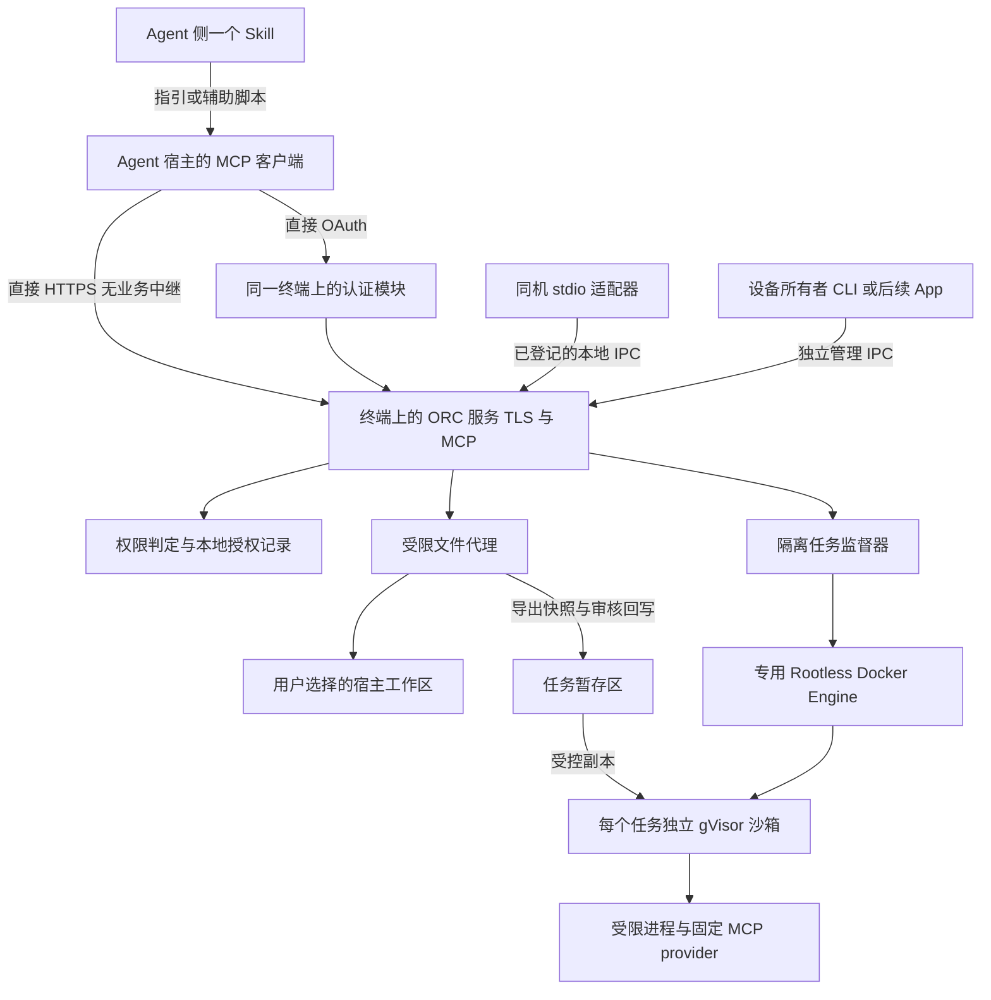

# OpenRemoteConnector 技术架构与组件复用

> **历史参考，不作为实现或选型依据。** 自 2026-10-18 起，以 [PRD v0.4](../PRD.md) 为当前产品需求。独立 MCP、可选宿主执行及委托身份等需求尚未形成新技术方案；下文的拓扑、语言、组件和后端选择均为旧提案，本轮未重新确认。

原文更新日期：2026-10-15。历史状态：待实现提案；关联历史文档：[旧 MVP](../MVP.md)、[旧 Linux 沙箱设计](../LINUX_SANDBOX.md)。

当前用户场景、功能要求与产品验收见 [产品需求文档](../PRD.md)；以下仅记录旧需求下的组件和执行边界。

核心决策是让 MCP 与权限执行驻留在终端设备，使用现成组件处理传输、身份认证和进程隔离。Linux 首版采用 Rootless Docker Engine + gVisor runsc / systrap，提供 CLI 与 systemd 用户服务；macOS 后续接入 Apple container。ORC 自己实现设备与工作区授权、文件进出隔离环境的规则、任务生命周期、撤销和管理入口。

## 1 架构总览



HTTPS 与认证均终止在目标设备；取消原独立网关、Caddy 转发、frp 反向隧道及远端 Keycloak 部署方案。不新增第三台主机来转发请求，即使由用户自建也不允许。这里的 Agent 端是实际发起工具请求的运行环境，不一定是用户打开浏览器的电脑。

同机模式只经过 stdio 适配器、本地 IPC 和设备服务；异机模式使用直接可达的设备 HTTPS 地址。本地与远程共享能力和策略实现。标准网络路由与明确配置的 NAT 映射可以存在，但不能引入应用代理、VPN 中转节点或中继回退。

设备服务、文件代理、监督器和容器引擎运行在宿主用户环境中；任务与第三方 provider 才进入沙箱。引擎不向 Agent 暴露通用 Docker API。macOS P1 用 Apple container 替换图中的 Linux 执行后端，保持授权和工具契约一致。

## 2 四个责任边界

| 层 | 负责 | 不负责 |
| --- | --- | --- |
| Agent Skill 与宿主客户端 | 单一安装入口、必要配置辅助、直接连接、说明能力与处理待审批状态 | 授权最终裁决、保护秘密、沙箱、证明调用者身份 |
| 设备上的连接与认证模块 | TLS 终止、OAuth 身份、证书维护、连接限流与直连诊断 | 决定本地目录权限、批准回写、绕过设备端禁用 |
| 设备授权与文件代理 | 校验身份和授权、限定工作区、校验每次操作、审核回写、审计和撤销 | 把自然语言“安全承诺”当权限、仅凭命令名称断定行为安全 |
| 执行沙箱 | 限制任务和 provider 的文件、网络、进程与资源访问 | 证明代码可信、保证结果无敏感信息、撤回已发送的数据 |

第三方 MCP Server 即使只宣称提供文件工具，也可能在被调用之前执行代码。因此隔离必须在启动 provider 时建立，而非只对 `tools/call` 参数过滤。MCP 本身不提供操作系统沙箱。[MCP 本地服务安全说明](https://github.com/modelcontextprotocol/modelcontextprotocol/blob/main/docs/docs/2026-07-28/tutorials/security/local-server-security.mdx)

## 3 威胁边界与明确的信任关系

保护对象是未授权文件和凭证、错误设备上的数据、其他客户端或工作区的隔离数据，以及设备的可用性。将 Agent 请求、工具参数、项目内容、工具输出及第三方 provider 视为不可信输入。

设备操作系统、ORC 设备服务、管理 CLI、专用 rootless 引擎、runsc 及设备认证模块属于可信基础。gVisor 是用户态内核沙箱，不是每任务硬件 VM，仍依赖宿主内核，且存在系统调用兼容性与性能代价。直连移除了中继服务信任方；Agent 宿主和模型服务仍可读取返回内容。设备公开监听带来扫描、认证滥用与拒绝服务风险，必须有认证前限额、请求大小限制与失败限流；不把“不经中继”描述为免认证或绝对隐私。[gVisor 安全模型](https://gvisor.dev/docs/architecture_guide/security/)

首版不防御已取得宿主同用户任意代码执行或 root 权限的攻击者。若本机 Agent 已有不受 ORC 控制的文件和 shell 工具，它也可能绕开 ORC。给某条 MCP 连接加沙箱不等于给整个 Agent 加沙箱。

Linux 端不授予任务宿主 root、docker 组权限、宿主网络、X11/Wayland、D-Bus 或 SSH agent socket。安装前置包、subuid/subgid 分配、cgroup 委派等可能需要管理员配置，与任务 rootless 运行分开。macOS P1 默认不申请全盘访问、辅助功能或录屏权限；原生桌面适配器需另行设计。

## 4 设备端授权模型

### 4.1 身份与授权分开

远端身份键为经过验证的 `issuer + subject + OAuth client_id`，资源绑定固定设备端点。客户端显示名、请求中的 `agent_name`、Skill 内容和 MCP session ID 都不能作为身份凭据。

本地 stdio 适配器由设备所有者通过管理 CLI 登记，获得特定客户端的本地凭据，连接受文件权限和 peer credential 校验保护的 Unix socket。设备管理 IPC 与工具 IPC 分开；工具凭据不能批准权限。用户可通过自己的 SSH 会话在设备上运行管理 CLI；ORC 不把 SSH 能力暴露给 Agent。此措施不宣称能抵抗宿主同用户恶意进程。

授权记录由设备保存，包含：

| 字段 | 含义 |
| --- | --- |
| `grant_id`、`policy_revision` | 授权标识和策略版本；更新或撤销使旧执行许可失效 |
| `principal` | 已验证的远端身份或本地登记身份 |
| `device_id` | 密钥绑定的设备身份，不由名称决定 |
| `workspace_id`、`snapshot_id` | 本地登记的工作区及批准导出的版本 |
| `actions` | 如 `workspace.read`、`job.run`、`changes.propose` |
| `execution_profile` | 隔离后端、固定镜像、资源限制和网络策略 |
| `expires_at`、`revoked_at` | 本地授权期限与撤销状态 |
| `approval_mode` | 工作区快照授权、修改逐次确认等明确模式 |

有效权限是“令牌 scope、本地 grant、设备全局限制、执行环境限制”的交集。默认拒绝。新工具、新 provider 或新增权限不自动纳入旧 grant。

一个 OAuth 客户端中的多个会话可能共享身份。首版承诺按“账号与客户端连接”隔离，不把无法验证的聊天 ID 当作每个 Agent 实例的独立身份。需要会话级隔离时，必须增加可验证的独立委托凭据。

### 4.2 执行前检查

每个调用依次完成身份验证、设备绑定、工具参数校验、工作区与动作授权、资源配额检查及执行前策略版本确认。工具枚举只展示获准能力，但隐藏工具不能代替执行时检查。

文件路径不直接用于权限判断。先解析到已登记工作区内的资源，逐级拒绝链接和路径穿越，验证已打开的句柄；不能只使用字符串前缀或一次 `realpath`。MVP 对符号链接、具有多个硬链接的文件、设备文件和 socket 直接拒绝。

批准事件绑定客户端、设备、工作区、动作、规范化参数摘要、快照版本、策略版本和期限；只能消费一次。参数变化后重新请求批准，不能复用“刚才允许过写文件”的确认。

### 4.3 撤销与失败行为

本地撤销立即落盘并递增策略版本，阻止新操作、待处理批准和回写，通知监督器终止关联 sandbox/provider。Linux 按引擎容器 ID 和 ORC 所有权记录停止整个 runsc 实例，不能只杀启动 CLI。终止超时则强制停止并验证进程与实例消失。无法证明已停止时标记 `termination_failed`，不显示“已全部停止”。

撤销不撤回已经返回给云端的数据，也不自动回滚已经应用的文件修改。旧输出只有仍有读取权限的同一主体可以远程获取；设备所有者可以在本地查看和清理。

工作区写入与撤销共享设备侧执行锁，明确操作在线性化点之前还是之后获准。已完成写入保留审计记录。授权过期、重启或系统休眠恢复后先重新校验，再开放执行；系统时钟异常时拒绝延长授权。

## 5 沙箱与文件流

### 5.1 Linux P0 后端决策

选择 **Rootless Docker Engine + gVisor runsc / systrap**。引擎复用 OCI 镜像与实例生命周期管理，gVisor 限制应用直接接触宿主系统调用接口，rootless 降低执行链的宿主权限。systrap 不要求 `/dev/kvm`，适用于没有嵌套虚拟化能力的 VPS；不使用 rootful daemon 或把用户加入 docker 组来冒充 rootless。[Rootless 运行方式](https://gvisor.dev/docs/user_guide/rootless/)、[systrap 平台](https://gvisor.dev/docs/user_guide/platforms/)

首版只支持 Ubuntu 24.04 LTS x86_64 基线，安装诊断必须验证 user namespace、subuid/subgid、cgroup v2、systemd 控制器委派、runsc 与 LSM 策略。不能只根据系统版本判断可用。缺少条件时拒绝执行，不自动全局关闭 AppArmor/SELinux，也不回退到 runc、bubblewrap 或宿主 shell。rootless 下资源限制对 cgroup 与 systemd 有条件要求，必须检查实际效果。[Docker rootless 资源限制](https://docs.docker.com/engine/security/rootless/tips/#limiting-resources)

ORC 使用专用引擎 socket、配置与数据目录，不修改用户现有 Docker 默认 context，也不管理其无关容器。每个任务/provider 独立 sandbox；固定镜像、只读 rootfs、非 root 工作负载 UID、清空 capabilities、no-new-privileges；不允许 Agent 传入 OCI 注解、宿主挂载、运行时参数或任意环境变量。

网络同时使用引擎独立的无网络 namespace 和 runsc 的 `--network=none`；沙箱内可有自己的 loopback，不得连接宿主 loopback、抽象 Unix socket、局域网或公网。无端口发布、代理、设备或管理 socket。镜像只在受信安装/更新流程获取，任务不能触发任意 pull/build。[gVisor 网络控制](https://gvisor.dev/docs/user_guide/networking/)

任务输入为只读快照，写入发生在有容量限制的临时文件系统；输出经限量通道收集，再由文件代理审核。CPU/内存由 cgroup v2 限制，进程、线程、存储、日志和墙钟时间另有可验证限制；不能把 cgroup 内宿主 PID 数等同于沙箱内进程数。详细限制、清理与实验矩阵见 [Linux 沙箱设计](../LINUX_SANDBOX.md)。

`SandboxBackend` 提供 `probe/create/start/status/terminate/destroy` 并返回后端类型、版本、有效控制项和实例身份；授权固定执行 profile，后端变化要求重新授权。Apple container 是 macOS P1 的独立适配；Firecracker 留作需要硬件虚拟化边界的后续方案，P0 不同时实现多个后端。

### 5.2 工作区导出和回写


P0 不直接把真实项目以可写卷挂进沙箱。文件代理复制已允许的普通文件，限制总大小，跳过 `.git`、凭证配置、ORC 数据和链接。Linux 通过受限文件句柄解析，优先使用 `openat2` 的目录约束并核验对象；回写再次检查基线与授权，不能依赖启动时路径检查。排除规则不能发现所有嵌在源代码中的秘密；管理 CLI 必须能显示导出清单，快照更新重新明确授权。

快照代表用户允许 Agent 获得的内容；工具输出也视为数据导出渠道。即使任务无网络，仍可把快照内容写到 stdout 再返回给云端，所以“无网络”不等于“数据绝不离开设备”。

回写不执行 `git apply` 的任意扩展行为、项目 hooks 或任务返回的宿主脚本。文件代理只接受限定路径的普通文本变更，核对基线内容摘要，并在回写时重新校验路径和策略。单文件原子替换；首版不声称多文件批次具有文件系统事务原子性。冲突或部分失败明确显示，并停止自动重试。

默认拒绝回写会改变 Agent、编辑器或工具自动执行行为的控制配置，例如 ORC 配置、Agent hooks 和自动执行任务配置；未来需要修改时独立授权。普通源代码的修改也可能在用户之后运行项目时产生作用，差异界面应显示实际内容，而不是把“已在沙箱测试”当作代码可信证明。

### 5.3 macOS 第二阶段与宿主能力

macOS P1 使用 Apple container，在 Apple Silicon/macOS 26 起提供每任务独立 Linux VM。复用 OCI 工作负载、快照协议和授权模型，但单独验证无网络、资源限制和生命周期；不强行复用 Linux 的 systemd、Docker daemon 或 user namespace 实现。[Apple container](https://github.com/apple/container)

菜单栏、Keychain、签名公证及休眠恢复随 macOS 后端交付。较旧 macOS 和 Intel 的 Lima 后端排到 P2。两个后端的安全边界不同，测试报告应记录具体后端，不能把 gVisor 沙箱称为硬件 VM。

Linux 宿主 shell、设备管理、GPU、eBPF、内核模块，以及 macOS 的 Xcode、AppleScript 和桌面操作，均为独立能力扩展，不用“兼容模式”绕开隔离。sandbox-runtime/bubblewrap 可以作为原生进程限制的研究对象，但不作为 gVisor 不兼容时的自动后备。

## 6 无中继直连与设备内认证

### 6.1 支持拓扑及可达条件

| 模式 | 路径与条件 | 决策 |
| --- | --- | --- |
| 同机 | Agent 的 stdio 适配器直接访问设备本地 IPC | P0，无远程监听要求 |
| 局域网 | Agent 执行环境直接访问设备 HTTPS 地址；有路由且证书受客户端信任 | P0；不能从浏览器同网推定云端执行环境同网 |
| 公网 | 终端自身有可达 IPv4/IPv6，或所有者设置 NAT 端口映射与防火墙规则；HTTPS 证书有效 | P0，覆盖公网 VPS；需从真实客户端验证地址族和端口 |
| CGNAT / 入站完全阻断 | 无可达地址且客户端不能与设备直接通信 | 返回 `direct_unreachable`；不回退为隧道或中继 |
| 打洞与外部信令 | 需要可控客户端、协商与独立的直连证明 | P0 不实现，不将其作为云端 MCP 的可用前提 |
| 任意业务中继 | 转发 VPS、反向代理 CDN、frp、托管隧道、TURN/DERP、VPN 中转节点、SSH 跳板 | 排除，包括自建和只转发密文的服务 |

DNS、证书机构和安装包分发只承担解析、证书与发布，不转发 Agent 操作流量；不需要 ORC 的中央设备目录或配对服务器。普通路由/NAT 不被误称为业务中继，证书签发可暴露域名等元数据，不能宣传为完全无外部依赖。

每台设备单独提供 `https://<device-host>/mcp`，证书、设备 ID、预期 issuer 与 resource 绑定；没有统一多设备转发入口。端点发生变化需重新核验，不能凭同名设备自动换址或跟随任意重定向发送凭据。

默认仅允许本机入口。所有者选择直连模式后，设备服务才绑定指定网络接口；向导明确展示地址、端口与证书。不会静默全网监听、开启 UPnP、改路由器或放宽防火墙。云端 MCP 路径使用客户端信任的有效 HTTPS 证书；局域网私有 CA 仅在客户端明确支持导入信任时可用，禁止跳过校验。

设备服务直接终止 TLS，不部署另一个代理进程代替连接终点。使用成熟 TLS/ACME 库管理证书签发、续期、失败状态和到期前提示；ACME 验证有自身 DNS/入站条件，不承诺只安装就获得公网可达域名。设备服务无需为绑定低端口而长期以 root 运行。

校验 Host、存在的 Origin、身份和资源绑定，限制认证前请求大小、连接数和频率，避免暴露无限成本操作。公开接口仅提供必要认证流程与 MCP，管理 IPC 始终本地可达；不能因为请求来自 localhost 就跳过认证。[MCP 传输要求](https://modelcontextprotocol.io/specification/2025-11-25/basic/transports)

### 6.2 设备上的 OAuth 与授权

远程 MCP 的认证模块随终端安装包交付，和资源服务部署在同一设备；不要求用户另行维护 Keycloak 或账号服务器。MCP 允许授权服务与资源服务同机部署，但 SDK 不自动提供完整的安全授权服务。[MCP 授权规范](https://modelcontextprotocol.io/specification/2025-11-25/basic/authorization)

这会把认证集成工作移入 ORC。M0 必须选择并验证成熟的 OAuth 服务端实现或可嵌入组件，固定依赖和许可证；Rust OAuth 客户端库、JWT 校验库都不能被当成完整授权服务。选型与真实客户端闭环尚未完成，是远程发布的阻塞条件，不能为降低安装步骤改用共享静态 token 或无认证接口。

模块需覆盖授权码与 PKCE S256、精确 redirect URI、protected resource metadata、授权服务器发现、短期访问令牌、刷新与撤销，以及按设备 resource/audience 绑定。先验证预注册客户端；如需客户端元数据或受限动态注册，须另验 SSRF、注册滥用与重定向校验。访问令牌建议 5 分钟，本地 grant 默认一小时；二者独立，token 有效不能恢复已撤销 grant。

首次认证以设备本地所有者确认的会话完成：远端只能发起有时限、限流的认证请求，所有者在本地 CLI/App 核对客户端、资源与请求标识后确认。浏览器回调只能消费一次相匹配的请求；配对说明不能充当管理员凭据，不能仅凭客户端显示名放行。登录确认不自动创建工作区 grant；grant 和文件修改审批仍经独立管理 IPC。无桌面 SSH 管理与云端 OAuth 的交互是否可用必须在 M0 实测，不能凭协议推断用户体验。

原始访问令牌只交给目标设备认证边界，不传给沙箱/provider；工具结果读取和修改应用依旧逐次验证 grant。短期配对材料不得进入聊天记录、Skill、命令行参数或普通日志；优先在宿主凭据入口/受保护输入中交换。

### 6.3 凭据、诊断与撤销

设备生成本地密钥和稳定 device ID；向导输出无长期秘密的连接地址、设备身份与配置说明。Agent 宿主保存自己的凭据，设备分别记录客户端；不存在中央共享设备令牌。每个端点的认证、授权与撤销独立完成。

Linux P0 凭据存于用户专属目录（0700）中的普通文件（0600），拒绝链接和错误所有者，不写入环境快照、插件、日志或诊断包；此配置不是静态加密，也不防同用户恶意进程。macOS P1 优先使用 Keychain；必需的证书文件另行保护和清理。

诊断分别显示“已安装”“服务正常”“本机/局域网可达”“目标 Agent 已验证直连”。本机自检成功不得标记公网连接成功；至少一次从实际调用环境发起握手并核验设备身份才可通过。失败区分 DNS、路由/端口、TLS、认证和权限，不建议关闭证书验证或换用中继。

### 6.4 便利安装交付

- **Linux P0：一个安装入口。** 支持基线上一条命令启动安装器，检测固定依赖、核验发布签名/摘要、配置 ORC 专用运行时和用户服务、生成身份，再进入网络与工作区向导。用户不手工拼装 Docker、runsc 或认证服务，也不必编译。管理员依赖操作集中列出、按需提升；运行服务仍为非 root。
- **发布信任。** 通过明确的官方发布渠道分发安装器，内置受信发布公钥验证版本清单与下载产物；不能只下载同一不受信来源的校验和便宣称真实性。引导脚本本身的信任来源需文档说明，提供可先下载审阅的等价流程。不在发布前捏造 `curl | sh` 地址。
- **可恢复安装。** 重复安装幂等，不更改其他 Docker context 或容器；下载、签名和依赖检查失败不得启用不完整服务。升级保留配置与身份、校验兼容性并保留回退路径；卸载停止 ORC 服务/任务并使凭据失效，列出可清理的本地数据，不删除用户项目。
- **Agent P0：一个 Skill 入口。** 优先调用宿主原生 MCP 注册/认证能力，必要时随 Skill 提供小型、固定版本、可审核的辅助脚本，无另一个常驻客户端服务。脚本本身不能让宿主获得它没有的网络或配置权限；宿主不支持自动配置时，生成明确的一次原生连接步骤。不得把长期凭据写入 Skill 或对话。
- **macOS P1：一个 App。** 签名、公证安装包提供初始化、运行时检测与管理入口；不能要求用户先用包管理器手工搭多套服务。安装必要后端资源与系统权限通过明确向导完成；后续其他桌面系统同样交付安装包。

## 7 MCP 与 Agent Skill 契约

设备端使用官方 Rust SDK `rmcp` 实现 MCP。本地提供 stdio 适配器，远程提供 Streamable HTTP。协议版本协商由 SDK 处理，固定经验证发行版；MVP 工具契约优先保持在较广泛可用的能力子集，不自行模拟新版本或声称所有 MCP 特性透传。[Rust SDK](https://github.com/modelcontextprotocol/rust-sdk)

首版每台设备独立端点，通过连接名和 `device_info` 显示身份。增加第二台设备即增加第二个连接，不先实现统一工具聚合网关。设备离线返回明确错误，不自动切换同名设备或项目。

建议工具契约如下，名称为设计草案：

| 工具 | 作用与限制 |
| --- | --- |
| `device_info` | 返回设备 ID、名称、受支持能力与运行环境；不泄露未授权用户信息 |
| `workspace_list` | 只列当前主体已授权工作区与快照版本 |
| `workspace_read` | 分页/限量读取授权快照内普通文本文件 |
| `job_start` | 指定工作区与快照，在固定 profile 中执行；返回 job ID，不等待长任务完成 |
| `job_status` | 返回状态与有长度上限的输出片段，所有权与 grant 再校验 |
| `job_cancel` | 取消同主体有权管理的任务；等待或报告实际终止结果 |
| `changes_propose` | 申请限定文本修改，绑定基线摘要；设备端确认后回写 |
| `changes_status` | 查询待批准、已拒绝、冲突、已应用或部分失败状态 |
| `grant_status` | 查看自己的权限和剩余时限，不提供批准或扩权能力 |

执行命令可包含复杂脚本，但仅运行在隔离环境；不以“命令白名单看起来安全”替代隔离。`job_start` 的宿主镜像、挂载、网络和 runtime 参数由设备服务决定。

第三方 provider 首版只接入固定 allowlist 的 `tools/list` 与 `tools/call`，工具名空间包含 provider ID 和固定版本，参数在设备端按对应 schema 校验。新 schema、工具或 provider 升级暂停原授权，等待重新批准。不转发 sampling、自动安装指令、任意 URL 资源或未知内容类型；不提供无限制的 `call_any_tool`。

第三方 provider 在独立隔离实例中运行，仅得到其工作区副本；工具描述和结果作为不可信数据显示。它不能连接控制 socket、取得原始客户端 token，或直接操作宿主工作区。

以一个 Skill 分发使用说明、无秘密的配置模板和必要辅助脚本，优先复用宿主 MCP 连接；不再要求用户同时安装 ORC 插件与客户端守护进程。Skill 指导 Agent 先确认设备与快照，再执行、查询状态、处理修改批准，不能绕开被拒绝的权限。Skill 可包含脚本，但并不自动获得 MCP 注册、认证或网络访问权限；“安装 Skill”与“连接配置完成”必须分别检测。[官方 Skills 文档](https://learn.chatgpt.com/docs/build-skills)

Codex CLI 是单 Skill 接入体验的 P0 验证目标；ChatGPT 保留真实远程 MCP 直连验证，若其宿主要求额外添加连接或授权，应明确保留一次原生设置步骤，不标为纯 Skill 自动接入。不支持 Skill 的客户端仍可使用标准工具 schema；不同产品的 Skill 分发方式分别适配，不承诺一个包原样兼容所有宿主。

## 8 任务可靠性与审计

状态机建议为 `accepted → starting → running → succeeded/failed/cancelled`，补充 `unknown` 与 `termination_failed`。设备重启后先与真实隔离实例对账，不能把数据库中的 running 当作仍然执行，也不能自动重跑未知结果的任务。

Linux 容器 restart policy 固定为不重启。独立 watchdog 根据监督器租约和授权到期清理 ORC 实例，不能假设杀死 `docker run` 客户端会杀死容器。按专用引擎、实例 ID 和本地登记记录核对所有权，绝不使用全局 prune 或 kill-all 清理用户容器；细节见 [生命周期约束](../LINUX_SANDBOX.md#5-生命周期与无人值守)。

客户端提交独立幂等键，设备按主体、设备、授权、动作和参数摘要持久化接收记录。同键同参数返回原任务；同键不同参数拒绝。JSON-RPC request ID 不能作为跨连接幂等键。进程启动前写入意图，启动后记录实例 ID；崩溃窗口返回未知状态并人工协调，不承诺通用 exactly-once。

同一宿主工作区的回写串行化，并核对基线摘要。各任务使用独立可写副本，不共享其他 grant 的缓存、工作区或凭证。安装阶段只读工具链镜像可共享。

本地 SQLite 保存 grants、任务、批准摘要和审计元数据。默认审计记录时间、经验证主体、设备、workspace ID、动作、结果和拒绝原因；不记录原始 token、文件正文或完整 shell 参数。初始保留建议为元数据 7 天、任务输出 24 小时并设置大小上限，用户可提前清理。

输出在返回前截断并标记，日志和 UI 渲染为纯文本，避免控制字符、HTML 或终端转义触发额外行为。输出脱敏只能作为补充，不能保证识别所有秘密。

## 9 技术栈与直接复用组件

| 组件 | 采用方式 | 不能替代的 ORC 工作 |
| --- | --- | --- |
| [rmcp](https://github.com/modelcontextprotocol/rust-sdk) | P0，官方 Rust MCP SDK | 业务授权、能力限制、兼容测试 |
| Rust、Tokio、Axum 与成熟 TLS/JWT 库 | P0，设备服务与 CLI，依赖版本固定 | token 策略、设备绑定、路径和执行安全 |
| Linux CLI 与 systemd 用户服务 | P0，headless 管理、后台服务与 watchdog | 审批 IPC、生命周期、控制字符转义、登出与开机策略 |
| [Rootless Docker Engine](https://docs.docker.com/engine/security/rootless/) | P0，专用引擎管理 OCI 镜像与实例；不依赖 Docker Desktop | 引擎 socket 隔离、固定 runtime、资源委派检查；rootless 不能代替沙箱 |
| [gVisor runsc](https://github.com/google/gvisor) | P0，systrap 用户态内核沙箱 | 策略、工作区导出、无网络、资源限额、兼容测试 |
| 成熟 TLS/ACME 库 | P0 候选，设备服务直接终止 TLS，自动维护证书；具体库 M0 锁定 | 域名、签发条件、续期诊断、监听范围与证书身份绑定 |
| 可嵌入或随包交付的 OAuth 服务端组件 | P0 待选型，部署在目标设备，用户不单独运维 | 完整认证流程、设备 resource/audience、所有者确认、跨客户端验证；不能以客户端库替代 |
| SQLite 与 Linux 用户私有凭据目录 | P0，本地状态和 headless 秘密存储 | 数据模型、文件权限、所有者校验、轮换与清理；不声称凭据默认静态加密 |
| [MCP Inspector](https://github.com/modelcontextprotocol/inspector) | P0，协议与认证诊断 | 不能替代真实 Agent 与设备测试 |
| [MCP filesystem reference server](https://github.com/modelcontextprotocol/servers/tree/main/src/filesystem) | 固定版本的 provider 集成验证候选，仅在隔离环境内运行 | 不把示例实现直接作为宿主安全边界 |

以上“复用”指复用协议栈、运行时和服务，不代表零配置部署即可满足安全要求。实施时锁定 release/commit、镜像摘要与依赖清单，逐项记录许可证及 NOTICE。Linux 使用开源 Engine/运行时，不以 Docker Desktop 为分发或使用前提；各二进制、基础镜像和传递依赖的许可证单独核对。

### 9.1 保留为后续选项的组件

| 组件 | 适用情形 | 首版决策 |
| --- | --- | --- |
| [Apple container](https://github.com/apple/container) | Apple Silicon 上运行独立 Linux VM | **P1 首个设备后端扩展**；单独验证网络、文件与资源限制 |
| [Tauri 2](https://github.com/tauri-apps/tauri) 与 macOS Keychain | macOS 授权 UI、菜单栏与密钥存储 | P1；Linux GUI 以后按需求添加，不阻塞 headless 首版 |
| [Lima](https://github.com/lima-vm/lima) | 扩展较旧 macOS 或 Intel | P2；关闭默认 home 共享、端口和 SSH agent 转发后重新验收 |
| [Firecracker](https://github.com/firecracker-microvm/firecracker) | 需要 KVM microVM 边界的 Linux 部署 | P2；需要独立镜像、jailer 与设备访问设计，不作自动后备 |
| [bubblewrap](https://github.com/containers/bubblewrap) / [sandbox-runtime](https://github.com/anthropics/sandbox-runtime) | 原生进程能力限制实验 | P2；共享宿主内核，策略需自行定义，不能等同于 gVisor |
| [Podman](https://podman.io/) | 替换 Linux OCI 引擎 | 后续候选；不在 P0 同时维护两种引擎集成 |
| [Cedar](https://github.com/cedar-policy/cedar) | 策略变复杂，需要独立策略语言 | P1；P0 使用小型、固定 schema 的 grant 判定，先明确权限语义 |
| [Supergateway](https://github.com/supercorp-ai/supergateway) | 快速验证 stdio/HTTP 转换 | 研发诊断可用；正式设备服务已有 SDK，不叠加第二套协议代理 |
| [MCPHub](https://github.com/samanhappy/mcphub) | 大量 MCP 聚合、集中治理 | 不作为 P0 核心依赖，避免重复控制平面 |
| [WebCodex](https://github.com/yyjeqhc/webcodex) | 完整项目运行平台与本地 MCP gateway | 参考接口、行为和测试案例；不整体 fork 成另一个平台 |

WebCodex 已能托管本地 MCP provider，因此 ORC 的独立价值必须体现在明确的设备授权、隔离与文件回写边界，以及更小的连接产品体验；“支持本地 MCP”本身不足以差异化。[WebCodex provider 文档](https://github.com/yyjeqhc/webcodex/blob/v0.4.6/docs/RUNNER.md#local-mcp-providers)

## 10 模块组织与优先验证事项

建议未来目录如下，本次只创建设计文档，不代表这些模块已实现：

```text
apps/desktop/             P1 macOS Tauri UI 与设备管理入口
crates/orc-core/          身份、grant、资源模型、错误与策略
crates/orc-device/        直接 TLS/MCP endpoint、管理 IPC、任务调度
crates/orc-auth/          设备认证集成、OAuth 会话与 token 生命周期
crates/orc-cli/           Linux 管理审批、配对、诊断、本地 stdio 适配
crates/orc-files/         快照导出、路径检查、差异回写
crates/orc-sandbox/       P0 Docker + runsc；P1 Apple container 适配
crates/orc-watchdog/      独立租约检查与隔离实例清理
crates/orc-provider/      固定 MCP provider 生命周期与工具映射
images/worker/           固定 OCI 工具链与沙箱内工作进程
integrations/            单 Skill 入口、辅助脚本与客户端配置模板
install/                 Linux 单命令安装器、发布校验、升级与卸载
deploy/linux/            systemd 用户服务、专用 rootless 引擎与 runsc 配置
tests/                   协议、权限、隔离、网络与恢复测试
```

最先验证五件事：Linux 上 rootless/runsc 组合能否强制隔离并限制资源；设备内 OAuth 与真实客户端的直连兼容性；单命令安装与单 Skill 接入能否在支持环境完成；设备端 grant 能否在每条路径强制生效；两台 Linux 设备在不可直连、断线、监督器崩溃与撤销时是否保持正确目标并终止任务。任意一项不成立，应调整方案后再投入桌面 UI 与多客户端适配。
